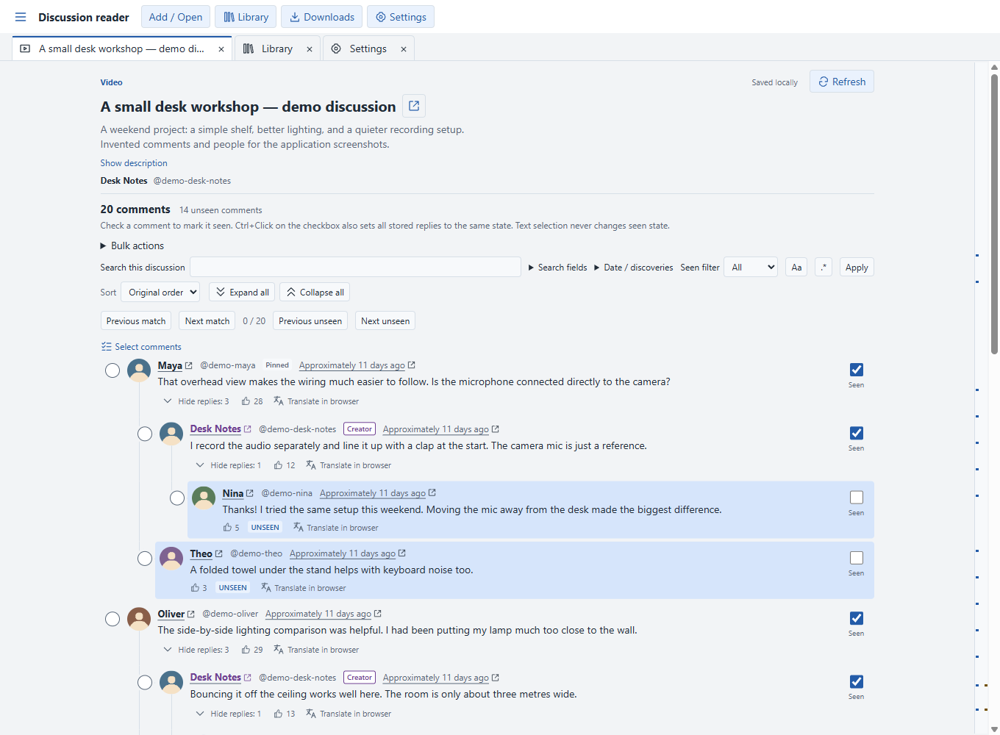
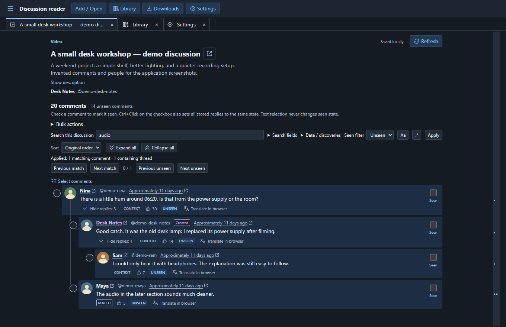
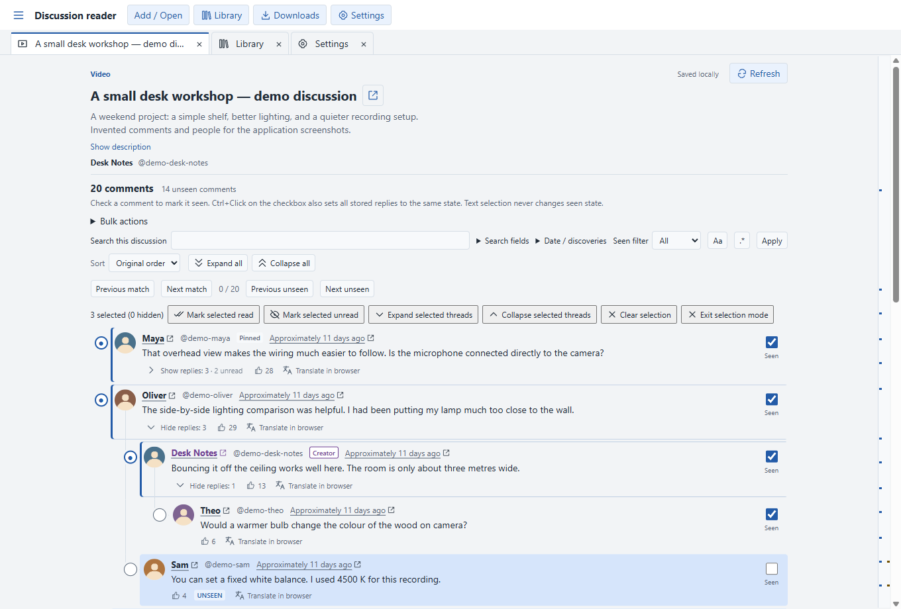
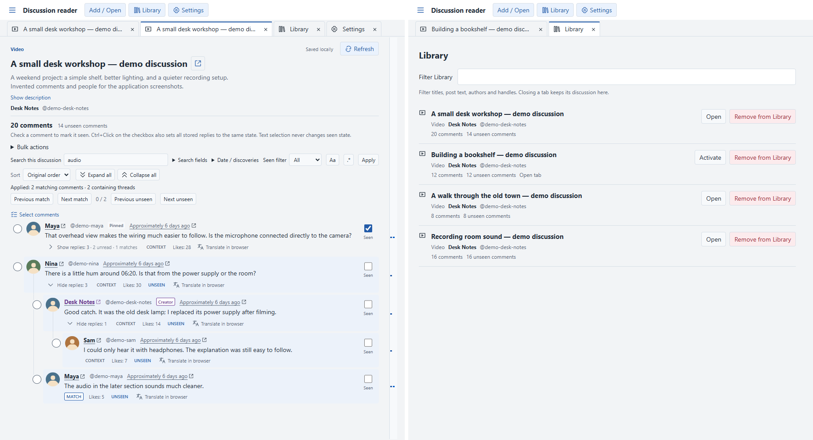

# YouTube Comments

A Windows desktop app for reading YouTube discussions without losing your place.
It downloads video comments and individual Community Posts into a local library,
where you can search them, mark what you have read, and come back later.

This is a personal project. Other people are welcome to use it, but development
and maintenance happen as time allows.



The screenshots use invented discussions and people in the actual Electron app.

## What it does

- Keeps discussions in a local SQLite library, with nested replies and collapsible threads.
- Lets you mark comments seen or unseen yourself. Reading and scrolling never mark them.
- Searches comment text and authors, with optional regex, seen, publication-date,
  and latest-refresh discovery filters. Matching conversations stay together for context.
- Sorts whole conversations while keeping replies in order, with navigation between
  matches and unread comments and an overview ruler beside the reader.
- Shows NEW for comments first discovered in the latest accepted Refresh after the
  initial download. This is separate from publication date and seen status.
- Restores tabs, searches, filters, sort, collapsed replies, and reading position.
- Duplicates discussion tabs with independent searches and reading positions,
  while sharing the stored comments and seen state.
- Opens independent reader windows through **File > New Window / Ctrl+N**. Quit
  restores all open windows; closing one among several excludes it next launch.
- Moves tabs through **Move to Window… / Move to New Window** in the tab menu
  (Shift+F10). Discussion matches, selection and reading position move with the tab.
- Reorders tabs by dragging, drags them between windows, and detaches them into
  new windows when dropped outside. Physical Windows drag checks are still pending.
- Offers comment selection, right-click actions, bulk marking, and Undo for bulk changes.
- Opens author channels and original video comments in your browser. Google Translate
  also opens there, sending comment text only when you explicitly choose Translate.
- Backs up and restores the local library through Settings. The interface supports
  English and Polish, with System, Light, Dark, neutral Charcoal and imported JSON
  themes. Optional local wallpaper sits behind the centered reader with adjustable
  opacity and blur. See [appearance setup and example theme](docs/APPEARANCE.md).

## Running on Windows

The Windows x64 ZIP is the recommended distribution. Extract **all files** into a
folder, then run `youtube-comments.exe`. Keep the adjacent files and folders;
they include the Electron runtime. You do not need Node.js or npm to run it.
You do need the external tools below to acquire or refresh discussions.

This repository is awaiting owner review for an initial public ZIP release;
these instructions do not imply a published download. You can build the
application yourself using [Packaging](docs/PACKAGING.md#build-and-verify).
The generated ZIP is located at:

```text
out/make/zip/win32/x64/youtube-comments-win32-x64-1.0.0.zip
```

Squirrel `Setup.exe` is also built under `out/make/squirrel.windows/x64/`, but real
installation, update, and uninstall behavior has not been tested in an isolated
Windows installation. Use the ZIP for now. The binaries are unsigned, so Windows
may show a SmartScreen warning. `1.0.0` is inherited build metadata, not a published
stable release.

The extracted app has been checked on Windows 11 x64. Other Windows versions
have not been verified here.

## External tools

Helpers are installed separately; the app does not bundle, install, or update them.
Video comments use [yt-dlp](https://github.com/yt-dlp/yt-dlp), and Community Posts
use [post-archiver-improved](https://github.com/sadadYes/post-archiver-improved).

For a pip-based Windows installation, first install
[Python](https://www.python.org/downloads/windows/) with pip and the `py` command
available, then run:

```powershell
py -m pip install --upgrade yt-dlp post-archiver-improved
```

The current upstream requirements are Python 3.10+ for
[yt-dlp](https://pypi.org/project/yt-dlp/) and Python 3.9+ for
[post-archiver-improved](https://pypi.org/project/post-archiver-improved/).
Use a Python version supported by both. Keep that Python installation available:
pip's Windows `.exe` launchers still need it.

The executables are `yt-dlp.exe` and `post-archiver.exe` (the latter has a shorter
name than its pip package). They may be in Python's `Scripts` directory, which
is not always on PATH. In Settings, choose the real executable for each helper
if automatic detection does not find it. The app accepts direct `.exe` launchers,
including pip's launchers, and does not run `.bat` or `.cmd` wrappers.

Tested with this app: yt-dlp `2026.08.19` and post-archiver `0.4.0`. These are
tested versions, not mandatory locks. Other recognized versions can run with an
untested warning; a newer version is not guaranteed to work.

### If a helper does not work

- **Executable not found:** check `py -m pip show yt-dlp post-archiver-improved`
  in PowerShell. If a package is missing, install it with the command above.
- **Scripts is not on PATH:** `py -c "import sysconfig; print(sysconfig.get_path('scripts'))"`
  prints the usual Scripts folder for that Python. For a `--user` installation,
  use `py -c "import sysconfig; print(sysconfig.get_path('scripts', scheme='nt_user'))"`.
  Select the `.exe` files from that folder in Settings, or add the folder to your
  user PATH and restart the app.
- **Invalid path or version:** use Settings → Recheck and make sure you chose the
  right helper. You can check it directly in PowerShell with
  `& 'C:\path\to\yt-dlp.exe' --version` or
  `& 'C:\path\to\post-archiver.exe' --version`.
  Use automatic detection to clear a stale saved choice. An explicit startup
  environment override takes precedence; correct or unset it before relaunching.
- **Detected, but extraction fails:** confirm the URL is a public video or an
  individual Community Post, check your connection, and try again later.
  YouTube changes can break helpers even when their version check passes. Check
  the helper's upstream issues and update it manually if needed. A failed Refresh
  keeps the stored discussion.

More about [helper detection and supported extraction](docs/EXTRACTORS.md).

## Using it

1. Paste a video or individual Community Post URL and choose Acquire.
2. Read, search, and filter the stored comments. Apply updates the local view;
   it does not download anything.
3. Mark comments with their checkboxes, or select several for a bulk action.
   Undo can recover the last bulk change in that discussion.
4. Use Refresh later to fetch comments again and merge changes into your local copy.

There is no automatic synchronization with YouTube. Search and bulk commands work
within the active discussion. Library filtering searches discussion metadata.
See [reading and navigation](docs/UI_AND_NAVIGATION.md) for shortcuts and details.

Square checkboxes save seen/unseen state. Round circles select comments temporarily
for an explicit bulk action; selecting, scrolling, or following a match does not
mark anything seen. Ctrl+click a checkbox to apply its resulting state to that
comment and its replies. Search results stay in place after marking until Apply
or a successful Refresh updates the view.

### Tabs and windows

Right-click a discussion tab and choose **Duplicate Tab** to read another part of
the same discussion independently. Each copy remembers its own search, filters,
sort, collapsed replies, and position. Refresh and seen changes are shared.
Opening an already open discussion from Library activates a copy in that window.

Use the menu button beside **Discussion reader**, or the native **File** menu,
to open a **New Window**. Drag tabs along the strip to reorder them, onto another
window's tab strip to attach, or outside to detach. For a keyboard alternative,
focus a tab and press **Shift+F10**: **Move to Window…** lets you select a destination
and confirm with Move; **Move to New Window** creates one for that tab. Moving the
last tab leaves its source window open and empty.

**Close Window** removes just that window from the next session when others remain.
Closing the last window keeps it for next launch. **Quit Application** saves the
complete set of currently open windows, so use Quit when you want them all back.
Closing a tab or window does not remove its discussions from Library.

| Windows shortcut | Action |
| --- | --- |
| Ctrl+W | Close tab |
| Ctrl+N | New Window |
| Ctrl+Shift+W | Close Window |
| Ctrl+Shift+Q | Quit Application, preserving all open windows |
| Ctrl+Tab / Ctrl+Shift+Tab | Next / previous tab |
| Alt+Left / Alt+Right | Reorder the focused tab |
| Ctrl+Shift+PageUp / Ctrl+Shift+PageDown | Move the active tab left / right without wrapping; works from the reader |
| Ctrl+F / Ctrl+Enter | Focus search / apply the draft |
| F3 / Shift+F3 | Next / previous applied match |
| Ctrl+Z | Undo the discussion's last recoverable bulk seen change |
| F1 | Settings shortcut reference |

## More screenshots

An applied search with an unread filter, keeping replies in context:



A collapsed thread and comments selected for a bulk action:



The [Library view](docs/screenshots/library-light.png) lists saved discussions and
their local counts.

Two separate native readers, with independent tabs (their real content captures
are placed side by side; this is not evidence of physical dragging):



The [Move Tab dialog in Polish and dark mode](docs/screenshots/move-tab-pl-dark.png)
shows the destination choices. [Capture details](docs/M9_2_VERIFICATION.md#screenshots)
describe the fictional data and verification.

## Your data

The production profile is `%APPDATA%\youtube-comments-production`, with comments
in `reader.sqlite`. The ZIP does not store data beside the executable; moving or
replacing the app folder on the same Windows account still uses that profile.

Use Settings to create a SQLite backup before moving or replacing data. Restore
replaces the full local profile database, with a confirmation and a safety backup.
It includes saved windows, tabs, and reading state. Temporary bulk selection is
not restored after restarting. Recovery files are retained beside the database.
Custom theme definitions and wallpaper settings are included; wallpaper image files
are separate profile assets and are **not** included. Keep your original image.
Do not copy the live database while the app is open. See
[backup and restore](docs/DATABASE.md) for recovery details.

## Limitations

An acquisition may retrieve only part of a discussion. A successful download does
not prove every remote comment was returned. Helpers are maintained elsewhere,
and changes to YouTube can stop extraction from working. Community replies may
have thread information without a precise direct parent, and Community comment
permalinks are unavailable. The app reads local copies; it does not post replies,
change likes, or manage a YouTube account.

Native dragging still needs [physical Windows verification](docs/M8_MANUAL_VERIFICATION.md).
Escape delivered inside the app cancels a drag, but Escape outside can create a
detached window. Releases over other apps or the taskbar can do the same.

Large libraries can still pause the app: Refresh, bulk changes, and some database
operations can take seconds. The [scale measurements](docs/M9_1_PERFORMANCE.md)
come from a high-memory workstation and do not establish a supported maximum or
verify low-memory hardware. See the [release review](docs/M9_2_VERIFICATION.md)
for completed checks and remaining manual work.

## Development

Built with Electron, React, and TypeScript. For dependencies, build commands,
artifact paths, and Windows verification, see [Packaging](docs/PACKAGING.md).
[Testing](docs/TESTING.md) covers checks; the [documentation map](docs/README.md)
links the reader's behavior and architecture notes.

## License

I've left the source publicly viewable, but I'm not offering it under an
open-source license at the moment (`UNLICENSED`). Third-party components keep
their own licenses. The app includes `resources/THIRD_PARTY_NOTICES.md` and the
license texts it points to; [the same index is here](THIRD_PARTY_NOTICES.md).

yt-dlp and post-archiver-improved are separate, user-installed tools with
[their own terms](THIRD_PARTY_NOTICES.md#external-acquisition-tools-not-distributed).
The [distribution audit](docs/DISTRIBUTION_LICENSE_AUDIT.md) records the notice
checks and remaining review, including installer licensing questions. The ZIP
remains the recommended format; installed Squirrel behavior is still unverified.
