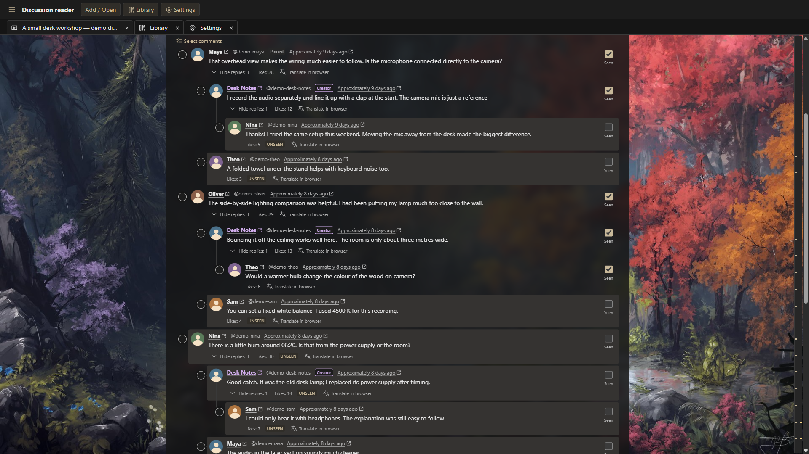

# Appearance, JSON themes and reader wallpaper

Settings supports System, Light, Dark, **Charcoal**, and imported custom themes.
Changes are shared across native windows and persist across restarts. System still
follows the operating system using the original Light/Dark palettes. Charcoal uses
neutral `#151515`, `#1c1c1c`, `#262626` surfaces and `#393939` borders, with warm
`#c9b99a` accents, `#e0cba5` focus/selection and differentiated unseen, NEW, creator
and error states.

## Edit and import a theme

In Settings, choose **Theme to export**, then **Export theme as JSON…**.
The native Save dialog starts in Documents; save to your own writable folder.
Current theme exports the active imported/built-in palette; System exports the
currently resolved OS Light or Dark palette. The selector also offers exact
**Light, Dark, Charcoal and Warm Graphite** starters, all bundled offline in the
application/ZIP. You can obtain each without activating it or writing into the
installed application directory. [Warm Graphite](examples/warm-graphite.json) is
also available here.

Choose **Open themes folder** to open the profile's writable `themes/` directory
in Explorer (`%APPDATA%\youtube-comments-production\themes\` in production).
**Save editable copy in themes folder** copies the selected export source there
without changing the active appearance. Alternatively, copy one of the Light,
Dark, Charcoal or Warm Graphite files from `themes/examples/` into `themes/`.
Examples are never loaded automatically or overwritten when edited.

Edit the JSON in an external text editor, then choose **Refresh themes**.
Additions, edits, renames and deletions are reconciled together. Settings lists
all custom names alongside System, Light, Dark and Charcoal in one Appearance
selector. Duplicate names (including built-in names) get a short ID suffix.
Import JSON theme still accepts a native-picked file from elsewhere, copies it
into `themes/`, and selects it. The external original is no longer required.
Export still saves through the native Save dialog outside the profile.

Up to 16 custom palettes are loaded. Remove a JSON file and refresh to free a
slot. Deleting the active file falls back to System. Invalid files are reported
individually; a previously loaded file keeps its last valid palette, including
when active. Other valid files still load. Selecting a built-in retains the custom
palettes. There is no watcher; startup also scans once. See
[the synchronization rules](decisions/0040-profile-theme-files.md) for recovery,
restore conflicts and scan bounds.

The UTF-8 JSON format is exactly:

```json
{
  "schema": "youtube-comments-theme",
  "version": 1,
  "name": "My theme",
  "colorScheme": "dark",
  "tokens": {
    "background": "#151515",
    "surface": "#1c1c1c",
    "surface-raised": "#262626",
    "text": "#e6e6e6",
    "muted": "#b0b0b0",
    "border": "#393939",
    "creator": "#d4b0f0",
    "accent": "#c9b99a",
    "accent-soft": "#302d28",
    "unseen": "#c9b99a",
    "unseen-surface": "#353331",
    "new-text": "#ffdc88",
    "new-surface": "#4e4021",
    "focus": "#e0cba5",
    "danger": "#ffadb5",
    "danger-soft": "#44282b"
  }
}
```

All top-level fields and the original 15 tokens are required. The only optional
token is `unseen-surface`, an opaque unread-row fill independent of button/badge
`accent-soft`. It uses the same strict `#RRGGBB` validation. Previously imported
version-1 themes with exactly 15 tokens remain valid, including SQLite backups:
omitting `unseen-surface` retains the original 65% `accent-soft` / transparent
background rule. No migration or theme-format version change is required. Older
application builds that predate this extension reject files containing the new
token; remove it for those builds.

Light uses `#d6e5fb` and Charcoal `#353331` unread surfaces. These opaque fills
keep their color over wallpaper, without tinting ordinary Charcoal surfaces.
Original Dark retains all original tokens and its exact translucent row rule.
System resolves these same Light/Dark rules live. Built-in Light/Charcoal normal,
muted, creator and action text retain at least 4.5:1 contrast on unread rows; focus
retains at least 3:1. Row-fill contrast itself is a regression/design threshold,
not a claim that background tint alone meets a WCAG state-indicator requirement:
the explicit unseen badge and checkbox remain. Personal wallpaper at low surface
opacity can still reduce seen-row text readability; prefer the defaults or 100%.

Charcoal's unread-row ratios are 10.08:1 normal text, 5.80:1 muted text, 6.75:1
creator text, 6.52:1 action text and 7.94:1 focus. Its unread badge uses `#c9b99a`
on `#302d28` (7.11:1). Tests retain the 4.5:1 text and 3:1 focus floors and also
check ordinary surfaces and semantic badges. Warm Graphite is a separate starter;
its blue accents remain unchanged. Exports and newly created Charcoal examples use
the bundled palette; existing editable copies and examples are never overwritten.

`colorScheme` is `light` or `dark` and
also controls native form elements. Every color is exactly `#RRGGBB`, with either
letter case accepted. Names contain 1–80 characters; control/bidirectional-control
characters and angle brackets are rejected. Files are limited to 16 KiB. Unknown
properties, missing tokens, other versions, CSS functions, named colors, alpha,
URLs, scripts, HTML and stylesheet imports are rejected. A valid palette can still
have poor contrast: check normal/muted text, focus, disabled controls and every
badge before using it. The app makes no automatic contrast guarantee for arbitrary
owner-authored palettes.

Built-ins and bundled starters use this same validated JSON structure under `src/shared/themes/`.
Semantic CSS rules remain in `src/index.css`; colors are installed through a fixed
allowlist of CSS custom properties. A new semantic token requires updating the
shared contract and explicitly deciding format compatibility, rather than silently
accepting arbitrary CSS properties.

## Reader wallpaper

Choose **Settings → Reader wallpaper → Choose image**. The native picker accepts
PNG, JPEG and static WebP. Selection imports a profile-owned copy and enables it.
Moving/deleting the original afterward is safe. No reference screenshots or
third-party wallpapers are bundled.

Wallpaper covers the discussion viewport with centered `cover` sizing and stays
stationary while comments scroll. A separate centered surface sits behind the
reading column. Adjust opacity (0–100%) and blur (0–20 px), then choose **Apply
wallpaper settings**. Keyboard arrows/Home/End work on the native range controls;
visible outputs and accessible values show percentages/pixels. Slider motion only
edits a draft and causes no SQLite writes. Cancel reloads current saved values.
Defaults are wallpaper disabled, opacity 92%, blur 8 px. Restore wallpaper defaults
stages those values for Apply and retains the selected image. Remove wallpaper
clears the selection. Use 100% opacity and 0 px blur for maximum readability.

Library and Settings remain ordinary opaque application surfaces. Text, avatars,
controls and focus outlines keep full opacity. Forced-colors hides the decorative
image and translucent surface. The `.reader-panel` still owns scrolling; no filter,
transform or backdrop filter is applied to ancestors of virtual rows, fixed menus,
floating controls or the ruler. A single empty sibling surface bounds blur to the
viewport. Hidden discussion tabs do not mount wallpaper images.

## Wallpaper example

The actual Electron reader below uses the current built-in warm **Charcoal**
theme with **85% reading-surface opacity** and **8 px blur**. The discussion and
people are fictional demo data captured in a disposable profile.



Wallpaper: **[Carmine Rock — ReFiend](https://www.deviantart.com/refiend/art/Carmine-Rock-736895172)**.
Redistribution permission has not been established; this credit is not a license
to reuse the artwork. The artwork appears here in an application screenshot;
the full-resolution wallpaper is not bundled with the application.

These example settings are optional. The application defaults remain wallpaper
disabled, 92% opacity and 8 px blur. To create a similar view with an image you
have permission to use, choose **Charcoal** in Settings, then follow the
[reader wallpaper setup](#reader-wallpaper) above.

## Storage, safety and backups

Schema **15** adds validated appearance configuration and extends the appearance
choice. Historical migrations 1–14 are unchanged. Startup still creates a verified
pre-migration safety backup; older backups upgrade only on staging copies.

Editable themes live in the profile's `themes/` directory, with their latest
validated definitions and IDs retained in SQLite and **included in SQLite backups**.
Refresh (or restart) before backing up external edits. Rejected edits retain the
last valid definition in backups. On restore into another profile, backed-up
definitions are materialized without replacing existing files. Within a profile,
tracked files remain authoritative on the next scan: restoring SQLite does not
rewind user-edited JSON. Copy a backed-up theme into a separate profile to recover
its historical palette without changing current files. Wallpaper settings and the selected image digest are also
in SQLite, but **wallpaper image bytes are excluded from SQLite backups**. Keep
your original image separately. After a restore to another machine/profile, a
missing or corrupt image causes an opaque reader fallback and a localized notice
in Settings. Choose the image again to recover it. Themes continue to work because
their validated definitions travel with the database.

Approved wallpaper files live under the selected profile's
`appearance/wallpapers/<sha256>.jpg`. Production uses
`%APPDATA%\youtube-comments-production`; development and explicit demo roots use
the existing separate development profile. Tests use owned temporary directories.
The ZIP is not portable-data software: replacing the application directory does
not replace themes or wallpaper. Backups restored in the same profile may reuse a
matching existing image. Removal/replacement clears the selection; immutable old
image files are retained, allowing same-profile historical backups to reuse them.
There is no automatic asset-pruning policy in this increment.

Main owns authenticated payload-free pickers and checks the captured document and
profile lifecycle again after asynchronous work. It enforces regular-file and
12 MiB input limits, approved raster headers, 8192 pixels per side and 16 million
pixels total **before** decoding. Actual decoded dimensions must match. Output
is resized to fit 2560×1600 and re-encoded as JPEG; original metadata, animation
and file names are not distributed to readers. Transparent areas flatten to black.
Only generated digest filenames enter the profile asset directory.

PNG/JPEG use Electron nativeImage. WebP uses a short-lived sandboxed Chromium
WebContentsView without a native window, preload, Node access, reader authority,
network or permissions. It has a 10-second deadline, verifies decoded dimensions,
resizes through OffscreenCanvas, and is closed in `finally`; main then validates
and re-encodes the returned JPEG. The view is retained throughout asynchronous
decoding to prevent garbage collection from invalidating a conversion. See
[Electron nativeImage](https://www.electronjs.org/docs/latest/api/native-image) and
[WebContentsView](https://www.electronjs.org/docs/latest/api/web-contents-view).

Renderers receive only an opaque `reader-wallpaper://asset/<token>` capability.
Protocol reads validate the current profile/selection, digest, limits and actual
decoding; disabled, removed and terminally restored profiles cannot serve stale
capabilities. No local path, generic URL/file reader, CSS execution or plugin system
is exposed. Concurrent imports are bounded to one, stale revisions fail, and
unsaved wallpaper drafts use the established preserve/discard Settings transfer
gate. Failed imports may leave an unreferenced immutable asset, never a partially
selected wallpaper or modified theme.

Theme export accepts only an allowlisted template choice/current-theme intent.
Main captures that palette before opening the exact caller's native Save dialog.
Document loss, profile barriers and cancellation prevent later writes. A sibling
temporary file and atomic replacement avoid partial JSON. Profile-directory
destinations are rejected. Export shares the single appearance dialog slot, but
does not mutate preferences/revisions and never exposes destination paths.

## Verification and owner review

Implementation review map:

| Area | Files and responsibility |
| --- | --- |
| Contract/palettes | `src/shared/appearance.ts`, `src/shared/themes/*.json`, `preferences.ts`, `reader-api.ts`: validated data, defaults, token allowlist and narrow intents |
| Import/storage | `src/main/appearance-assets.ts`, `appearance-picker.ts`, `wallpaper-decoder.ts`: native origins, bounded file reads/decoding, immutable assets |
| Persistence/lifecycle | `src/main/persistence/appearance-migration.ts`, `migrations.ts`, `reader-repository.ts`, `backup-validation.ts`, `src/main/reader-service.ts`: schema 15, CAS, post-COMMIT notifications and barriers |
| Delivery | `src/main.ts`, `src/preload/reader-bridge.ts`, `index.html`: authenticated bridge, opaque protocol and CSP |
| Presentation | `src/renderer/AppearanceSettings.tsx`, `ReaderBackdrop.tsx`, `appearance.ts`, `App.tsx`, `VirtualCommentList.tsx`, `i18n.ts`, `src/index.css`: settings drafts, live palettes, bounded layers and hidden-offset guard |
| Verification | Six appearance test files, `scripts/smoke-appearance.cjs`, extended packaged/scroll-layout harnesses and current-schema regression fixtures |

Run after a Forge build:

```powershell
npm.cmd test
npm.cmd run typecheck
npm.cmd run lint
npm.cmd run test:appearance
npm.cmd run test:electron
npm.cmd run make:zip
npm.cmd run verify:artifacts
npm.cmd run test:packaged
```

The appearance harness uses production main/preload/renderer, two actual native
windows and a fictional 3,000-comment discussion with alternating seen/unseen rows
in an OS-temp profile. Light, Dark, Charcoal and System (both OS modes) run at
start/middle/end virtual positions with and without patterned wallpaper. Every
mounted unread row must use its expected independent fill (or the exact original
Dark mix), while seen rows stay transparent. Actual applied queries verify
MATCH/CONTEXT/NEW, nested rows, selection and checkbox focus. All four offline
starter exports are imported again; active/custom/System exports preserve the
captured palette without preference writes. Native Save replies are controlled
only in the test process; the separate unmodified ZIP EXE harness uses actual
Windows dialogs for each starter. It also covers
PNG/JPEG/WebP decoding and resizing, real protocol/CSP image rendering, deleted
originals, invalid theme isolation, synchronized themes/wallpaper, OS light/dark
emulation, native keyboard slider input with no intermediate writes, forced colors,
0/100 opacity boundaries, stationary layers, bounded blur, variable-height
virtualization, narrow/125% layouts, anchors/ruler, restart, native-dialog-controlled
backup/restore and missing-asset fallback. Diagnostic captures are ignored under
`.packaging-diagnostics/appearance/`; they are not redistributed reference assets.
Unit tests cover format rejection, file bounds, tampering, decoder/write failures,
origin loss, barriers, stale peers, profile isolation, migration rollback/safety and
historical backups. Detailed run results are recorded in [TESTING](TESTING.md).

Owner review remains necessary for visual preference and contrast with personal
images at low opacity, Windows native file-picker ergonomics, high-DPI/multiple
monitor appearance, physical scrolling and native tab dragging. Automated native
key events and synthetic drag tests do not certify physical input or Close flicker.
Existing M8 P01–P25 and installed-Squirrel gates remain pending. No Setup execution,
public release, identity/version change, tag, commit or push is part of this work.
