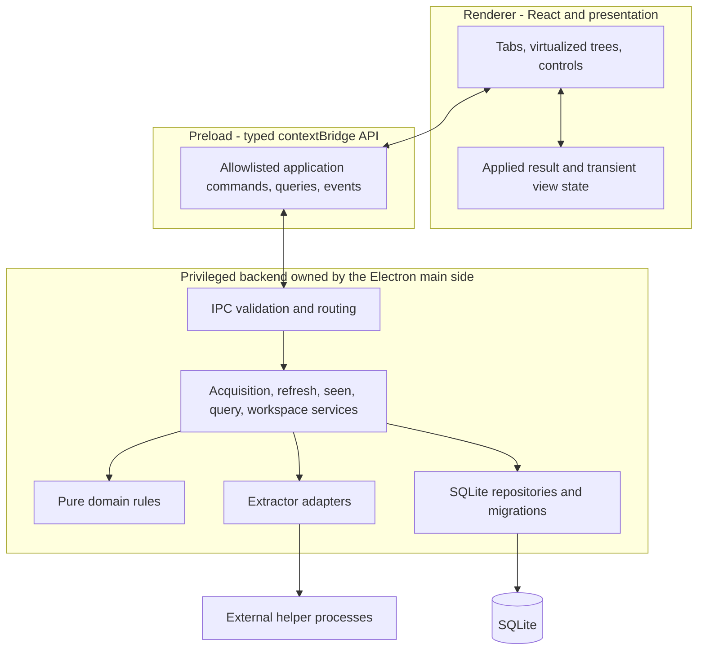

# Architecture

## Atomic cross-window transfer (M7)

[ADR 0033](decisions/0033-atomic-cross-window-tab-transfer.md) adds a main-owned
TabTransferCoordinator and explicit keyboard/menu moves. Main reserves exact
source/target document leases, topology, epoch and ownership generation before
source checkpointing. A bounded memory-only snapshot preserves frozen results,
logical reading state and temporary selection. Destination reconciliation and
provisional construction precede readiness; neither grants write authority.

One repository transaction moves the same instance, repairs both workspaces/resume
pointers and advances topology/save fencing. Library/Settings merge into an existing
local singleton; normal same-item discussions never merge. New hidden natives stay
outside restore membership until that same transaction commits. Source-empty windows
remain open. M2 disposes/adopts sessions by ownership generation; M3 synchronously
cancels precommit transfers before sealing drains, with independent transfer/profile
queue pauses. Schema remains **14**; tokens and live results never persist. Native
gestures remain M8; aggregate scale/release remains M9.

## Equal native windows and session restoration (M6)

[ADR 0032](decisions/0032-equal-native-windows-and-session-restoration.md) implements schema **14**, equal production BrowserWindows and
one shared main-owned service/repository. File > New Window / Ctrl+N (Cmd+N) creates
a new empty logical workspace through the secured factory. WindowCoordinator
registers its persistent identity before trusted loading; M1 derives caller scope.
M2 shared commits and M4/M5 private view ownership remain unchanged. Startup loads
only explicit durable restore membership, validates normal DIP geometry against
current displays, waits for each shell's payload-free readiness and focuses the
last-active window once. Constructor/load failure removes provisional membership.

M3 retains all-participant Close/Reload drains. Final native geometry and restore
membership commit before Close; cancellation re-enrolls the window. Peer Close
keeps shared operations/service alive. Quit snapshots all live windows before
teardown; last close retains one; crash restores acknowledged membership. Native
debounced saves flush at profile checkpoints and are terminally fenced offline.
Backup restore/relaunch replaces the entire intended session. Historical milestone
sections below describe their original scope; M6 supersedes their one-reader limits.

## Independent duplicate discussion tabs (M5)

[ADR 0031](decisions/0031-independent-duplicate-discussion-tabs.md) enables multiple independent discussion views inside the one production
native window, using schema 13. Main allocates a new owned instance after source
queues settle and source/topology CAS checks succeed. The semantic copy and
placement/activation/resume update commit atomically. New views hydrate through a
versioned, single-view read before M2 publishes their topology; ordinary duplicate
notifications do not reload unrelated comments. Existing sessions never rehydrate.

ViewId owns the query executor/result, drafts/applied criteria, sort/collapse,
viewport/selection, save queues and local interactions. ItemId retains shared
comments, seen/revisions, source/NEW/history and one guarded Undo. Refresh fans out
to each instantiated view's own applied query. Namespaced article/description IDs,
owned-panel reveal checks and explicit active state prevent focus/thumbnail work
from targeting hidden copies. M3 drains all instantiated views and forbids duplicate
creation during its global barrier. Native windows/geometry/transfer remain M6-M8.
Historical milestone sections below keep their original scope.

## Persistent window and view identities (M4, ADR 0030)

The current schema is **13**. Main owns one repository/service and still constructs
exactly one production reader. WindowCoordinator obtains a persistent window ID
before constructing/loading its reader; reload keeps it while replacing the runtime
document lease. Scoped bootstrap, metadata, workspace writes and acquisition replies
use the authenticated caller's window. Renderer-supplied window/view identities
never establish ownership. Closed instances retain their owner and resume pointer.

Discussion tabId and viewId are the SAME opaque instance ID, referencing shared
itemId. React panel keys, activation/close/focus, session registry and intent/collapse
writers use that instance ID. Item-to-session fanout preserves shared seen and
Refresh behavior without sharing draft/applied/sort/anchor/collapse. M2 snapshots
and metadata are window-scoped; private saves remain ordered watermarks. Structural
commands use topology CAS; separate intent/collapse CAS lanes avoid races between
the two FIFO queues. M3 seals per-view checkpoints with those versions and retains
its global barriers, incarnation authentication, release reconciliation and terminal
restore fence. Clean optional rows remain absent.

The lossless forward migration preserves raw optional state for open AND dormant
legacy discussions and every authoritative shared field. Historical backup shapes,
verified safety and staged upgrades remain exact. See
[ADR 0030](decisions/0030-persistent-window-topology-and-view-instances.md) and
[DATABASE](DATABASE.md) for tables, constraints and mapping. No native geometry is
recorded. M5 duplicate UI and descendant DOM namespaces are implemented above; M6 owns extra native
windows and full restore policy; M7 owns transfer. The following milestone sections
retain their historical scope and are superseded here for identity/schema details.

## Global profile and native lifecycle safety (M3, ADR 0029)

One main-owned ProfileOperationCoordinator enrolls current WindowCoordinator
document contexts and owns PREPARING → DRAINING → QUIESCENT → EXECUTING → RELEASED
or terminal RESTARTING. Ordinary writes stop before preparation notification.
Queued seen/preferences/bulk/Undo intents register exact one-use tickets before
preparation; frozen participants seal those tickets plus bounded dirty view/collapse
checkpoints into main-issued operation/epoch/incarnation/sequence leases. No generic
DATA_BUSY bypass exists. Clean optional view/collapse records remain absent.

All participants freeze input, capture anchors, settle accepted workers/operations
and drain queues before profile execution. Read-only M2 reconciliation stays available
until offline replacement. Release requires reconciliation before ordinary editing
resumes; failures remain visible and timeouts fail rather than approve a drain.
Native initial Close keeps authority until drain; controlled reload and explicit Quit
use the same protocol. Failed or later-cancelled Close remains usable. Shared service
shutdown belongs to application Quit/last-window settlement, never a peer close.

Backup keeps verified online snapshots and acquisition-busy policy. Restore retains
captured native-dialog ownership, staging, explicit confirmation, independent safety,
offline recovery and full relaunch. After affirmative acceptance it is app-owned;
RESTARTING fences every old-profile command before offline storage begins. Crashes
and uncontrolled reloads recover only committed SQLite data. See
[ADR 0029](decisions/0029-global-profile-and-window-lifecycle-safety.md) for bounds,
failure rules, conservative all-participant close drains and M4–M6 limitations.

## Ordered shared replicas (M2, ADR 0028)

Repository outer transactions publish once after COMMIT under a random repository
profileEpoch and a bounded process-local commitRevision. Comment Undo revisions
and workspace revisions remain separate. Observer and recipient failures cannot
change committed success. Schema remains 12; restart/reopen requires a fresh epoch
and authoritative snapshot rather than a durable event log.

The fixed typed shared notification reaches every M1-authorized document. Small
seen updates carry at most 256 ID/boolean values plus current Undo. Content/large
seen/removal changes invalidate one item; preferences/workspace use small metadata;
view/collapse/history-only writes carry watermarks. No arbitrary subscription bus
or renderer identity/version authority exists. Preload validates bounded envelopes.

ReaderReplica subscribes before bootstrap, serializes events and command stamps,
ignores included/old revisions and rejects obsolete epochs. Shared UI fields
update only through its subscription; command callbacks retain feedback. A 64-envelope bound,
gaps or scoped reads at a later revision trigger full snapshot recovery. A small
two-second watermark detects lost final events/subscriptions. Failed reads retain
acknowledged data. Checkbox intent is captured as an explicit desired state;
Undo atomically requires the displayed operation ID and conflicts without writes
if recovery changed. Peer seen updates preserve frozen applied membership/order.
Peer Refresh reevaluates local applied criteria after content props commit, keeping
drafts, sort/collapse/selection and anchor semantics. Progress fans out separately
from committed content. See ADR 0028 for exact limits and response reconciliation.

Production still opens one reader. Test-only second windows share the actual
service/repository. M3 adds all-window backup/restore and close/reload queue barriers
as described above. M4 supplies persistent identity and M5 supplies duplicate UI;
extra-window UI and transfer remain later milestones.

## Secure window coordination (M1, ADR 0027)

`WindowCoordinator` owns application-window registration and renderer lifetimes.
The shared secured factory fixes sandbox/context isolation/preload/Node settings
and denies popup/navigation/redirects before load. Runtime opaque windowId is
independent of BrowserWindow IDs; every trusted document commit gets a new renderer
lease. Navigation/reload/crash/close revoke the old context. The once-registered
reader IPC guard checks registered live sender, exact current top frame and document,
and current main-owned lease before passing a frozen caller context to ReaderService.
No renderer-provided identity participates in authorization; no preload contract changes.

Native helper/backup/restore dialogs resolve only their accepted caller's still-live
origin. Expired dialog results cancel without reparenting. Helper probes recheck before
saving; restore preflight rechecks before confirmation. Confirmed restore and started
backup finish under the existing application-owned safety/shutdown protocol. Startup
recovery messages retain separate application-level ownership. One service/repository,
single reader startup, existing profile/order/seeding, thumbnail protocol and packaged
security remain. Registry removal never shuts down persistence. See
[ADR 0027](decisions/0027-secure-window-coordination-foundation.md) for exact lifecycle
and cancellation boundaries. Shared synchronization is implemented in M2 and global
drain barriers in M3; M4 adds persistent windows/views while public additional windows remain later work.

## Usability increment (ADR 0026)

Settings keeps custom translation drafts separate from acknowledged preferences.
Shared syntax validation runs in renderer and privileged IPC/repository boundaries;
one schema-12 transaction saves code and activation. Preset/app switches retain the
code. Main resolves it from SQLite at the existing identity-only browser action;
URLSearchParams, disclosure, length limits and copy fallback remain unchanged.

Reader queries and bulk actions share one internal Temporal custom date/time
resolver. Optional local HH:mm requires its date and rejects ambiguous/nonexistent
specified minutes. Query bounds resolve once at Apply/Refresh using the captured
system zone/clock before the numeric worker payload. No Temporal import/per-comment
parsing enters the worker. Semantic times persist; native validity also guards Ctrl+Enter.

Video titles/source actions precede optional thumbnails. Selection circles use an
outer lane, with avatar-centered rails and responsive indentation using shared CSS
variables. Existing measurement/anchor handling covers reflow, with a bounded
next-frame mounted-row measurement fallback when scrolling makes synchronous
layout-invalidation measurements unavailable. Loading rings
intentionally rotate under reduced motion for acquisition/Refresh/backup/restore,
without global motion overrides or percentages. See ADR 0026.

## Selection and confirmed explicit targets (ADR 0024)

DiscussionViewSession owns a renderer-only bulk ID set and visual anchor, independent
of persisted navigation selection. Range/prefix resolve against shared complete and
collapsed ID-index maps. Selection never enumerates DOM membership. The small menu
portal manages focus/native ranges and closes on scroll, target/view invalidation
or tab hiding; a scoped observer avoids tab-activation panel rerenders.

Confirmed item/ID snapshots use the existing bulkSeen channel with explicit reason
selected or view-prefix. Main validates shape/size/uniqueness and all ownership
inside an atomic mutation. Existing FIFO acknowledgments and revision-safe Undo
remain authoritative. Main-only copy-permalink reconstructs a trusted stored video
link before writing clipboard; the renderer supplies identities only.

Schema 11 persists two validated preferences and new Undo kinds with a preserving
parent/child rebuild. Startup/staged backup safety and historical schema checks remain.
See [ADR 0024](decisions/0024-comment-selection-context-menus-and-view-prefix-seen.md).

## Collapse projection and persistence (ADR 0023)

Main-owned schema 10 holds an optional discussion default and sparse opposite-default
comment exceptions behind exact typed assignment IPC. Renderer hydrates once, applies
presentation immediately and serializes idempotent writes; backup/close flush the queue.
Invalid defaults and orphan overrides cannot prevent content bootstrap.

The complete sorted ReaderPresentation remains authoritative for query membership,
logical navigation, X/N and stored bulk commands. A separate CollapsedPresentation
uses two iterative O(N) passes over frozen safe display parents, deriving visible
rows/indexes, ID representatives and descendant/live-unseen/frozen-match summaries.
TanStack measures only these visible rows. No source hierarchy, recursive traversal,
per-row ancestor copying, DOM-derived membership or new persistent counters exist.

Explicit target navigation walks ancestors once, assigns only collapsed ancestors
expanded and persists before the normal virtual reveal/focus pipeline. Hidden
selection remains logical; scroll anchors resolve to visible hiding ancestors. Ruler
markers keep original target IDs while using representative row geometry; hidden
category prefix/next indexes keep geometry aggregation bounded. Exactly three SVG
paths and one keyboard stop remain. See [ADR 0023](decisions/0023-persistent-thread-collapse-and-virtual-navigation.md); Q-21 is unchanged.

## Reader external actions (ADR 0022)

`openCommentAction` is an exact identity/action intent. Main reads the stored item
and an indexed, item-owned comment, revalidates safe source/author identity, and
constructs a fixed YouTube or Google Translate HTTPS URL before invoking the existing
browser capability. No renderer text/URL/target/host/process authority is accepted.
Bootstrap contains only affordance booleans; no per-render IPC or click-time forest
reconstruction is needed. Browser errors are sanitized without logging exceptions
that could contain translated text or generated URLs. Main resolves the saved
translation target at activation. No automatic translation/network work exists.

Creator presentation uses positive normalized video uploader evidence only. No
Community creator or comment permalink is inferred. Row-wide marking handlers are
removed, preserving native selection and explicit checkbox-only marking. Global
progress keeps ADR 0018's transport and linearization, with a reduced-motion CSS
spinner. [ADR 0022](decisions/0022-reader-actions-external-links-and-translation-preferences.md)
records the schema-9 preference and shared outline icon vocabulary.

## Windows distribution (ADRs 0020/0021)

Forge produces a complete Windows x64 ASAR application and the existing ZIP maker
archives its entire runtime. The ZIP needs no installer; durable data remains in the
established application-data profile, independent of the executable directory. Normal
packaged mode is production; the explicit demo root still selects development. No
renderer capability or ADR 0019 recovery/relaunch protocol changes. Main/preload/
renderer/worker, restricted fuses and actual extracted-EXE restore/relaunch are checked
by artifact validation and an external disposable-profile smoke. Scoped build-time ZIP
dependency overrides fix the reproduced Node 26 extraction/archiving failures. See
[ADR 0020](decisions/0020-windows-packaged-application-and-zip-distribution.md) and
[Packaging](PACKAGING.md). ADR 0021 adds the existing Squirrel maker, complete-runtime
NuGet/Setup validation and fixed application/shortcut identity. Squirrel lifecycle
events gate all normal startup work, before profile or SQLite initialization.
ZIP and installed execution share fixed profiles; uninstall must retain data.
ADR 0019 uses default `app.relaunch()` to restart the running EXE, independent of
binary location. No installer runs on the owner's account: genuine installed
behavior remains unverified. Signing/helper distribution remain separate.

## Main-owned profile data operations (ADR 0019)

Settings exposes only payload-free `createBackup`/`restoreBackup`; native paths and
replacement confirmation stay in main. Renderer first freezes interaction and drains
its seen/preferences FIFO and visited discussion evaluation/view saves. Main holds
a mutation barrier for the entire native-dialog/data operation, drains earlier helper
selections and rejects stale IPC. Backup reports busy during acquisition; confirmed
restore aborts/awaits acquisition/helper cleanup before verified safety creation.
Shutdown waits for data operations before closing SQLite.

Acquisition acknowledgments that arrive during preflight wait behind the renderer
barrier. Cancelled/invalid restore or completed backup releases them for ordinary
reconciliation. Committed restore and offline recovery retain the barrier until
restart, preventing old ReaderState from being presented over replacement data.

SQLite online backup copies asynchronously in batches, then main verifies and
exclusively publishes a flushed sibling. Staged restore validation admits exact known
application schemas and invariants, never arbitrary SQLite files/SQL. Only staged
older schemas migrate. Full integrity/application verification and probe bootstrap
remain synchronous during a visible modal stage; see measured limits in TESTING.

Restore checkpoints WAL, selects DELETE and closes all connections before moving
files. Immutable recovery phases, separate verified safety and closed previous files
support offline startup acceptance/rollback, including rename/marker gaps and repeated
crashes. Startup recovery and async pre-migration safety precede all profile openers
and seeding. Electron relaunch discards old service/renderer state. A single-instance
lock prevents competing app writers. Recovery failure preserves artifacts and stops
startup; it cannot initialize an empty fallback. See
[ADR 0019](decisions/0019-consistent-sqlite-backup-and-safe-restore.md).

## Persistent view reconstruction (ADR 0017)

SQLite remains main-owned. Validated bootstrap records supply semantic draft/applied
queries, sort and stable anchor/selected comment identities. A discussion registry
hydrates each session once from that bootstrap, lazily on first activation. Later
ReaderState acquisition/Refresh copies cannot overwrite live renderer intent.
Library/Settings startup does not mount/evaluate hidden discussions. Previously
visited panels retain isolated memoized rendering and bounded virtualization.

Saved applied queries use the existing resolver and cancellable worker with current
comments/seen/NEW, fresh now/system IANA zone and the same 1000 ms deadline. Relative
presets remain semantic. A loading state avoids presenting an unrestricted result
before reconstruction. Successful evaluation rebuilds complete trees, applies the
persisted sort, restores displayed selection without DOM focus, and resolves the
anchor by application ID/index plus row offset. Navigation and ruler share the same
sorted data projection. No result ID arrays, measurements or geometry persist.

One asynchronous serialized/coalesced queue per discussion view writes complete current
intent through `saveDiscussionView`, with debounce for drafts/scroll and prompt
Apply/sort/selection saves. Switch/close flush useful anchors. Failed acknowledgments
stay dirty for retry and show localized feedback while reading remains available.
Corrupt presentation rows fail independently; worker restoration failure produces an
unrestricted session with saved applied criteria as draft for retry, retaining the
original durable applied intent. See [ADR 0017](decisions/0017-persistent-discussion-view-restoration.md).

## Narrow source and clock intents (ADR 0015)

[ADR 0015](decisions/0015-safe-usability-intents-and-helper-confidence.md) adds an identity-only openSource capability: main reads stored identity,
verifies kind/source kind and reconstructs/validates a supported canonical HTTPS
YouTube destination before invoking Electron shell.openExternal. No renderer URL
capability exists. Optional bulk clock minutes remain semantic local strings;
main resolves the final publication target inside its transaction. Query workers
still receive numeric bounds and no Temporal dependency. Helper versions now
express tested confidence, while helper identity and unchanged runtime JSON
validation guard acquisition. Row gestures reuse the existing seen intent.

Status: target architecture, with proposed organization explicitly identified. [Map](README.md) · [Requirements](PRODUCT_REQUIREMENTS.md) · [Owner's walkthrough](HOW_IT_WORKS.md) · [Decisions](decisions/README.md)

## Current scaffold

The repository uses Electron Forge/Vite and strict TypeScript. [src/main.ts](../src/main.ts) creates a sandboxed, context-isolated window with Node integration disabled; navigation/new windows are blocked. [src/preload.ts](../src/preload.ts) exposes the narrow `window.reader` API. [src/renderer.tsx](../src/renderer.tsx) mounts the React reader, with components and localization in `src/renderer`, pure domain rules in `src/domain`, and explicitly synthetic fixtures used for main-side initialization.

The persistence milestone adds `src/main/persistence` for SQLite profiles/migrations/repository mapping, `src/main/reader-service.ts` for validated use cases and structured outcomes, `src/main/reader-ipc.ts` for channel/sender routing, `src/shared` for driver-free contracts/preferences, and `src/preload/reader-bridge.ts` for the private transport wrapper. One main-owned built-in SQLite connection stores normalized discussions, separate per-comment local state, and preferences. The renderer loads asynchronously and updates only after save acknowledgment; it has no fixture-state fallback. Ctrl subtree changes are transactional and preserve displayed order. [ADR 0002](decisions/0002-sqlite-and-typed-reader-boundary.md) records these choices; [ADR 0001](decisions/0001-synthetic-reader-foundation.md) remains the foundation record. ADR 0004 adds pure normalized merge planning and transactional SQLite ingestion/history. [ADR 0005](decisions/0005-live-helper-execution-and-acquisition-ipc.md) adds main-only live public acquisition/refresh and minimal UI. ADR 0008 adds active-discussion search/seen filtering, stable applied views and match/unseen navigation; ADR 0010 adds bounded variable-height rendering; ADR 0011 adds durable NEW and the applied-view ruler; ADR 0012 adds system-zone publication-date and latest-discovery filtering; bulk actions and durable safe Undo are implemented in [ADR 0013](decisions/0013-atomic-bulk-seen-and-durable-undo.md). The broader target below is not a completed security review. See [Testing](TESTING.md).

Initial development and packaging target Windows. Platform integrations should avoid unnecessary barriers to later Linux/macOS support, but those platforms are not initial implementation or packaging requirements.

## Live acquisition implementation

[ADR 0006](decisions/0006-compact-reader-and-persistent-tabs.md) adds separate
SQLite workspace tables; [ADR 0007](decisions/0007-unified-workspace-and-library-removal.md) evolves them to generic tab identities and exact app-open/activate/close/move intents. ReaderState contains
library data plus a compact ordered workspace DTO. Tab writes return workspace
only and never mutate discussion/seen/history. Successful Acquire opens within the
merge transaction; Refresh preserves workspace. A persisted workspace revision
lets React reject older acknowledgments independently of seen reconciliation.
ADR 0017 adds validated bootstrap discussion-view intent and main-owned schema-8 upserts. First activation reconstructs saved applied criteria via the existing resolver/worker, then sorts/restores data anchors/selection. Hidden discussions remain unmounted until needed; expansion remains future.

Main owns confirmed local removal transactions; the native renderer dialog is the
user confirmation surface, not a privileged SQL capability. Synthetic baseline
provenance produces the driver-free removable flag. The canonical active acquisition
target blocks same-source removal with ACQUISITION_BUSY. Other local workspace
operations/removals stay available. Deferred FK checks commit the item/history cycle
atomically; failure preserves all rows. Renderer removed-ID reconciliation excludes
deleted items from delayed content snapshots, alongside workspace revision protection.
Settings owns preference controls, Library owns metadata-only filtering and listing.
Structural rails are renderer CSS/DOM over the unchanged domain tree; no helper path,
process or source relationship semantics cross this presentation change.

Author avatar evidence flows adapter → normalized remote JSON → source-independent
Author → decorative anonymous HTTPS image/fallback. Older JSON defaults missing
avatar evidence to unavailable in memory. CSP permits HTTPS images without relaxing
script/process access. Main snapshots authoritative executable overrides and reads current saved
profile configuration before safe direct PATH lookup. Only display-only helper
path/status evidence crosses preload (ADR 0014). See [Extractors](EXTRACTORS.md).

`acquisition-target.ts` owns supported URL validation/canonicalization;
`helper-process.ts` owns environment/saved/PATH resolution, strict executable validation and no-shell asynchronous spawning;
`live-extraction.ts` probes helper identity and tested-version confidence, builds trusted commands, owns anonymous
Community temporary config/output, enforces deadlines and normalizes before writes.
`acquisition-service.ts` coordinates the temporary single-live-operation lock,
stored-identity refresh, repository ingestion and compact acknowledgment.
`ReaderService` validates exact intent payloads. The IPC sender/frame/document
checks are unchanged. Raw output, environment and process capability never cross preload;
ADR 0014 permits narrow display-only helper path/version/status evidence. Normal quit aborts/awaits child cleanup before closing SQLite.

Successful acquire/refresh returns committed ReaderState plus item/coverage/count
summary. Existing seen state is never written by merge, including edits made
while extraction runs. Structured fixed diagnostic tokens enter existing attempt
history; full stderr/public payloads do not. See ADR 0005 for the Windows process
tree termination and unresolved release work; ADR 0006 extends helper resolution
with exact startup overrides.

## Date-query boundary (ADR 0012)

The renderer application boundary captures one now and current runtime system
IANA zone per Apply/successful Refresh. Source-independent `resolvePublication`
uses pinned Temporal polyfill calendar arithmetic to resolve semantic criteria to
numeric bounds. The worker import graph excludes that resolver/Temporal: it sees
only normalized own publication milliseconds, durable NEW eligibility and resolved
bounds, alongside existing narrow query fields. It never obtains clock/locale/zone
or extractor JSON. Cancellable evaluation/deadline and frozen applied results remain.
ADR 0013 date bulk reuses the same resolver/predicate semantics on the privileged
backend. ADR 0012 itself adds no IPC capability, schema, mutable NEW state or durable
query state changes.

## Atomic seen-command boundary (ADR 0013)

The intent bridge adds `bulkSeen({itemId, seen, target})` and `undoSeen({itemId})`.
Exact runtime payload/arity and existing sender/frame/document guards apply.
Matching accepts bounded frozen IDs (100k maximum, 256 characters each), rejects
duplicates/malformed IDs, and validates every ID's same-item ownership before
writing. All and semantic publication targets are resolved authoritatively from
stored rows inside the mutation transaction. Main calls ADR 0012's resolver and
shared own-instant/predicate code, with a fresh system IANA zone. There is no
generic SQL, arbitrary-ID write, revision or recovery-row renderer capability.

Schema 6 revisions and one operation per discussion support conditional partial
Undo. Target resolution, state writes, replacement and entries commit together;
Undo restoration/consumption likewise. Synchronous main transactions define
ordering; asynchronous extraction remains parallel outside them and never writes
existing seen/revisions. New comments are not retroactive targets. The renderer
FIFO acknowledgment queue prevents accepted local commands from overtaking each
other, and reconciles undo descriptors alongside seen states across overlapping
remote responses. Bootstrap supplies durable undo availability per discussion.
Full bootstrap/acknowledgment remains O(N), independently of bounded virtual DOM.

## Required process boundary

The privilege boundary is renderer -> typed preload/contextBridge API -> privileged application backend owned by the Electron main side -> persistence/extractors. The renderer never directly owns or accesses SQLite and receives no generic Node, filesystem, SQL, shell, or process-launch capability. The main-side backend may later delegate database work to an internal worker if justified; that is an implementation decision within the same privilege boundary. Extractor processes are invoked only by Electron main. Backend output is untrusted data, not executable UI content.

Implemented IPC maintains context isolation and disabled renderer Node integration, validates exact payload shapes/arity and allowed senders, and exposes bootstrap, manual seen changes, preferences, acquire({url}), refresh({itemId}), openSource({itemId}), openStoredItem({itemId}), openLibrary(), openSettings(), activateTab({tabId}), closeTab({tabId}), moveTab({tabId,toIndex}) , removeLibraryItem({itemId}), getHelperStatus({kind}), chooseHelper({kind}) and clearHelper({kind}). Only the owning window's top-level expected document is accepted. TypeScript does not replace runtime validation. Stable error codes support localized failure context; broader request-ID/diagnostic policy remains future work.

The bridge should express intent such as opening an item, querying comments, setting seen state for a validated scope, refreshing, or persisting tab preferences. These are conceptual operations, not finalized method signatures. Main resolves and validates identities, scope, executable selection, and arguments. Do not expose a generic `execute(command)`, `query(sql)`, or unrestricted IPC forwarding API. Permalink opening and copy actions also use appropriately constrained application capabilities. Detailed sandbox/CSP/navigation policy and API contracts must be finalized with the relevant implementation increment.

## Current query execution boundary

[ADR 0016](decisions/0016-whole-conversation-sorting.md) adds a pure renderer
presentation stage: stored comments -> immutable applied query/filter result ->
complete containing trees -> sorted display-root spans -> flat ReaderRows ->
virtualizer/navigation/ruler. Query `visibleCommentIds` remains Original preorder.
Immediate `DiscussionSort` chooses root publication (Newest/Oldest), projected
root likes (Most liked), whole-tree publication maximum (Latest activity), or
Original. Keys are prepared once per root in a linear displayed-comment pass;
comparators never walk subtrees. Unknowns are last and Original breaks ties.
The existing comment-ID join indexes supplied comments; Q-21 bootstrap costs stay
unchanged. Session caching shares rows/order/like availability between controls,
navigation and reader, and the ruler consumes those rows' actual sorted indexes.
Live-content joins retain accepted order until an explicit sort change or new
applied result, preventing committed Refresh metadata from moving trees before
anchor capture at worker completion; seen-only joins do not recompute keys.
Immediate sorting captures/restores the virtual anchor ID/offset, preserves
selection and never calls the query worker. ADR 0017 coalesces persistence of the
preference through the full-view save intent. Apply/Refresh retain mode; seen/NEW
do not supply sort keys. Restart restores the mode after fresh reconstruction.

[ADR 0008](decisions/0008-active-discussion-applied-queries.md) adds pure
DiscussionQuery/DiscussionViewResult semantics and a dedicated renderer Web Worker.
The existing full-discussion bootstrap is unchanged. A narrow application-owned
projection sends identity/placement, direct-relationship kind/status, text, author
displayName/handle, live seen, own publication milliseconds and durable NEW eligibility;
resolved bounds replace semantic dates (ADR 0012). No remote evidence, SQL, preload or raw
extractor data crosses this boundary. The worker imports only pure query/tree code.
All comparison evaluation (text and regex) uses this worker, with request IDs,
supersession/termination and a 1000 ms whole-query deadline. Late/partial outcomes
are rejected; errors keep the prior complete applied snapshot. CSP worker-src is
self only and Vite emits a separate worker asset. No privileged API is added.

Per-discussion session state separates controls/draft, applied criteria/result,
execution/error, saved-seen staleness and selection. Seen acknowledgment updates
live state without reevaluation. Successful source Refresh reconciles committed
comments/local writes then reevaluates last applied criteria, preserving draft.
Frozen preorder and parent placement keep the previous result readable even if
refresh updates relationship projection and reevaluation fails. Navigation resolves
application IDs from data before DOM reveal. Close/reopen retains session state;
removal disposes it; restart does not restore it.

This in-memory worker implementation is bounded to the current full-reader model.
Pure types/rules allow later main/SQLite-backed execution with the same observable
substring/regex/context semantics. ADR 0010 now bounds mounted comment DOM; full
bootstrap, structured cloning, SQLite acceleration, memory/query budgets and future
paging remain Q-21 work. No FTS or persistence redesign is implied.

## Responsibilities and dependency direction

| Layer | Owns | Must not depend on |
| --- | --- | --- |
| Domain | Comment identity and trees; match predicates; state mutation rules; merge planning; sort invariants | Electron, React, raw extractor schemas, SQL mechanics |
| Application services | Use cases, transaction boundaries, orchestration, cancellation/error outcomes, query and mutation scopes | React component lifecycle or rendered DOM |
| Extractor adapters | Helper invocation configuration, raw parsing, validation, normalization, capability/completeness reporting | Renderer or UI state |
| Persistence | SQLite access, schema evolution, repositories, history, backup/restore support | React or helper-specific comment models |
| IPC/preload | Serialized contracts, validation, narrow capability exposure | Arbitrary renderer-supplied executable paths or SQL |
| Renderer | Accessible reading interactions, virtualization, per-tab view state, presentation, localization and themes | Raw helper formats, direct database/process/filesystem access |

The data flow is external extractor -> adapter/normalizer -> domain observations -> persistence -> UI. Domain rules use [our model](DOMAIN_MODEL.md). The persistence schema is a storage choice, and IPC DTOs are serialization choices; neither should force helper-specific fields into that model. See [Extractors](EXTRACTORS.md) and [Database](DATABASE.md).

One proposed future organization is `src/domain`, `src/main/services`, `src/main/extractors`, `src/main/persistence`, `src/shared` for serialized contracts, `src/preload`, and `src/renderer`. This is an illustration, not a required refactor of the current entry points. Exact modules and libraries should be selected incrementally and recorded in [ADRs](decisions/README.md) when significant.

## Four different kinds of state

| State | Examples | Ownership and lifetime |
| --- | --- | --- |
| Remote observations | Text, author metadata, parent relationships, publication time, likes | Normalized by adapters and persisted; eligible fields may update with newer valid information |
| Local user state | Each comment's seen flag | SQLite; never overwritten by a remote refresh |
| Discovery/history | First discovered, last observed, baseline acquisition, refresh outcomes, per-refresh additions | SQLite; independent of user processing state; initial baseline is not visually NEW |
| View/workspace state | Tabs; separate draft/applied predicates; sort; anchor and selection | SQLite semantic intent (ADR 0017). Result membership, geometry, focus, errors and pending state remain renderer-only; restart reconstructs applied criteria against current data |

This separation prevents a common destructive shortcut: replacing a database row with a raw helper object and accidentally resetting local fields. It also explains why Apply can change a view without saving any checkbox edits: those edits were already saved. See [Seen state](SEEN_STATE.md), [Refresh and merge](REFRESH_AND_MERGE.md), and [Filtering](FILTERING_AND_SEARCH.md).

## Reads, writes, and consistency

The initial query path evaluates all locally stored comments of the active discussion, including collapsed and unrendered comments. Raw search matches satisfy search alone; active-filter matches satisfy the complete filter set at the applied evaluation. Context expansion includes complete trees containing active-filter matches. Query results preserve this distinction for counts, bulk targeting, and navigation independently of mounted rows. Library-wide search is future scope. SQL may accelerate predicates; semantics remain the contract. ADR 0008 selects the bounded renderer worker execution location; indexes, query batching and large-data execution remain open.

Seen mutations are explicit application commands with a validated target scope. Generic all/date bulk actions target the active discussion; matching bulk actions target the last applied active-filter matching IDs, including while seen edits await Apply. Successful writes persist immediately without silently rebuilding the applied matching set or displayed membership/order. Failures require visible feedback or rollback of optimistic presentation. The view must not misrepresent failed writes as saved. [Seen state](SEEN_STATE.md) defines subtree, bulk, and recoverability semantics with durable revision-owned recovery under ADR 0013.

The applied active-filter set is the authority for matching counts, match/context roles, matching bulk actions, and filtered-reader next/previous match navigation. Seen changes update live checkbox state but do not replace that set. Apply recomputes it locally. ADR 0008 selects separate draft/saved-seen indications and applied role badges; they must not redefine the applied matching set.

The implemented refresh pipeline stages and validates observations before a short merge transaction. Existing records retain local state; newly discovered identities get unseen defaults. Eligible remote fields may update with newer valid information, without requiring every run to mutate them. Missing records remain untouched. Refresh bookkeeping and content updates must describe the same committed outcome. After a successful explicit remote Refresh safely merges, automatically recompute the active view so newly discovered comments can appear under its filters. Apply remains local recomputation only. [ADR 0003](decisions/0003-extractor-observations-and-normalization.md) implements pure observation adapters and accepts valid partial/unknown input; [ADR 0004](decisions/0004-durable-observation-merge.md) implements durable normalized merges with baseline/history and safe relationship projection. ADR 0005 connects main-owned resolution/probes/process execution to those adapters, ingestion and acknowledged UI updates.

The first successful acquisition establishes a recorded baseline: comments receive `firstDiscoveredAt` and unseen defaults without visual NEW markers. Subsequent refresh discoveries are eligible for NEW independently of `publishedAt` and current seen state. Accepted partial/unknown acquisitions establish the first baseline with true coverage retained. ADR 0011 defines NEW as the latest accepted post-baseline first-discovery cohort, retained through restart and replaced by every accepted refresh. Publication filters use `publishedAt`; discovery-based "new since refresh" uses refresh history.

Concurrency must preserve these invariants: a checkbox changed while a helper runs cannot be replaced with an older captured value at commit; stale view results cannot overwrite newer workspace settings; overlapping refreshes cannot produce contradictory histories. Per-item serialization and revision-tagged query results are candidate techniques. ADR 0005 currently serializes live acquisition globally and leaves local writes available during helper awaits. ADR 0018 implements explicit pre-save cancellation and typed global progress. Broader scheduling, crash recovery and cross-tab view notification policy remain open. State shared by tabs is still one set of stored comment records.

## Performance without DOM-dependent logic

[ADR 0010](decisions/0010-variable-height-discussion-virtualization.md) adds a pure
flat presentation over frozen applied preorder/parents joined to live comments.
Rows carry exact depth, display root/parent, first/last siblings, children, shared
linked ancestry and match/context/raw-hit roles. Selection is joined for mounted
articles. It does not mutate source relationships, Comment or query results.
Shared paths keep deep projection linear without copied ancestry arrays.

Renderer-only pinned TanStack React Virtual measures variable border-box heights,
caches by application ID and estimates unmounted multiline rows. The existing
reader-panel owns header, query controls and list scrolling; a measured scroll
margin accounts for header reflow. Six-row overscan bounds large DOM work, plus
at most one retained focused row. Results up to a constant 200-row ceiling keep
the complete accessible reading surface. Width/locale reflow invalidates cached
measurements and retains the visible identity/offset; hidden zero sizes cannot
erase useful geometry. Fixed avatar/fallback dimensions prevent load shifts.
Neutral row rails derive from data ancestry independently of mounted parents.

Session scroll intents resolve identity→presentation index→measured mount/reveal.
Only the exact resolved ID is used for final DOM reveal/focus. Explicit Apply goes
to the first restrictive match or start; Refresh retains visible identity/offset
when possible. ADR 0017 persists stable application-ID/row-offset anchors across restart. These changes add no
IPC/schema, SQLite paging, FTS or query-worker semantics. O(N) data work, full
bootstrap/clone/memory and large-library scaling remain unresolved under Q-21.

[ADR 0009](decisions/0009-isolated-discussion-rendering-and-tab-input.md) isolates
mounted discussion content from workspace visibility/saving updates. Each panel
subscribes to its own session; forest projection depends on its comment snapshot
and applied result. Draft edits reuse comment rows. This removes measured
cross-discussion work while retaining mounted scroll/description state. ADR 0010
extends that isolation with bounded, measured flat comment rendering.

Thousands to tens of thousands of comments are an expected workload, not an exceptional case. Virtualize the comment view, including variable-height content and expanded replies. Build traversal/navigation and overview marker information from the data model. Whole-tree inclusion in a query does not require mounting that whole tree as HTML simultaneously.

Persisted IDs should support scroll anchors and selection so recomputing or rendering rows does not confuse a comment's identity with its row index. Keep replies attached to their parents when sorting top-level threads. The overview/navigation ruler is a required target feature, using data for at least unseen, search-match, and subsequent-discovery markers; ADR 0011 selects measured/estimated height geometry, three category lanes and pixel-band aggregation. ADR 0016 maps sorted presentation to navigation and ruler; collapse is implemented in ADR 0023. Main orchestration and renderer interaction must remain responsive while extraction, normalization, search, or SQLite work occurs. Batching and internal database workers can be evaluated within the main-owned backend without giving the renderer privileged access.

Regex execution needs a responsiveness strategy as well as syntax validation; pathological valid patterns must not freeze the application. ADR 0008 selects ECMAScript u/iu in a cancellable dedicated worker, a 1000 ms whole-query deadline, and localized errors preserving prior results. Large-data budgets and measurements remain open. Benchmark fixtures should exercise large deep/wide trees, long comments, broad and selective filters, and navigation to unmounted results. Specific latency budgets and libraries are not fixed. See [Filtering](FILTERING_AND_SEARCH.md) and [Testing](TESTING.md).

## Cross-cutting contracts

- **Language and appearance:** shared error codes and stable translation keys allow English/Polish presentation without tying domain behavior to interface language. Semantic tokens provide System/Light/Dark appearance, defaulting to System and following OS changes in that mode. [Localization and theming](LOCALIZATION_AND_THEMING.md)
- **User data:** SQLite is valuable persistent data. Environment isolation, migrations, backups, restoration, and eventual export must be designed before shipping those capabilities. [Database](DATABASE.md)
- **Distribution:** development PATH resolution must permit later app-local helpers. Windows is the initial target; supported Windows versions/architectures, native integration, and helper distribution/update mechanics remain open. Linux/macOS support may follow later. [Packaging](PACKAGING.md)
- **Verification:** pure rules get deterministic domain tests; database boundaries get temporary SQLite integration tests; adapters get saved fixtures. A small meaningful UI/E2E suite is expected later. [Testing](TESTING.md)
- **Documentation:** important exported contracts need TSDoc explaining invariants, ownership, error cases, and why choices matter. Keep schema, query, adapter, and UI documents consistent when behavior changes. [Agent guidance](../AGENTS.md)

The [decision register](decisions/README.md) identifies unresolved policies separately from these required boundaries. Do not resolve an architectural convenience by weakening a product invariant.

## Overview ruler and discovery read boundary (ADR 0011)

Schema 5 adds explicit durable attempt ordinals, preserving existing insertion order and assigning new order within the merge/history transaction. Main selects the latest accepted attempt and exposes only its identity on ContentItem through the existing ReaderState; the typed preload command surface stays unchanged. The pure domain NEW predicate uses baseline and comment first-discovery identity. No renderer history access, mutable NEW flag or restart-specific renderer persistence is added.

Pure renderer marker projection joins virtual rows, applied result, live seen and NEW IDs. Aggregation uses full virtualizer starts/sizes, measured header margin and bottom extent, with three 6px category lanes and 3px bands. Three compound SVG paths and one labeled keyboard stop keep marker DOM constant; targets/counts remain data. The ruler portal belongs to its reader panel, so hidden discussions hide it and preserve tab render isolation. Pointer/keyboard activation shares session selection and ADR 0010 index/mount/exact-ID reveal. O(N) projections/target memory and full bootstrap/query costs remain Q-21.

## External helper Settings boundary (ADR 0014)

[ADR 0014](decisions/0014-main-owned-helper-settings.md) adds three exact helper-kind
intents: get/recheck status, choose executable and clear saved selection. Main owns
the parented native picker, validation/probe and schema-7 helper_settings writes;
renderer input has no path, arguments or shell fields. Configuration remains outside
ReaderState/Preferences and discussion removal. Environment > saved setting > safe
PATH is fail-closed for configured sources. Helper identity/confidence probes are shared with live
extraction; the resolver reads current saved settings for every later acquisition.
Settings checks lazily once when first viewed, with explicit Recheck and acknowledged
Choose/reset status; ordinary Reader/bootstrap renders launch no probes. Configuration
commands serialize separately from the unchanged acquisition lock. Normal quit aborts
probes and awaits configuration/acquisition work before releasing SQLite. Raw diagnostics
stay privileged; status paths are plain display evidence, never execution requests.

## Acquisition progress boundary (ADR 0018)

Main retains one global remote operation with an opaque UUID, fresh operation controller
and AbortSignal.any composition with shutdown. Exact active cancellable-ID matching
protects newer operations from stale clicks. Validated cancelAcquisition({operationId})
and getAcquisitionProgress() use existing sender/top-frame/document checks. One narrow
main-to-renderer channel sends exact safe AcquisitionProgress or ID-scoped settlement;
preload strips Electron events, validates payloads and returns listener cleanup. Main
sends only to the owning expected document. There is no generic bus or process control.

The synchronous atomic ingest is the cancellation linearization boundary: Saving and
cancellable=false are published immediately before it with no await. Earlier accepted
user cancellation writes only failed user-cancelled target history after child close
and temp cleanup. Shutdown awaits the same cleanup before closing persistence. Later
operations get fresh IDs/controllers. Renderer retires completed IDs and handles
post-commit query reevaluation separately under Updating view without Cancel.

Injected monotonic timings separate target read, helper/probe, preparation, child fetch,
processing/cleanup, atomic ingest, ReaderState construction and total main duration.
Electron serialization/transfer is not separately measurable here. Timings are returned
with successful results and never persisted. Full pre-Refresh bootstrap and post-merge
bootstrap remain intentionally measured rather than redesigned; Q-21 is independent.
See [ADR 0018](decisions/0018-acquisition-progress-and-safe-cancellation.md).

## Profile-owned video thumbnails (ADR 0025)

`ThumbnailCache` is a main-owned best-effort service independent of ingestion and
comment sessions. It uses normalized yt-dlp image evidence and validated video-ID
fallbacks, with bounded HTTPS retrieval, connection-time public IPv4 validation,
manual approved redirects, finite deadlines/retries, MIME/signature/dimension and
native decoder checks. Up to two network jobs run concurrently, coalesced per
canonical video; no comment-dependent work or extractor invocation occurs.

The typed bridge exposes get/check/open-thumbnail requests containing only itemId.
Existing exact-shape/window/frame/document authorization applies to all three.
`reader-thumbnail://cache/<opaque UUID>` serves validated raster bytes, checks
current canonical item ownership, never reveals paths and has no generic fetch
capability. CSP permits that image scheme; sandbox/context isolation/navigation
and the single-window architecture remain intact. Only explicit context-menu
activation can resolve a regular cache file and call main-owned `shell.openPath`.

The cache is a `thumbnails` sibling of the database resolved by the explicit
profile policy. Immutable content files and atomic metadata replacement retain
old good bytes on failure. Cached display is followed by asynchronous 24-hour
conditional revalidation; source Refresh can force it independently, with a
15-minute failure backoff. Image failure cannot change acquisition results or
comment/seen/discovery/query state. See [ADR 0025](decisions/0025-persistent-video-thumbnails.md)
for limits, naming, restore/removal ownership and cache lifetime.
