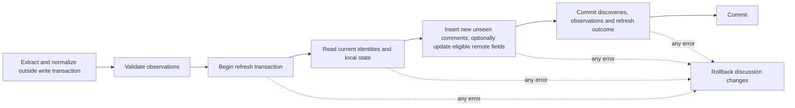

# Database and durable data

## Appearance configuration (schema 15)

Migration 15 copies every preference field verbatim into the expanded appearance
CHECK and adds one bounded, validated `reader_appearance.config_json` row. It holds
the appearance CAS revision, up to 16 versioned theme definitions, selected custom
theme identity, wallpaper digest/enablement, surface opacity and blur. Migrations
1–14 remain exact. Pre-migration safety, exact historical schema validation and
staged backup upgrade now cover 1–15; schema-15 JSON is validated before use.

Theme definitions are profile configuration **inside SQLite backups**. Wallpaper
JPEG files in `appearance/wallpapers/` are **outside SQLite backups**. Settings and
docs state this explicitly. Missing/tampered images after restore produce an opaque
fallback and localized Settings notice; saved themes still work. Immutable old
images are retained for same-profile historical restores, without automatic pruning.
See [Appearance](APPEARANCE.md) and [ADR 0037](decisions/0037-validated-themes-and-reader-wallpaper.md).
Historical sections below retain their original schema numbers.

## Atomic tab ownership movement (M7, schema 14 unchanged)

[ADR 0033](decisions/0033-atomic-cross-window-tab-transfer.md) uses the existing
composite keys and deferred active-membership FK. One outer transaction checks
both topology revisions, exact source placement/owner and final intent/collapse
counters, removes affected placements/resume references, updates the instance
owner, rebuilds both lists/active IDs and repairs owned resume pointers. Optional
private rows never rebuild or cascade away. Discussion identity stays unchanged;
same-item views never merge. Existing destination Library/Settings singletons
survive source merging, including dormant instances.

Both discussion save lanes advance and a main-owned runtime token rotates on every
transfer, including A -> B -> A. Token changes roll back on failed SQL/COMMIT. M1
incarnations plus current owner/token/CAS fence ordinary and M3 checkpoint writes.
A newly created provisional native joins window_restore inside the ownership
transaction, so crashes cannot leave committed ownership in an unintended reader.
One M2 workspace notification follows COMMIT; failed transactions publish nothing.

No schema increment or migration changes: exact migrations 1-14, historical backup
validation, staged upgrades, pre-migration safety, offline fencing and no-reseed
rules remain. Backups contain committed topology/private state, never transfer
reservations, frozen result IDs, temporary selection or ownership tokens.

## Native session metadata (schema 14, M6)

[ADR 0032](decisions/0032-equal-native-windows-and-session-restoration.md) adds strict `window_restore` (ordered intended members),
singleton `window_session` (version 1, CAS revision, required focused-member FK)
and required per-window `window_geometry` (independent CAS revision and optional
bounded version-1 JSON). Geometry stores getNormalBounds() in DIP, separate
maximized/fullscreen and optional display/scale/work-area evidence, never minimized.
Geometry and session mutations publish M2 watermarks and do not advance tab/view CAS.

Quit atomically captures live membership before teardown. Ordinary peer Close
removes its member, last Close retains one, and a cancelled final Close re-enrolls
it. Crash restores acknowledged membership, never every historical app_windows row.
Closed window/tab/view data remains dormant and shared Library data is retained.
New windows have empty workspaces. Full backup/restore preserves all these tables.

Migration 14 is additive; historical migrations 1?13 keep their original meaning.
Unrecorded v13 membership maps once to its former single startup choice, without
inventing geometry or reopening dormant history. Exact historical validation,
verified pre-migration safety and staged upgrades now cover schemas 1?14. Current
validation additionally checks session membership/focus, required geometry rows and
versioned finite bounded DIP data. M3 native checkpoints precede snapshots/offline
replacement; no delayed native save can write a restored profile. Older sections
below retain their historical schema contracts.

## M5 duplication on schema 13

[ADR 0031](decisions/0031-independent-duplicate-discussion-tabs.md) uses the existing M4 tables without a schema migration. One transaction
allocates a new discussion tab/view identity, copies optional intent/collapse rows,
inserts its placement after the owned source, activates it, advances topology CAS
and updates the local resume pointer. Source intent/collapse CAS counters must
also equal the acknowledged values; new counters start at zero. Source rows and
shared content/seen/Undo/history are untouched. Copy/COMMIT failure rolls back all
structural and seed changes and emits no commit event. Optional absence survives.

Activation updates item_resume_view per window/item. Library Open uses that pointer
if open, first strip-order copy if the pointer is dormant but siblings are open,
and the retained pointer if no sibling is open. Closing retains all private rows;
item removal cascades all copies. Verified backups include open/dormant instances,
placements/active tab, independent intent/collapse and resume identities. Historical
migrations 1-12 and preserving migration 13 remain unchanged.

## Persistent topology and view ownership (schema 13, M4)

[ADR 0030](decisions/0030-persistent-window-topology-and-view-instances.md) is the
current identity/storage contract; the older sections below record their original
schema increments. `app_windows` has durable topology CAS and a composite active
membership FK. `tab_instances` has opaque IDs and retained window ownership;
`window_tabs` enforces one placement per instance and unique positions. Checked
kind/item composite FKs bind required `discussion_views` identities to discussion
tabs. Library/Settings have a same-table partial unique index per window.

Optional `discussion_view_intent`, `view_collapse` and sparse
`view_collapse_overrides` are view-owned and have same-item comment FKs.
`item_resume_view` explicitly retains the owned instance for closed discussions.
TabId equals viewId for discussion instances. Multiple views may reference one
item without duplicating comments, seen, history, NEW or Undo. Item deletion
cascades every view and placement; ordinary close deletes placement only.

Migration 13 creates one legacy window and one instance for EVERY item, copies
exact workspace positions/order/active mapping and raw optional reading/collapse
records, preserves absence, and creates owned resume pointers for dormant items.
Unrelated authoritative tables never rebuild. Counts/ownership are checked;
DDL/data/user_version roll back together on failure. Startup recovery and verified
pre-migration safety precede this transaction. Historical definitions 1-12 are
unchanged; backup validation selects their OLD shapes. Older backups upgrade only
in staging, never by rewriting the selected source. Schema 13 snapshots include
all topology and all dormant views; newer/modified schemas reject.

Renderer topology commands require expected topology revision; intent and collapse
have separate durable CAS counters, so their independent FIFO writers cannot
collide on a shared version. Main derives the window from its document registry
and authenticates view ownership, including M3 checkpoints. Runtime M2 epochs and
commit revisions remain separate. No native geometry or restore set is invented;
M6 can add optional metadata without a destructive topology change. Startup still
opens only the initial persisted reader. M5 is implemented above; M6/M7 remain future work.

M3 adds runtime-only global profile/window lifecycle coordination, with no schema
change: M3 itself retained schema **12**; current schema is **13** (M4). All participating authorized renderers drain
accepted queues before a backup or restore snapshot. Main-issued pre-preparation
mutation tickets and exact bounded drain leases prevent ordinary DATA_BUSY bypass.
Every successful drain transaction uses the existing post-COMMIT M2 revision stream;
failed COMMITs publish nothing. Clean optional view/collapse rows are not created
merely by lifecycle preparation. M4's independent view/window identity migration is implemented in ADR 0030.

After confirmed restore, main settles children and verifies independent safety as
before. Terminal RESTARTING fences every old-profile write before offline SQLite
preparation/close/replacement. Only full relaunch/recovery can open replacement
storage, under a new repository epoch. Cancelled preflight releases participants
through M2 reconciliation; crashed documents contribute only committed data. See
[ADR 0029](decisions/0029-global-profile-and-window-lifecycle-safety.md).

M2 (ADR 0028) keeps schema **12** and all historical migration/backup rules.
Repository post-COMMIT publications use a random open-incarnation epoch and a
bounded process-local revision; neither is a durable content/Undo/workspace
revision. Restart/reopen reconstructs SQLite state under a fresh epoch. No new
table or migration is required. Main compares expected Undo operation IDs inside
the existing transaction before any restoration/consumption.

## Schema 12 usability settings (ADR 0026)

Migration 12 rebuilds only preferences, explicitly copying every existing column,
value and constraint while permitting translation_target=custom. Nullable
custom_translation_target retains the last saved code independently of app/presets.
Shared renderer/main syntax validation precedes atomic code plus activation writes;
failures retain committed values, and Custom cannot activate without a valid code.
Fresh profiles still follow application language. Both fields enter backup/restore.
Historical schemas 1–11 retain exact validation, pre-migration snapshots and staged
upgrades; unknown/modified/newer schemas still fail closed. No discussion/workspace/
collapse/Undo tables are rebuilt by migration 12.

Saved draft/applied publication JSON optionally adds semantic fromTime/toTime HH:mm.
Old date-only JSON stays valid. Bounded shape validation permits invalid semantic
drafts for correction; Apply checks real dates/times/ranges/DST. UTC bounds and result
IDs never persist. See [ADR 0026](decisions/0026-custom-translation-reader-minutes-and-layout.md).

## Selection preferences and Undo metadata (schema 11, ADR 0024)

Current schema is 13; this section describes schema 11. Schema 11 added checked selection_controls (on-demand default,
or always) and include_collapsed_in_prefix (boolean, default 1). Selected ID sets,
visual range anchors and selection-mode flags remain renderer/session-only.
The existing durable navigation selected_comment_id is a different identity.

seen_operations admits selected and view-prefix kinds. The transactional upgrade
saves operation/entry rows to temporary tables, drops the referencing child first,
rebuilds parent/child/index, restores rows and removes staging. Dropping the parent
first with cascading foreign keys would destroy recovery. Populated operations,
written revisions and later partial Undo are tested across upgrade and restart.
Failure rolls back the complete schema/data/version change.

Exact schema validation recognizes 1–11, retaining historical definitions. Startup
protects older profiles with verified pre-migration snapshots; restore upgrades only
a staged copy. Both preferences and explicit operation recovery are in full backups.
No new profile, fallback reset, localStorage or generic SQL IPC exists. See
[ADR 0024](decisions/0024-comment-selection-context-menus-and-view-prefix-seen.md).

## Sparse collapse state (schema 10, ADR 0023)

Additive 9 to 10 migration creates strict discussion_collapse(item_id,
default_collapsed) and comment_collapse_overrides(item_id, comment_id). An override
means opposite to the default; no row means expanded. All changes one default and
clears exceptions without enumerating comments. Same-item foreign keys, atomic main
ownership validation and cascading cleanup protect discussion/comment identity.
Close/reopen retains rows; Library removal cascades them. Invalid presentation rows
are ignored independently from content. Exact setDiscussionCollapse IPC is bounded
to All or 1 to 100,000 unique bounded comment IDs plus a boolean assignment.

Complete online backup includes both tables. Current schema is 10; exact known
schemas 1 to 10 validate, and schemas 1 to 9 migrate only on staged restore copies.
Startup pre-migration safety snapshots still precede any schema modification.
No existing data, profiles or schema-9 view intents change. See [ADR 0023](decisions/0023-persistent-thread-collapse-and-virtual-navigation.md).

## Translation target (schema 9, ADR 0022)

The additive migration adds `preferences.translation_target TEXT NOT NULL DEFAULT
'app'`, constrained to app/en/pl/de/fr/es/it/pt/ja/ko/zh-CN. Existing preferences become
Follow application language, preserving all other tables/values and profile identities.
Only exact validated preference intents update this field. Main resolves app to the
current persisted locale at browser activation; explicit overrides survive restart.

Backup includes the target with all existing authoritative data. Exact known schema
validation now recognizes 1–9; schema 1–8 copies upgrade only in staging. Verified
pre-migration safety protects schema-8 profiles before opening/migration; rollback,
crash recovery, newer/modified-schema rejection and source immutability remain ADR
0019. No separate store, translation text/cache or URL persistence is added. See
[ADR 0022](decisions/0022-reader-actions-external-links-and-translation-preferences.md).

## Complete backup and full-profile restore (ADR 0019)

Settings creates independently usable complete SQLite snapshots with asynchronous
`node:sqlite.backup`. Every authoritative table is included: items/comments and
metadata, source/discovery/refresh history and attempt order, seen/revisions/Undo,
workspace, preferences, persistent discussion views and helper selections. Chromium
caches, helper binaries and temporary process files are not authoritative backup
data. JSON discussion export remains separate and unimplemented.

Main owns native Save/Open dialogs. Backups first use private sibling `.partial`
files, full validation and flushing, then exclusive publication. Existing files
remain untouched; choose a new filename. Internal profile destinations and live
database restore inputs/aliases reject. Destination filesystems must support hard
links; unsupported filesystems fail safely. No open database file copy is used;
SQLite backup includes committed WAL state without copying sidecars.

Restore stages the selected standalone snapshot in
`<profile>/recovery/restore-<UUID>/candidate.sqlite`. It validates recognized schema,
full SQLite integrity, foreign keys and application invariants. Schemas 1–9 migrate
only on the copy, followed by revalidation/bootstrap. Current schema is 10. Version
0/unknown/modified schemas and newer versions reject. The source stays untouched.

Explicit Cancel-first native confirmation precedes child settlement, a verified
current-data `safety.sqlite`, WAL checkpoint/DELETE transition and connection close.
Immutable phase files bracket same-volume renames to `previous.sqlite` then the
absent live path. Startup validates an accepted replacement or restores safety;
interrupted rollback is repeatable. Failed candidates/sidecars are quarantined.
Recovery failure reports the profile path and never creates an empty fallback.
Single-instance ownership prevents competing application writers.

Nothing in `recovery` is pruned, including cancelled staged candidates. Safety is
separate and never consumed. Ambiguous recovery/missing live data stops startup.
Development seeds only a genuinely new profile, never a restored empty library.
Snapshots can contain personal metadata and machine-specific helper paths; restored
paths retain normal validation/environment precedence. Profile isolation is unchanged.

Before opening a recognized older existing profile, async startup creates a verified
`recovery/pre-migration-vN-<UUID>.sqlite`. Failure aborts before transactional schema
changes. This implements the future released-schema safety policy; every released
migration still needs populated upgrade/failure tests. No downgrade runs.
See [ADR 0019](decisions/0019-consistent-sqlite-backup-and-safe-restore.md) for exact
ordering and Windows limits; [TESTING](TESTING.md) records measurements.

## Schema 8 discussion view intent (ADR 0017)

One optional strict `discussion_view_state` row per content item stores bounded
`draft_query_json`, `applied_query_json`, five-mode `sort`, nullable
`anchor_comment_id`, finite bounded `anchor_offset`, and nullable
`selected_comment_id`. Null anchor means header/top with offset zero. Item deletion
cascades the row; closing/reopening tabs and reacquisition retain it. Same-item
comment foreign keys and main ownership validation protect anchor/selection.
No row means existing defaults. Migration 7→8 is additive and transactional,
creates no synthetic state rows, and preserves content, seen/revisions, history,
workspace, durable Undo, preferences and separate helper settings.

Exact query validation accepts only current semantic fields, text up to 16,384
UTF-16 units, unique selected fields, known modes/enums, bounded calendar strings,
and no resolved bounds/results/regex objects. JSON strings are bounded before
parsing; per-row invalid state falls back independently with a fixed diagnostic,
never failing content bootstrap or resetting the database. Offset storage is
bounded to ±100,000 pixels. Renderer saves through a single narrow typed full-view
intent; no generic JSON/SQL/key-value bridge is available. Failed upserts retain
the prior acknowledged state. Detailed reconstruction/scheduling/failure rules are
in [ADR 0017](decisions/0017-persistent-discussion-view-restoration.md).

## Usability command extensions (ADR 0015)

[ADR 0015](decisions/0015-safe-usability-intents-and-helper-confidence.md) needed no migration; its historical baseline was schema 7. ADR 0017 adds schema 8. Publication command targets add
optional fromTime/toTime HH:mm strings associated with from/to dates. Main resolves
them with fresh system IANA rules inside the existing seen transaction. Recovery
still records only changed IDs and revision ownership; calendar criteria/zone
are neither persisted nor needed for Undo. Invalid/DST-ambiguous/nonexistent
explicit times roll back without changing rows or prior recovery. Date-only
boundaries retain ADR 0012. Source-browser opening is read-only and never updates
workspace/content/history. Helper selections already store paths only; tested
versus untested is probe evidence, not a new durable configuration field.

SQLite is the durable store for valuable discussion and manual processing data. Main-owned built-in `node:sqlite` now uses schema 12 with ordered transactional migrations. ADRs [0002](decisions/0002-sqlite-and-typed-reader-boundary.md), [0004](decisions/0004-durable-observation-merge.md), [0005](decisions/0005-live-helper-execution-and-acquisition-ipc.md) and [0006](decisions/0006-compact-reader-and-persistent-tabs.md) describe persistence, normalized history, live acquisition and the bounded tab workspace. [ADR 0011](decisions/0011-virtualized-overview-and-durable-new.md) adds explicit attempt order and derived durable NEW. [ADR 0014](decisions/0014-main-owned-helper-settings.md) adds separate profile-local helper selections.

The implementation below is deliberately small. Later sections describe the broader conceptual target and must not be read as implemented tables/features. Read the [domain model](DOMAIN_MODEL.md) for meanings and [architecture](ARCHITECTURE.md) for ownership.

## Schema 6 bounded seen recovery

[ADR 0013](decisions/0013-atomic-bulk-seen-and-durable-undo.md) adds
`comment_state.revision INTEGER NOT NULL DEFAULT 0 CHECK(revision >= 0)`.
Existing seen values remain unchanged; actual transitions increment revisions,
including ordinary clicks, subtree/bulk writes and restoration. Refresh only
inserts new state rows (unseen, revision zero), never updates existing state.

`seen_operations(id, item_id UNIQUE, created_at, kind, target_seen, target_count,
changed_count)` stores at most one recovery per discussion. Safe kinds are all,
matching, publication and subtree. `seen_operation_entries(operation_id, item_id,
comment_id, written_revision)` stores only actual changed rows. Composite foreign
keys enforce operation/item and comment/item ownership, with cascading deletion.
The prior seen value is the inverse of the operation's uniform target, avoiding
per-entry duplicate values. No query text, criteria history or extractor dump is
copied. Bootstrap exposes only safe descriptors, never revisions or entry rows.

One transaction resolves targets, changes states and replaces/creates recovery.
Undo conditionally restores only still-owned rows and consumes the record in one
transaction; changed-away-and-back rows remain stale. All-stale recovery is a
successful consumed attempt. No-op/failure/single-row edits retain prior recovery.
Bulk with multiple targets and one actual change records that change; Ctrl+click
requires more than one actual change. Closing tabs, Apply, Refresh and restart
retain it without expiry; discussion removal deletes it. No redo/stack exists.

A 50k changed operation keeps 50k small entries, not an unbounded history stack.
Prepared statements and indexes keep row work linear. Undo/deletion frees rows
for SQLite reuse; no automatic VACUUM or database compaction is introduced.
Measured generated costs and migration/rollback tests are in [Testing](TESTING.md).

## Schema 5 attempt chronology

`extraction_attempts.attempt_order` freezes existing insertion order during the
additive schema-4 to 5 migration. An AFTER INSERT trigger assigns the next ordinal
within the same short transaction as history/merge. A positive-order unique index
and item/outcome/order index protect and serve the derived latest accepted attempt.
UTC clock ties/regressions, UUID sorting and later VACUUM cannot reorder this fact.
Migration failure rolls back column/index/trigger/version changes; all discussion,
manual state, discovery/history identities and workspace data are preserved.

Main exposes latest accepted attempt identity in its existing item projection.
The domain compares it with baseline and comment first discovery to derive NEW;
no per-comment mutable flag, new renderer command or persisted renderer state is
introduced. Failure does not advance accepted order; accepted partial/unknown,
empty/unavailable and zero-discovery attempts replace the cohort. Future history
retention/export/import must preserve order or an equivalent explicit chronology.

## Schema 4 unified workspace and local removal

[ADR 0007](decisions/0007-unified-workspace-and-library-removal.md) migrates the old
discussion-only workspace preserving exact open order, active identity and revision.
It adds no app tabs and touches no content/comments/state/history/preferences.
`workspace_tabs(id, kind, item_id, position)` uses application IDs
`discussion:<internal item ID>`, `library`, `settings`. Kind/identity/ownership
checks and unique item/order constraints enforce singletons. The singleton workspace
references an open tab through `active_tab_id` with deferred FK and keeps revision.
`content_items.position` is independent Library insertion order.

All tab kinds open/close/activate/reorder through short transactions; reordering
keeps active identity and commits only the final pointer/keyboard order. Close
never deletes content. Removal advances revision even when the item was closed,
applies ordinary mixed right/left/empty selection, then deletes local state,
comments, content and attempts belonging to that item/target in one transaction.
Because baseline and attempts form a FK cycle, checks are deferred to commit with
foreign-key enforcement ON. No dangling references survive; late failures roll back
everything. Unrelated items, preferences and app tabs stay untouched.
Synthetic demos use the same confirmed transactional deletion, including cascaded
saved view/collapse and owned Undo. The reader DTO derives `isDemo` from the stored
baseline attempt's `synthetic-demo` backend, separately from the `removable`
capability. No schema change or history/identity rewrite is needed. Complete backups
retain demos and their provenance; restored demos remain removable. Startup seeds
only genuinely fresh development profiles, so deletions (including the last item)
and restored empty profiles never cause reseeding. Main rejects removal of the active helper
source, preventing stale results from recreating deleted content. There is no
remote deletion/helper call or persistent remote tombstone.

## Historical schema 3 workspace extension

Migration 3 adds `workspace_tabs(item_id, position)` referencing stored items with
unique nonnegative order, and singleton `workspace(active_item_id, revision)` with
a deferred foreign key to an open tab. It opens all existing items in library
order and selects the first, or initializes empty/null. Earlier tables/rows remain
unchanged, including old avatar-less JSON. All pending migrations/version updates
remain one transaction; migration failure rolls back without replacing the file.

Open/activate/close writes are immediate short transactions changing only workspace.
Closed items remain in Library with their comments, history and local state. Closing
active selects right, then left, then null; open appends or activates without
duplicates. Successful Acquire opens in its merge transaction; Refresh does not.
Revision protects acknowledgment ordering. `content_items.position` remains library
insertion order. At schema 3 there was no reorder/deletion UI; schema 4 supplies these above. ADR 0017 adds persistent scroll/query/sort/selection intent; expansion remains future work.

Avatar evidence uses existing checked `remote_json`, with no avatar column/migration.
Old authors default absent evidence to unavailable in memory; synthetic-history
creation includes unknown avatar evidence. Author projection reads the observed
usable HTTPS URL directly from normalized JSON; scalar author columns remain unchanged.

## Schema 2 normalized history foundation

Migration 2 extends schema 1 without deleting/recreating tables. Unique indexes enforce content identity in its kind scope and source comment identity within its item. Reader `video`/`post` kinds map one-to-one to the observation source families. Internal IDs remain distinct: new items/comments/attempts use an injected factory (main defaults to UUIDs); existing IDs survive migration.

Current normalized remote evidence is stored in checked JSON on each item/comment, alongside the retained reader scalar columns. It preserves authority, canonical URLs, item likes/counts, author fields, publication evidence and Community image/link metadata without a media subsystem. Publication stores instant and label precision/estimatedness separately when both exist. Unknown fields cannot erase observed values; trustworthy empty/zero/false can update. No raw backend dumps or historical text/like versions are stored.

`extraction_attempts` stores attempt ID, optional item/target, UTC time, backend/version, coverage/evidence, accepted/failed outcome, collection status, counts and sanitized structured issues/provenance. Baseline, first and last attempt references use foreign keys and same-item accepted-history consistency triggers. Accepted existing-comment counts include unchanged observations, not only changed remote values. Failed normalization records history only; database-write failure rolls back history with all candidate writes.

Relationships retain top-level/direct-parent/thread-containment truth and unresolved opaque targets in remote evidence. The reader derives safe placement from the entire item, making missing targets and cycle members display roots without altering source truth. Legacy `parent_id` is retained for schema-1 fixtures; it is not authoritative for ingested display trees. Later resolution needs no child-row write. There is no inferred deletion.

Migration explicitly establishes synthetic history from old discovery labels and observation timestamps while preserving all 24 demo comments, metadata, ordering, seen and preferences. Fresh demo seeding does the same in its existing empty-library transaction. Repeated initialization never resets existing library state. The nullable evidence/reference columns permit staged legacy fixture insertion within that transaction; reader operations fail on missing evidence rather than inventing it.

## Schema-1 compatibility foundation

`src/main/persistence` owns path resolution, connection setup, migrations, and explicit row/domain mapping. `content_items` and `comments` store current synthetic content/author metadata and parent relationships; `comment_state` stores local seen state separately; singleton `preferences` stores an explicit optional en/pl choice and System/Light/Dark intent. Fixture ordering is stored so reopen does not reorder the reader. Internal application IDs remain primary keys. Schema 1 originally had no real-source uniqueness constraints; schema 2 adds the conservative owner-approved source scopes above. Same-item parent foreign keys, boolean/enumeration/content constraints, and the parent lookup index are tested. Required local state is created atomically with each fixture comment and missing state fails reads.

Timestamps use ISO 8601 UTC TEXT (Z suffix, supplied precision retained). Optional publication timestamps remain NULL; they never receive discovery-time substitutes. Synthetic labels identify synthetic history. Schema 2 had no raw payload, undo, search/FTS or backup/export tables; schema 6 adds bounded seen recovery below. Schema 3 adds the separate bounded workspace above.

One main-owned synchronous connection configures foreign keys ON explicitly, `busy_timeout=5000`, and `synchronous=FULL`; new files use SQLite's default DELETE rollback journal. Multi-comment state writes and demo inserts use `BEGIN IMMEDIATE`/commit/rollback. This is appropriate for the current tiny dataset, not a large-data responsiveness claim. No pooling, WAL transition, or worker design is selected.

An ordered migration list uses `PRAGMA user_version`: an empty database starts at 0 and migration 1 introduces the complete initial schema/preferences. All pending migrations and their version updates share one transaction. A newer version is rejected before any migration; failures close the connection without resetting/deleting/recreating the file. Tests exercise version-0 preservation, populated 1→2 preservation/rollback and failed later migrations over the current schema. ADR 0019 now creates verified pre-migration snapshots before startup schema changes.

Development uses `<Electron appData>/youtube-comments-development/reader.sqlite`; future packaged production uses `<appData>/youtube-comments-production/reader.sqlite`. Tests supply explicit absolute files in newly created temporary directories and clean only directories they own. Missing/relative test paths or profile roots fail. The privileged `YOUTUBE_COMMENTS_DEMO_ROOT` option selects an absolute alternative development root with the same development-directory suffix, including for packaged checks. Empty/relative values never fall back. Main also separates Chromium `userData` using the chosen profile directory. On Windows the normal appData root is `%APPDATA%`; the renderer receives none of these paths.

Development startup seeds the two synthetic discussions only for a genuinely new profile, transactionally into a database with zero content items; an existing or restored empty database is never seeded. It never resets existing preferences/seen/workspace, including an empty workspace over a nonempty library. Packaged production is not seeded. Tab IDs/order/active selection, preferences and manual state survive restart; the current uncollapsed view intent now restores under ADR 0017.

## Ownership and access

SQLite belongs to the privileged backend owned by the Electron main-process side. That backend may open the database through application services/repositories or delegate work to an internal database worker. This is a security boundary, not a requirement that every query execute on the main thread. Renderer code requests typed operations through preload/contextBridge and receives neither SQLite/SQL execution nor arbitrary filesystem access. External extractor invocation remains owned by the Electron main process; see [architecture](ARCHITECTURE.md).

Do not use localStorage for durable discussions, seen state, tabs or user preferences. Derived UI caches are not authorities. The renderer may hold currently displayed data, but restart recovery comes from SQLite and documented backup artifacts.

## Conceptual records

| Record | Information and relationships | Important constraints |
| --- | --- | --- |
| Content items | Source kind, source item ID, canonical URL, available item/creator metadata, successful acquisition-baseline association | Stable source identity must be unique under validated source rules |
| Comments | Content item, opaque source comment ID, parent reference, remote content and available metadata | One comment per stable identity; parent relationships remain within the same item |
| Local comment state | Seen/unseen for a particular comment | Required for every comment; new comments start unseen; no thread-level seen flag |
| Discovery/observation information | `publishedAt`, `firstDiscoveredAt`, `lastObservedAt`; first-discovery refresh association | Baseline imports retain discovery history without visual NEW; publication and discovery remain distinct |
| Refresh attempts | Item, timing, outcome, coverage, diagnostics and useful counts | Committed outcome must agree with committed changes |
| Tab/view state | Open tab identities/order/active ID; separate draft/applied queries, sort, anchor/row offset and selection per discussion | One optional view per stored item; close retains it, removal deletes it. Sparse default/exception expansion is stored separately (ADR 0023) |
| Preferences | Interface language, appearance and translation target | Persist System/Follow app intent, not only resolved values |
| Migration metadata | Applied schema versions and runner bookkeeping | Must support ordered, repeatable startup decisions |
| Reversible changes | Information required by the chosen bulk undo/recovery mechanism | Schema 6 stores one operation per item and changed IDs/written revisions (ADR 0013) |

These are logical records, not a requirement for one table per row of this list. For example, seen state can share a comments table if refresh code cannot overwrite it, and first discovery can be represented by a refresh foreign key rather than a separate event table. Schema 2 implements baseline and per-comment first/last attempt references; future presentation must retain the initial-versus-later distinction. Do not create a redundant thread seen column or another durable flag derived from comment state.

Raw extractor payloads, diagnostic files, avatar caches and backups may require separate managed files. Their retention, paths and relationship to the database need explicit decisions; none replaces normalized domain storage. See [extractors](EXTRACTORS.md) and [packaging](PACKAGING.md).

## Constraints and indexes

The proposed source key is `(source kind, source content item ID, source comment ID)`, expressed through appropriate item relations. ADR 0004 chooses conservative item-scoped comment uniqueness, without asserting global source-comment uniqueness. Internal keys may simplify relations but must not replace source-key deduplication.

Parent relationships, refresh references and local state should have enforceable relational integrity where possible. SQLite foreign-key enforcement must be configured and verified for every relevant connection if the selected design uses foreign keys. Cycle detection and domain-specific relationship validation still belong in domain logic: a foreign key alone cannot establish a valid conversation tree.

Expected lookup patterns include source identity, item membership, parent/child traversal, publication ranges, seen state, refresh discovery membership and tab restoration. Initial search/filter queries cover all stored comments in the active discussion; default bulk scope is also the active discussion. Index choices should follow those queries and measured representative datasets. Do not commit to an index or full-text strategy without verifying the required ordinary substring, case and opt-in regex semantics. A full-text index alone may not satisfy those semantics. See [filtering and search](FILTERING_AND_SEARCH.md).

Comments without reliable publication times must not receive discovery times in that field just to satisfy a schema constraint. Schema 1 chooses fixture UTC TEXT and nullable optional fields with inline author metadata. Schema 2 preserves real observation precision/labels and unresolved source relationships; date-query canonicalization and any separate normalized-author entity remain open.

## Transaction boundaries

All discussion changes accepted from a refresh belong to one transaction, along with the committed history/discovery information that describes them. A process failure outside that transaction may still produce a failed-attempt history record without touching the prior snapshot. [ADR 0003](decisions/0003-extractor-observations-and-normalization.md) accepts valid partial/unknown observational input without implementing any database writes. [ADR 0004](decisions/0004-durable-observation-merge.md) implements conflict/baseline/history/outcome policy; future process crash reconciliation remains open.

Multi-comment seen commands and recovery are atomic under ADR 0013. Target resolution, state/revision updates, operation replacement and changed-entry creation commit together. Undo conditional restoration and log consumption also commit together. Failed transactions preserve prior states, revisions and recovery. Apply recomputes views; seen changes have already been saved.

Matching-only bulk commands receive the last applied active-filter matching IDs from the active discussion, with backend validation of their scope. They do not replace that set with a fresh database predicate merely because seen state has changed since evaluation. Raw search matches and contextual IDs must stay distinct from these targets. A successful explicit remote Refresh commits its merge and then triggers active-view recomputation; Apply recomputes without extraction. See [seen state](SEEN_STATE.md).

Service boundaries must prevent an in-flight refresh from overwriting a manual seen change. The eventual write scheduling/concurrency policy should also define ordering for multiple windows/tabs, overlapping refreshes, and reversible operations. Thread-safe use of a driver, synchronous versus asynchronous calls, connection counts, busy handling and journaling mode remain implementation decisions.

## Migrations

Schema migrations are part of the product, including packaged builds. Use explicit schema versioning and a migration runner; do not rely on ad hoc startup `CREATE TABLE` calls as the whole evolution strategy.

Required design outcomes are:

- Opening a supported older database applies a known ordered migration path.
- A failed migration does not silently discard data or recreate an empty database.
- Opening an unsupported newer database produces a clear failure rather than destructive downgrade behavior.
- Migration tests verify both schema and preserved user data, especially seen state and source identities.
- Development resets and test helpers cannot target the user's real database.

ADR 0019 implements verified pre-migration safety before startup schema changes; each released upgrade still requires explicit populated preservation/failure tests. Some operations may require special handling outside a simple migration transaction; that is a reason to design and test recovery, not to assume all migration failures are harmless. Changes with substantial compatibility consequences should receive [ADRs](decisions/README.md).

## Data locations and environment isolation

Production, development and test data are isolated through the implemented profile strategy above and [ADR 0002](decisions/0002-sqlite-and-typed-reader-boundary.md). Tests always receive explicit temporary paths. Final backup/raw-file retention, uninstall behavior, and export locations remain open with [packaging](PACKAGING.md).

Never let a missing development/test path fall back to the installed application's database. Test and reset utilities must validate the intended environment and target before modifying data. Tests should own and clean up only the temporary directories they create. A packaged build should have a stable production data location that application upgrades do not overwrite.

No real user database, private extraction or credentials should enter source control as fixtures. Use deliberately prepared fixtures and databases under [testing](TESTING.md).

## Backup, restore and export

The complete workflow is implemented by ADR 0019 above. Live snapshots use SQLite's
online backup API; the offline restore protocol accounts for journaling and restart.

Restore requires explicit replacement confirmation after staged validation and a
verified safety snapshot before any live file replacement. No automatic restore or
pruning is authorized. Scheduled backups and a future retention UI remain open.

Eventual discussion export serves portability/sharing and is distinct from complete backup. Export format, whether it includes seen state and discovery history, and whether re-import is supported are unresolved. Do not promise export/import round-tripping before specifying those semantics.

## Performance and verification

The target is thousands to tens of thousands of comments per discussion. Measure read/query behavior and state operations at that scale; virtualized rendering alone does not make a blocking database/search path acceptable. Filtering, search, tree building and navigation use application data independently of mounted DOM nodes. Indexes, batching, caches or workers are implementation choices guided by the required semantics.

Use temporary SQLite databases for integration tests of migrations, source-key uniqueness, baseline/first discovery, refresh rollback, missing comments, seen-state preservation, multi-comment atomicity, active-discussion scope, last-applied matching targets and restoration of durable preferences/view state. Tests should include populated old-schema fixtures when migrations exist and verified backup/restore behavior when implemented. See [testing](TESTING.md).

Before a storage increment opens or changes durable data, choose the driver/native-module approach, initial schema and identity constraints, timestamp conventions, migration mechanism, connection ownership and isolated development/test paths needed by that increment. Resolve source collision, parent and partial-result policies before the associated ingestion writes. ADR 0019 implements complete backup/restore; export format, raw-diagnostic retention and retention management remain open until their dependent work is scoped; they are not universal gates before scaffolding or domain-only work. Data protection and eventual backup/restore remain product requirements throughout. These dependency notes do not define the first implementation milestone. Track choices in [decision records](decisions/README.md); [packaging](PACKAGING.md) must reflect any driver or helper distribution decision.

## Profile-local helper configuration (schema 7)

[ADR 0014](decisions/0014-main-owned-helper-settings.md) adds a separate strict
helper_settings table keyed by the two fixed helper identities, containing only
validated/probed saved executable selections. No row means automatic detection.
Startup overrides are not persisted. The additive transactional schema-6 migration
preserves content, seen revisions, history, workspace, preferences and durable Undo.
Selections survive restart and local discussion removal, and remain independent in
development/production/test profiles. The table never enters discussion or Preferences
DTOs; only narrow Settings path/status evidence is returned through validated IPC.

## Thumbnail cache is excluded from snapshots (ADR 0025)

No thumbnail migration is required: normalized image URLs/dimensions fit existing
item remote JSON. Actual raster bytes and HTTP validators live only in the
main-owned `<profile>/thumbnails` directory beside `reader.sqlite`. Development
and production keep distinct directories under the existing explicit path policy;
explicit test database paths likewise use their own sibling cache. Installation
and source directories are never cache destinations.

Cache naming is `<videoId>.json` plus `<videoId>-<SHA256>.<jpg|png|webp>`; identity
is canonical YouTube video identity, never titles or internal item IDs. Atomic
content/manifest writes preserve the prior valid image. Database backup/restore
covers SQLite alone, so snapshots neither grow with images nor depend on them.
After restore, canonical identity must match before a cached image can be delivered;
an internal item-ID match grants nothing. Missing images may download again.

Library deletion commits before best-effort removal of an unreferenced video's
cache. A remaining stored video reference protects it, and cleanup failure never
rolls back deletion. Successful replacements remove obsolete versions best-effort.
There is no cache quota or crash-orphan sweep in this milestone; cache files are
regenerable, never authoritative comment evidence. See ADR 0025 for freshness,
negative backoff and validation limits.
