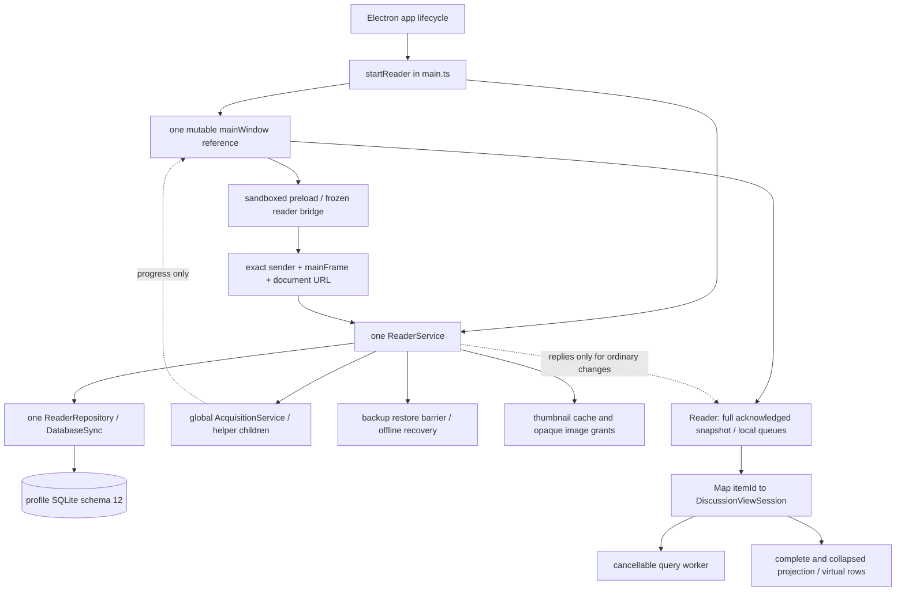

# Multi-window readiness audit

Follow-up: M1 is now implemented by
[ADR 0027](decisions/0027-secure-window-coordination-foundation.md). The audit below
remains the historical baseline; its mutable-mainWindow findings describe the
pre-M1 source. Public startup still creates one reader; M2–M9 remain future work.

Research date: 2026-10-17 (Europe/Warsaw). Source baseline:
`bc5493801d499d99b8c6214b3a94550500f9ec63`, schema **12**, Electron **44.4.5**,
host Node **26.7.0**. This is an audit, not an accepted implementation ADR.
The companion [design](MULTI_WINDOW_DESIGN.md) proposes the next architecture.

## Scope and evidence labels

**Verified** means inspected source or an explicitly recorded execution below.
**Proposal** means a future change; none is implemented by this audit.
**Uncertainty** means native behavior or a product choice still needs verification.
No production source, schema, owner profile, installer, commit or push is part of
this task. Builds and tests use generated artifacts and disposable profiles.

Read first: AGENTS.md, docs/README.md, PRODUCT_REQUIREMENTS.md, HOW_IT_WORKS.md,
ARCHITECTURE.md, DATABASE.md, DOMAIN_MODEL.md, TESTING.md, PACKAGING.md and the
decision register. Relevant contracts include SEEN_STATE.md, REFRESH_AND_MERGE.md,
FILTERING_AND_SEARCH.md and UI_AND_NAVIGATION.md. Historical paragraphs in these
documents describe earlier milestones; current source is authoritative for this
audit. In particular, old schema-8/earlier test counts are not today's baseline.

## Assessment

The application has a useful shared backend foundation, but is **not ready to
enable multiple equal windows by adding BrowserWindow instances**. Its persistence
and renderer deliberately equate a discussion with one reading view. IPC authorizes
one WebContents. Most mutations update only the caller's presentation. Restore
flushes one renderer. Those are correctness and data-safety blockers.

Keep the existing single main-owned ReaderService/ReaderRepository authority.
Introduce separate window and tab/view identities, ordered shared change delivery,
ownership generations, coordinated lifecycle barriers and a preserving migration.
Do not combine that work with a SQLite worker, paging, extractor optimization or
an installer project. Cross-window drag UX needs a separate native feasibility
milestone before promising desktop-drop behavior.

| Owner requirement | Current support / gap | Proposed milestone |
| --- | --- | --- |
| 1. Multiple equal windows | One BrowserWindow factory/reference; no multi-window model | M1, M6 |
| 2. No primary-window dependency | No explicit primary-close exit, but singleton IPC/dialog/progress routing | M1, M6 |
| 3. Windows last-window exit | Already `window-all-closed`; retain and test during detach/provisional windows | M3, M6–M8 |
| 4. Drag outside to detach | Not implemented; desktop release/cancel uncertain | M0, M7, M8 |
| 5. Drag into another window | Not implemented; no token/ownership transfer | M0, M7, M8 |
| 6. Reorder per window | Existing local reorder; one persistent list | M4, M6–M8 |
| 7. Duplicate discussion tabs | Forbidden by schema and derived tab identity | M4, M5 |
| 8. Independent filters/sort/scroll/collapse/temporary selection | Independent different-item sessions only; same-item state is shared by identity | M4, M5, M7 |
| 9. Shared comments/seen/Library/settings/acquisition/SQLite | Central authority exists; no peer renderer content synchronization | M2, M3 |
| 10. Library/Settings singleton per window | Global singletons in current one workspace | M4, M6 |
| 11. Merge transferred special tabs | No transfer; target merge semantics absent | M7, M8 |
| 12. Never auto-merge normal discussion tabs | Current normal tabs open once by item; new duplicates require independent instances | M4, M5, M7 |
| 13. Restore all windows/tabs/positions/view states | One tab list and per-item view/collapse persist; native geometry absent | M4–M6 |
| 14. Multiple monitors/mixed DPI | Responsive layout/zoom tests exist; native topology/drag not verified | M0, M6, M8, M9 |
| 15. Safe data operations/concurrency/crashes/close | Strong single-authority transactions/recovery; one-renderer draining and reply reconciliation | M2, M3, M7, M9 |

## Current process and state ownership — verified

### Startup, windows and shutdown

| Exact implementation location | Verified behavior and implication |
| --- | --- |
| [src/main.ts](../src/main.ts), top-level Squirrel gate and `startReader` | Lifecycle events skip reader initialization. Normal startup resolves development/production profile, registers thumbnail scheme and fixed identity, and sets userData before readiness. Preserve this ordering. |
| `startReader` → `createWindow` | One `mainWindow` variable; fixed 1240×900 with minimum 720×520; no bounds persistence, display topology handling, new-window command or coordinator. `closed` unconditionally clears that variable. Calling this factory twice would replace routing/parent ownership; closing either could clear the remaining window reference. |
| `app.on('ready')` | Single-instance lock; offline `recoverProfile`, then `protectBeforeMigration`, then one service/repository, IPC registration and one window. Fresh development seeding is gated by original file existence and recovery, not empty Library. |
| `before-quit`, `window-all-closed`, `activate` | Windows already quits only after all native windows close; service shutdown aborts/awaits children and data operations before SQLite close. There is no explicit quit-on-mainWindow-close. macOS recreation uses the same singleton factory. No native-window close handshake drains renderer queues. |
| `ReaderService.shutdown`, `AcquisitionService.close`, `HelperSettingsService.shutdown` | Shared lifecycle controllers and awaited settlement exist. They are app lifetime resources, not suitable for destruction whenever one future window closes. |

### Security and privileged capabilities

* [reader-ipc.ts](../src/main/reader-ipc.ts), `registerReaderIpc`: one global
  registration per channel checks identity equality to `window()?.webContents`,
  exact mainFrame object and exact document URL before dispatch. A second renderer
  is forbidden today. Removing that equality without a registry would weaken the
  boundary. Service receives no authenticated caller/window context today.
* [preload.ts](../src/preload.ts),
  [reader-bridge.ts](../src/preload/reader-bridge.ts), `createReaderBridge`, and
  [reader-api.ts](../src/shared/reader-api.ts): frozen named intents; no generic
  invoke/Node/SQL/file/process authority. Runtime arity/exact payload validators
  remain required. Only acquisition has a subscription/current-state pair.
* `createWindow`: nodeIntegration=false, contextIsolation=true, sandbox=true;
  `setWindowOpenHandler` denies web-created windows and `will-navigate` blocks
  navigation. Future application-created windows must use a main factory, retaining
  these restrictions. Packaged fuses are independently verified by packaging tests.
* [data-backup-dialogs.ts](../src/main/data-backup-dialogs.ts),
  `createDataBackupDialogs`; [helper-picker.ts](../src/main/helper-picker.ts),
  `createHelperPicker`: native parents are late-bound to the singleton variable.
  The future originating window must be captured from authenticated IPC context,
  not the most recently focused window or renderer-provided native handle.
* `ReaderService.openSource`, `openCommentAction`, `thumbnail`, `thumbnailImage`:
  source/comment/translation destinations are reconstructed from stored identity;
  clipboard and shell are main-owned. Image grants are bounded bearer capabilities
  rechecked against canonical stored video identity. They are not window IDs.
  Removal revokes item grants; restore restarts the service. Preserve those checks.
* [helper-settings.ts](../src/main/helper-settings.ts), `serial`, `choose`, `clear`:
  helper selection/status already serialize globally; environment overrides remain
  authoritative. Future two-window dialogs need caller ownership and dead-parent
  handling without creating another helper service.

### Persistence and identity

| Location | Verified model / single-view assumption |
| --- | --- |
| [migrations.ts](../src/main/persistence/migrations.ts), `migrations`, `schemaVersion` | Ordered versions 1–12. Schema 4 `workspace_tabs`: unique item_id, globally unique position, CHECK discussion ID = `discussion:` + item_id, Library/Settings IDs = kind. `workspace` is one row `id=1`. |
| Same file, version 8 | `discussion_view_state` has item_id primary key: draft/applied JSON, sort, anchor comment/offset, selected navigation comment. No tab/window key. |
| Same file, version 10 | `discussion_collapse` item_id PK and `comment_collapse_overrides(item_id,comment_id)`; independent duplicate collapse cannot be expressed. |
| Same file, versions 6/11 | `comment_state.revision`; one `seen_operations` per discussion, with revision-owned cascading entries. This is correctly shared discussion data, not per-view state. Version 11 explicitly preserves populated children before dropping parents. |
| Same file, version 12 | Atomic custom translation preference activation/code. No multi-window change should rebuild or reset this preference. |
| `transaction`, `migrateDatabase`; `openReaderDatabase` in [reader-repository.ts](../src/main/persistence/reader-repository.ts) | Synchronous BEGIN IMMEDIATE/COMMIT/ROLLBACK; FULL synchronous, foreign_keys ON, busy_timeout 5000. No await within transactions; current connection setup does not enable WAL. Migration chain and user_version change transactionally. |
| `ReaderRepository.workspace`, `writeWorkspace`, `openWorkspaceItem`, `changeWorkspace` | One whole tab list; writes delete/reinsert it. Reader reconstructs discussion tab ID from itemId rather than reading independent stored ID. Revision guards ordering of returned snapshots, but commands carry no expected revision. Safe single-writer transactions do not resolve stale two-window intent by themselves. |
| `discussionViews`, `ownsViewIdentities`, `saveDiscussionView` | Independent validation/fallback per discussion; ownership checks anchor/selection; item-keyed full-intent upsert, no cross-renderer version guard. |
| `discussionCollapse`, `setDiscussionCollapse` | Sparse opposite-default representation, same-item validation, atomic all/IDs assignment. No independent view owner or generation. |
| `removeLibraryItem` | Deletes one derived discussion tab, increments global workspace revision even for a closed item, deletes comments/item/history in one deferred-FK transaction; other item-owned state cascades. Future removal must close every instance in every window atomically. |
| `bootstrap` | Eagerly reads ALL Library discussions and comments, Undo, preferences, one workspace, all saved views/collapse. More windows duplicate full IPC clones and renderer memory. |

Stable content/comment application identities are valuable and should remain.
The debt is substituting them for reading-view identities, not using itemId in
shared seen/source/thumbnail actions.

### Renderer/session identity inventory

| Exact file/function | Coupling requiring attention |
| --- | --- |
| [domain/workspace.ts](../src/domain/workspace.ts), `WorkspaceTab`, `discussionTab`, `openWorkspaceTab` | Deterministic discussion ID and global `library`/`settings` identities implement singleton opening. Normal discussion duplicate cannot exist. |
| [renderer/App.tsx](../src/renderer/App.tsx), `Reader` | One local workspace, full comments/items copy, preference fields, local removal tombstones, FIFO save queue and acquisition reconciliation maps. No shared data notification listener. |
| Same, `openItems` and final panel mapping | React key=item.id, panel ID=`panel-${item.id}`, active check=`discussionTab(item.id).id`, aria label derived from same ID. Two same-item tabs in one document would collide and share activation/session. |
| Same, `workspaceAction`, `activate`, `close`, Library open handler, keyboard handler | Focus targets and flushes use derived discussion/item identity. `activeDiscussion` stores itemId only; keyboard routes session through itemId. Settings/Library/help branches use literal IDs. |
| [use-discussion-views.ts](../src/renderer/use-discussion-views.ts), `useDiscussionViews` | `Map<string, DiscussionViewSession>` keyed by itemId; bootstrap saved/collapse indexed by same key; save closures send itemId; close/reopen retains same session; removal disposes one. Refresh/seenChanged address one session. |
| [discussion-view-session.ts](../src/renderer/discussion-view-session.ts), constructor, `attachReader`, `persistentIntent`, `refresh`, `apply`, `dispose` | A session owns one executor, draft/applied/result, sort, collapse, logical navigation selection, temporary bulk IDs/range anchor, one captureAnchor callback, scroll requests, caches and save queues. Sharing a session across two panels would replace its reader callback and mix presentation. |
| [discussion-view-save-queue.ts](../src/renderer/discussion-view-save-queue.ts), `DiscussionViewSaveQueue`; [collapse-save-queue.ts](../src/renderer/collapse-save-queue.ts) | Serialize/coalesce locally. Local revision counters are queue bookkeeping, not durable view revisions. Independent renderer queues can overwrite each other or send late writes after transfer/restore. |
| [WorkspaceTabs.tsx](../src/renderer/WorkspaceTabs.tsx), `WorkspaceTabs`; [use-tab-strip.ts](../src/renderer/use-tab-strip.ts), `useTabStrip` | Pure local pointer preview + one final index; capture on strip; blur/Escape/visibility/pagehide/lost capture/revision change cancel. No HTML data transfer or main drag session. aria-controls addresses item panels. |
| [CommentTree.tsx](../src/renderer/CommentTree.tsx), `commentTargetId`, `CommentArticle`; [VirtualCommentList.tsx](../src/renderer/VirtualCommentList.tsx), scroll-request effect `finish` | Article DOM ID includes only commentId. Final reveal uses document.getElementById, so two same-item panels can focus/scroll the other panel's article. Namespace DOM targets with viewId and scope final lookup without changing comment identities. |
| [DiscussionPanel.tsx](../src/renderer/DiscussionPanel.tsx), `DiscussionPanel`, `VideoDescription` | Shared item mutation callbacks are appropriate; description IDs based on item.id need view namespace. Local thumbnail expansion stays panel-local. Active/hidden observer must follow the owning panel after transfer. |
| Same panel plus App final panel map; [VideoThumbnail.tsx](../src/renderer/VideoThumbnail.tsx), effect | App currently omits DiscussionPanel's optional active prop, whose default is true. Thus hidden mounted panels still pass active=true to thumbnail lookup/check/timer logic. ContextMenu and floating controls separately observe the real panel hidden attribute. Multiple duplicates/windows would multiply unnecessary active thumbnail work; explicit active-view wiring needs a focused regression test. This is source inspection, not a newly reproduced network failure. |
| [BulkSeenControls.tsx](../src/renderer/BulkSeenControls.tsx), `BulkSeenControls`; App `seenFeedback`/`savingItemId` | Frozen item+IDs scope is correct; confirmations/status have no initiating view identity. A transfer/close must cancel the transient dialog or preserve its exact origin; never retarget it. Shared Undo is intentionally item-owned. |
| [CommentContextMenu.tsx](../src/renderer/CommentContextMenu.tsx), `CommentContextMenu` | Portal, native text Range, DOM focus origin and document observers are renderer-local. Cancel these on transfer, not serialize DOM references. |
| [render-work.ts](../src/renderer/render-work.ts) | Counters use item identity; future duplicate-view performance measurements must distinguish view IDs. This is instrumentation debt, not production data corruption. |
| [query-worker-client.ts](../src/renderer/query-worker-client.ts), `QueryWorkerClient`; [use-acquisition-progress.ts](../src/renderer/use-acquisition-progress.ts), `AcquisitionProgressState` | Worker client explicitly documents singleton-discussion ownership, but already supports one independent executor per instance. Progress model subscribes before reading current state and retires settled IDs, a useful existing example of snapshot/event race handling; it does not synchronize content. |

Document-global listeners/portals are not inherently wrong: separate renderer
documents isolate them. They need correct local view scoping, cleanup and IDs
when *one* window contains two instances of the same discussion.

### Acquisition, seen, Undo and stale snapshots

* [acquisition-service.ts](../src/main/acquisition-service.ts), `run`: one global
  active operation ID/controller; helper execution/normalization outside transaction;
  queued cancellation checkpoint, then noncancellable saving immediately followed
  by synchronous `repository.ingest`. Exact cancel ID cannot cancel a later run.
  User cancellation records failed history only. `close` aborts app lifecycle and
  waits for child/temp settlement. `emit` tolerates a destroyed observer.
* `ReaderRepository.ingest`: source identity merge, history and optional singleton
  workspace opening in the same transaction. Existing seen state is never rewritten.
  `AcquisitionService.refresh` and completion bootstrap read the whole repository.
  There is no initiating window/view in operation state or resulting open-tab action.
* `Reader.acquire` in App: overlays its own acknowledgedSeen/Undo maps onto an older
  acquisition snapshot; removedIds filters delayed results; acceptWorkspace compares
  workspace revisions. These are deliberately local race protections. Another window's
  mutation bypasses them; simply broadcasting old full snapshots would regress state.
* `ReaderRepository.toggleSeen`, `assignSeen`, `bulkSeen`, `undoSeen`: synchronous
  transactions define commit order. Undo restores only matching written revisions,
  increments revision and consumes the operation. Correct across serialized writers
  at the DB layer, but current `undoSeen({itemId})` would consume whatever operation
  is latest at execution, even if another window replaced the one the user saw.
* `toggleSeen` derives its result from stored current state. Two clicks from stale
  windows can toggle twice; this is serialized behavior, not a lost SQL update.
  Future explicit assignment/stale-target policy needs to be chosen and tested.
* Replies include booleans/full item comments, not a globally ordered data revision.
  Frozen applied matches remain until Apply/explicit Refresh; shared seen updates
  must mark all relevant sessions stale without changing their membership/order.

### Backup/restore and thumbnails

`ReaderService.dispatch`, `runDataOperation`, `shutdown` in reader-service.ts hold
`dataPending`/`stopping`/`restartPending`; reject later calls; settle helpers; reject
backup during acquisition; confirmed restore settles acquisition/helpers/cache,
creates separate verified safety, checkpoints DELETE/closes, replaces offline,
then relaunches. [profile-restore.ts](../src/main/persistence/profile-restore.ts)
`prepareRestore`, `installRestore`, `recoverProfile`, `protectBeforeMigration`
stage/validate/migrate copies, publish immutable phases and retain safety/previous/
failed artifacts. Never reopen obsolete service state after replacement.

The precondition “accepted renderer queues were flushed” currently comes from
one [DataBackups](../src/renderer/DataBackups.tsx) `run` → App `prepare` → local FIFO
and `views.flushAll`. Its modal and dataBusy are local. A second window's pending
debounce, worker evaluation, queue or input is not quiesced. Backend DATA_BUSY alone
prevents writes during the operation but does not prevent rejected stale queues
being retried after an aborted barrier or distinguish old-profile intent after
replacement. This is a blocker, not a reason to weaken backup validation.

[backup-validation.ts](../src/main/persistence/backup-validation.ts),
`knownStructure`, `validateBackup`: exact historical SQL structure from unchanged
migration prefixes; read-only query-only validation plus integrity/FKs/application
invariants. A new schema must branch validation; old tables cannot be assumed to
exist at every newer version. Startup pre-migration safety is already present.

[thumbnail-cache.ts](../src/main/thumbnail-cache.ts) and service methods keep raster
bytes beside SQLite, excluded from backup. Canonical video ID, not tab/window ID,
owns cache identity. Multiple views should reuse cache jobs while retaining local
expanded/collapsed presentation; last-tab close must never delete Library cache.

### Large-reader behavior

`DiscussionViewSession.presentation`/`displayed`,
[discussion-presentation.ts](../src/renderer/discussion-presentation.ts)
`projectReaderRows`, [discussion-collapse.ts](../src/renderer/discussion-collapse.ts),
and [discussion-navigation.ts](../src/renderer/discussion-navigation.ts) derive
membership/order/hidden representatives from complete data, independently of DOM.
`VirtualCommentList` uses TanStack dynamic heights, overscan **6**, complete small
reader limit **200**, stable comment keys, scoped `.reader-panel`, ResizeObserver,
bounded mounted remeasurement and application-ID reveal. `attachReader` captures
one logical comment/offset. Header/thumbnail changes preserve that anchor.

[discussion-ruler.ts](../src/renderer/discussion-ruler.ts), `aggregateRulerMarkers`,
and DiscussionRuler keep three category lanes and pixel-bounded paths; hidden
targets map to visible ancestors while retaining logical IDs. Query workers use
numeric resolved dates, cancellation and a **1000 ms** deadline; relative criteria
reconstruct with fresh clock/system zone. These algorithms are reusable per view.
Measured heights/DOM/worker handles cannot move to another renderer; transfer must
rebuild from intent and a handoff snapshot. Full data/bootstrap memory multiplied
by windows remains a measured scaling risk (Q-21), not a solved virtualization issue.

## Test baseline and limitations

The execution ledger below records the existing commands and their results. Initial
restricted `npm.cmd test` failed **before discovery**: esbuild could not traverse
`../../..`/resolve vitest.config.ts. The broader-access retry passed unchanged tests.
Typecheck and lint passed in the restricted environment. This is an infrastructure
permission failure, not a failing application assertion.

| Layer / current tests | What it establishes | Multi-window impact |
| --- | --- | --- |
| Domain discussion/query/date/merge/sort/collapse/ruler tests | Deterministic trees, conservative merge/NEW, complete match/context semantics, DST minute rejection, sorted navigation and hidden projection | Retain; add view ownership and transfer state-machine tests, not rewrite source semantics. |
| persistence `reader-repository`, `workspace`, `discussion-view`, `discussion-collapse`, `removal` tests | Current single list/open-once semantics, restart state, strict ownership, rollback and cascades | Preserve historical fixtures; rewrite current singleton workspace expectations for per-window lists and per-view persistence. |
| persistence `seen-operations`, `comment-selection`, `seen-performance` | Atomic targets, partial revision-safe Undo, no-op behavior, frozen explicit scopes, 10k/50k structural correctness | Retain; add interleaved callers, operation-ID guarded Undo and revisioned replies. No arbitrary millisecond budget. |
| persistence `backup-restore`, main `data-backup`, dialogs tests | Exact known schema validation, staged migration, safety failures, rename-gap crash recovery, mutation barrier, child settlement | Retain; extend to all renderer flush participants, topology changes, profile epochs, newer schema tables and stale windows. |
| `reader-ipc`, `reader-service`, preload bridge tests | Arity/payload validation, exact sender/frame/document, narrow transport, storage failure handling | Sender tests intentionally authorize one mock window; expand to registry and ownership attacks, keep all negative cases. |
| renderer App, use-discussion-views, session/restoration/save-queue tests | Local FIFO reconciliation, hydrate once, isolated *different-discussion* sessions, query stale/error behavior, lazy mount, local removal | Do not claim duplicate same-item isolation or external notification handling; add those explicitly. Test DTO mocks need new scoped bootstrap/events. |
| WorkspaceTabs/shortcuts tests | Local capture/reorder/cancel, wheel, focus, keyboard | Retain in-window assertions; revise blur/cancel behavior only after drag protocol chosen. Synthetic pointer events cannot establish native cross-window delivery. |
| VirtualCommentList/Floating controls/ContextMenu component tests | Bounded DOM/projection work, local reveal/selection, focus cleanup with test layout seams | Add two same-item panels/ID namespaces; actual reflow, DPI, native capture, focus and crash require Electron. |
| main acquisition/helper/action/thumbnail tests | One-operation lock, cancellation ordering/cleanup, source/translation/shell security and cache association | Retain; add origin death and broadcast results without moving privileged work into renderers. |
| scripts `smoke-electron`, `smoke-view-restoration`, `smoke-backup-restore` | Real main/preload/renderer/worker entries, SQLite restarts, large anchors, fixed sender security, fixture acquisition, snapshot and forced recovery | Each process expects one browser-window-created target; must become window-ID aware. Existing forced exits cover restore gaps, not arbitrary window/renderer death. |
| Other `test:electron` scripts: reader-actions, collapse, selection, reader-usability, thumbnails, usability-milestone | Actual browser selection/actions, collapse/reveal, floating controls, image layout and English/Polish/zoom | Keep as regressions, scope selectors by window/view. Zoom/layout checks do **not** prove mixed monitor DPI. |
| packaged/squirrel/startup tests | Runtime/fuse/archive checks and inert lifecycle gate tests | Unrelated baseline protection; no installer execution required for multi-window. Packaged native real relaunch is separate from built-entry relaunch substitution. |

### Infrastructure fragility and untested behavior

Verified harness inspection: smoke scripts attach to `browser-window-created` and
`did-finish-load` then run one-window selectors and quit the whole app when that
window passes. Many use literal `discussion:video-demo`, `panel-video-demo`, SQL
`INSERT INTO workspace_tabs VALUES (...)` and exact table snapshots. These are
useful explicit current contracts, but will require intentional migration updates.
They cannot be used unchanged as proof of a multi-window lifecycle.

Built-entry tests substitute helper execution, native dialog answers, shell actions
and (backup harness) relaunch; real process restart/SQLite is still exercised.
They are not evidence of actual installed dialogs or native drag/drop. Explicit
demo-root creation/cleanup must remain fail-closed. Forge/profile harnesses share
`.vite`; never build/profile concurrently with Electron smokes. Source profiling
scripts that read configured real profiles are unnecessary for this audit.

Historical TESTING.md records Windows filesystem stalls, one nonreproduced
pre-commit RESTORE_FAILED in a parallel acquisition/restore test, 5s guards raised
to 30s, hidden RAF throttling and occasional GPU shutdown diagnostics. These are
historical reports, not newly reproduced flakes unless the execution ledger says
so. Broad desktop CI load can make input/poll/watchdog tests fragile; collect stage,
window ID, exit code and sanitized diagnostics before classifying a timeout.

Currently absent: equal window lifecycle, same-item duplicates, cross-window shared
updates/reconnect/gaps, ownership spoofing, all-window backup preflight, stale epoch
writes, guarded shared Undo, atomic transfer/rollback, singleton merge, topology
restoration, mixed DPI/negative monitor origins, renderer crash handoff, native
drop outside every window and Escape discrimination. See the companion test matrix.

Historical performance evidence (TESTING.md, 10k/50k): query payload preparation
29–30/128–138 ms, first view restore about 299/466–499 ms, 19 rows/four ruler nodes
and 0.422px anchor error in sampled runs. 50k complete verification can block main
IPC roughly 1.4–2.5s; backup/restore can take seconds. These are measurements on
one host, not product latency guarantees. Multiple-window memory/CPU/clone and
input latency under those stalls must be measured before setting acceptance budgets.

## Technical debt register

Difficulty: S = focused module change; M = several modules plus integration;
L = cross-process/persistence work; XL = native uncertainty or broad safety work.
These are relative engineering sizes, not calendar commitments. “Blocker” means
before enabling the affected multi-window capability, not a demand for unrelated
cleanup before research/prototyping.

| ID / class / difficulty | Exact location and observable risk | Proposed remedy / tests / dependencies |
| --- | --- | --- |
| B1 BLOCKER L | domain/workspace `discussionTab`; migrations v4/v8/v10; repository workspace/views/collapse. Duplicate tabs cannot persist and same-item views overwrite each other. | Unique view instances and persistent windows; preserving migration; same-item independence/reopen/migration rollback tests. Foundation for B2/B4/B6. |
| B2 BLOCKER L | App Reader panel map/keyboard/focus; useDiscussionViews; CommentTree `commentTargetId`; DiscussionPanel description IDs. Duplicate React keys/DOM IDs and shared session/capture mix filters/scroll/collapse. | Registry/panels/queues keyed by viewId; item→views index for shared changes; DOM namespace. Two same-item panels incl. hidden navigation and independent workers. Depends B1 contracts. |
| B3 BLOCKER M | main.ts `mainWindow`, `createWindow`, progress callback; reader-ipc `registerReaderIpc`; dialog factories. Second window forbidden, stale close clears routing, wrong parent. | Main WindowCoordinator and authenticated caller context; exact registry/frame/document guard; parent snapshot per operation. Two real windows, foreign/closed/subframe senders, close each in either order. |
| B4 BLOCKER L | App `acceptSeen`/`acquire`/removedIds/preferences; ReaderService dispatch reply-only mutations. Peer windows remain stale or late full snapshots restore deleted/old data. | Commit-ordered change stream + snapshots/revisions/epoch and gap recovery; duplicate reply/event dedupe; removal tombstones. Interleaved seen/refresh/remove/preferences tests. Depends B3. |
| B5 BLOCKER XL | App DataBackups prepare; ReaderService `dataPending`, `runDataOperation`; main before-quit. Only one renderer flushes; late view writes lose intent or overwrite replacement state. | All-window quiescence/drain capabilities, deadlines, profile generation and terminal restore; close/quit handshake. Test hung/dead participants, cancelled preflight, crash phases, all-old writes rejected. Depends B3/B4. |
| B6 BLOCKER L | save/view/collapse queues and repository full-intent upserts; workspace commands without expected version. Old owner may write after transfer; stale target index affects wrong order. | Ownership generation + durable view revision/local sequence, window topology CAS, idempotent command IDs. Transfer fence tests and stale reorder rejection. Depends B1/B3. |
| B7 BLOCKER M | ReaderRepository `undoSeen(itemId)`; service/API `undoSeen`; renderer Undo descriptor. A's stale button may undo B's newer bulk operation. | Send expected operation ID and atomically compare before conditional restoration; show current shared recovery after conflict. Two windows replacing/consuming same recovery. Keep one Undo per discussion. Depends B4. |
| B8 BLOCKER L | main createWindow fixed bounds; no durable window rows/display handlers. Restart cannot restore all windows; disconnected monitor can strand UI. | Window topology/geometry records and validated DIP placement; pure geometry tests and physical monitor verification. Depends B1/B3. |
| B9 BLOCKER XL for dragging | useTabStrip capture/blur cancellation; no transfer protocol/native outcome. Naive dragend creates windows on Escape or loses tab between owners. | Separate feasibility gate; then transactional tokenized transfer with source preserved until commit and rollback. Native matrix + crash/duplicate token tests. Depends B1/B3/B5/B6. |
| B10 BLOCKER L for migration release | backup-validation `knownStructure`/`validateBackup`; migrations; profile-restore probe. New tables break assumptions or parent drops cascade valuable children. | Immutable old migration prefixes, versioned validator branches, populated v1–12 staged restore and current migration preservation/failure checks. Depends final schema; deliver with B1, never afterward. |
| R1 RECOMMENDED M | ReaderRepository `bootstrap`, acquisition refresh/completion; every renderer receives all comments. Memory/cloning scales with windows × library, main stalls delay all windows. | First measure 2–4 windows over 10k/50k, then item-level revisioned loading and bounded event batches; avoid all-library bootstrap broadcasts. No mandatory worker/FTS rewrite. Depends B4. |
| R2 RECOMMENDED M | App Reader central local fields/queues/reconciliation. Adding independent peer snapshots increases race complexity. | Extract narrow shared replica reducer/command transport during synchronization milestone; keep view sessions separate. Reducer ordering/gap tests. No wholesale UI rewrite. Depends B4 contract. |
| R3 RECOMMENDED M | smoke scripts one-window event hooks/selectors, repeated wait/cleanup code. Second windows cause duplicate harness runs/early quit; hangs hard to diagnose. | Shared window-aware harness utility with explicit disposable-root assertions, isolated event waits and sanitized artifacts. Preserve meaningful old assertions. Precede multi-window E2E. |
| R4 RECOMMENDED S/M | per-item render-work counters; TESTING historical samples | Add per-view/window metrics and peak memory/IPC-size observations; distinguish load guards from latency expectations. Depends B2/B4. |
| R5 RECOMMENDED S | App final panel mapping → DiscussionPanel active default → VideoThumbnail effect | Wire explicit active view identity so hidden duplicate panels do not run active thumbnail check/timer work. C test activation/switch/duplicate effects and E cache behavior; fold into B2/M5 instead of a separate cleanup refactor. ContextMenu's hidden observer already protects its portal. |
| O1 OPTIONAL L | synchronous DatabaseSync bootstrap/verification and full-comment seen ACK | Main-owned DB/validation worker if measured responsiveness requires it. Preserve single logical authority and offline restore ownership. Not a prerequisite absent an agreed responsiveness failure. |
| O2 OPTIONAL M | session registry retains visited closed discussions/workers | Bounded eviction after durable flush, if measured duplicate-view memory warrants it; lossless semantic rehydration tests. Do not evict unsaved/transient transfer state. |
| U1 UNRELATED | packaging helpers/fuses/Squirrel, external helper distribution | Signing, updater, helper bundling, real Setup lifecycle, portable profiles are separate projects. Preserve existing safeguards; do not execute installer. |
| U2 UNRELATED | extractors/domain/search algorithms | No speculative extraction optimization, FTS, library-wide search, AI features, source relationship rewrite or generic design-system cleanup. Existing abstractions support required semantics. |

## Execution ledger and continuation

Commands executed on 2026-10-17 from the repository, without source/test edits:

| Command | Result / evidence |
| --- | --- |
| `npm.cmd run typecheck` | PASS, exit 0. |
| `npm.cmd run lint` | PASS, exit 0, no lint findings. |
| `npm.cmd test` (restricted) | Infrastructure failure before discovery: esbuild directory access denied. No application test result from this attempt. |
| `npm.cmd test` (broader access) | Vitest: **928/928 tests, 74/74 files PASS**, 118.26s. PowerShell stderr redirection reported wrapper exit 1 on Vite's CJS deprecation warning; this was not a failed assertion. |
| `cmd.exe /d /s /c "npm.cmd test > .multi-window-tests-confirm.log 2>&1"` | Native exit **0**, **928/928 tests, 74/74 files PASS**, 134.87s. Confirms the baseline independently of PowerShell stderr status. |
| `npm.cmd run package -- --platform=win32 --arch=x64` | PASS, exit 0; fresh main/preload/renderer/worker builds and package validator, 4.81s. x64 executable/runtime/ASAR/fuses verified; 73 files, 385,929,382 bytes. Packages only; no maker/Setup execution. |
| `npm.cmd run test:electron` | All **nine harnesses** reported their complete PASS phases. PowerShell wrapper again returned 1 after captured Chromium GPU stderr; no assertion failure. |
| `cmd.exe /d /s /c "npm.cmd run test:electron > .multi-window-electron-confirm.log 2>&1"` | Native exit **0**, all **nine harnesses and their restart/recovery phases PASS**. Confirms the entire chain independently of PowerShell stderr handling. |

Ignored raw command logs are retained in the workspace as `.multi-window-tests.log`,
`.multi-window-tests-confirm.log`, `.multi-window-typecheck.log`,
`.multi-window-lint.log`, `.multi-window-build.log`, `.multi-window-electron.log`
and `.multi-window-electron-confirm.log`. These are optional local diagnostics,
not committed evidence dependencies; the durable results are recorded here.

The first full Electron run completed smoke-electron's four restart phases;
view restoration's seed/write/read/library/reopen/relative/failure phases;
backup roundtrip plus both forced previous/candidate rename-gap recovery scenarios;
reader actions/restart; collapse write/read; selection and restart at both 10k/50k;
reader usability fresh/deleted/empty development and independently redirected
production-mode cases; thumbnail first/restart/offline; usability milestone first/
restart. The runtime reported Electron 44.4.5, embedded Node 24.21.0, SQLite 3.53.4.
Expected invalid-backup diagnostics and injected restore crashes are test outcomes,
not ordinary workflow failures. One non-failing GPU WaitForGetOffsetInRange message
was observed. No flaky application assertion was reproduced.

Isolation detail: most harnesses set a newly owned `YOUTUBE_COMMENTS_DEMO_ROOT`.
`smoke-reader-usability.cjs` production-mode cases set `appData` to its owned OS-temp
root **before importing the built entry**, and simulate isPackaged in the harness.
They do not access the owner's production profile. Source/profile-reuse scripts,
live YouTube acquisition and Setup.exe were not executed. `test:packaged` was not
needed for this source-architecture audit; genuine installed lifecycle remains
unverified as before. Mixed physical monitors/native multi-window gestures remain
future tests because the feature/prototype is deliberately not implemented.

Current repeat-run SQLite observations (not latency acceptance thresholds):

| Scale | Bulk all commit/ack | Undo commit/ack | Backup incl. verify | Independent verify | Restore preflight | Fresh bootstrap |
| ---: | ---: | ---: | ---: | ---: | ---: | ---: |
| 10k | 356ms | 347ms | 386ms | 284ms | 784ms | 215ms |
| 50k | 2,892ms | 2,831ms | 10,504ms | 2,234ms | 5,610ms | 1,131ms |

These runs overlapped other verification load. The 50k database was about 138.4MB;
its safety copy/verification was 3,939ms and offline install/recovery 9,351ms. The
first Electron selection run mounted 14 rows and three ruler paths at both 10k and
50k. This supports bounded rendering, not acceptable aggregate memory/latency for
multiple windows. Full-repository bootstrap on every window remains unmeasured.

Actual first-run built-entry measurements for the combined 10k+50k backup profile:
backup-phase reader readiness **16,022.5ms**, restore-phase readiness **15,956.0ms**,
Settings backup **2,232.7ms**, confirmed restore **17,107.5ms**, and fresh verification
process reader readiness **18,851.7ms**. Harness setup/table comparisons are separate.
These readiness samples include the full application startup/IPC/renderer path;
they do not identify one function as the cause. They are much larger than the
isolated repository bootstrap numbers, so multi-window startup must be profiled at
the actual usable-shell boundary as well as at SQL timings.

### Completion and precise next-session plan

**Audit complete.** Parts 1–8 have durable source findings/proposals here and in the companion design:
current ownership trace, baseline coverage/debt, proposed synchronization/lifecycles,
drag feasibility comparison/spike scope, migration mapping, test matrix and M0–M9.
No production implementation or prototype has started. All requested existing
verification commands completed; native test and Electron exits are confirmed zero.
Both full runs reproduced passing assertions, with no application flake observed.
The deliberately unperformed work is future feature/prototype verification, genuine
mixed-monitor/native drag trials and installer lifecycle testing, as bounded above.
Final working-tree inspection shows only the two new requested Markdown files;
local documentation links resolve and whitespace checks pass. No commit or push.

A later session should **not repeat this investigation from scratch**:

1. Read these two documents, AGENTS.md and `git diff`/HEAD/schema for changes since
   the baseline above. Recheck only changed code/assumptions; raw local logs are
   helpful but unnecessary when the ledger is complete.
2. Resolve the narrow owner policies listed at the end of MULTI_WINDOW_DESIGN.md
   before their dependent milestone. Do not convert recommendations into requirements.
3. The next engineering task should be **M0, a separate disposable drag feasibility
   spike**, or **M1, authenticated window context while retaining one-window UX**.
   Choose explicitly; neither is started by this audit. Do not combine M1–M8 in one task.
4. Use the matrix to scope deterministic versus real-window/native tests. All-window
   restore barrier and view-instance migration are safety gates before shipping
   multiple windows. Native release/cancel and physical monitor verification remain
   technical uncertainties until M0/M8; they cannot be resolved by rereading code.
