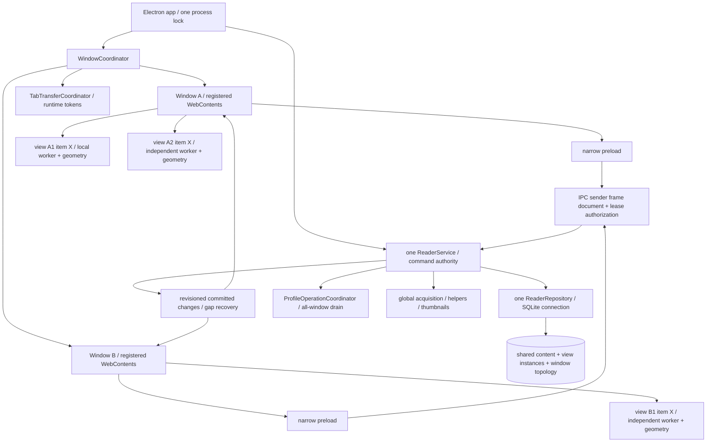
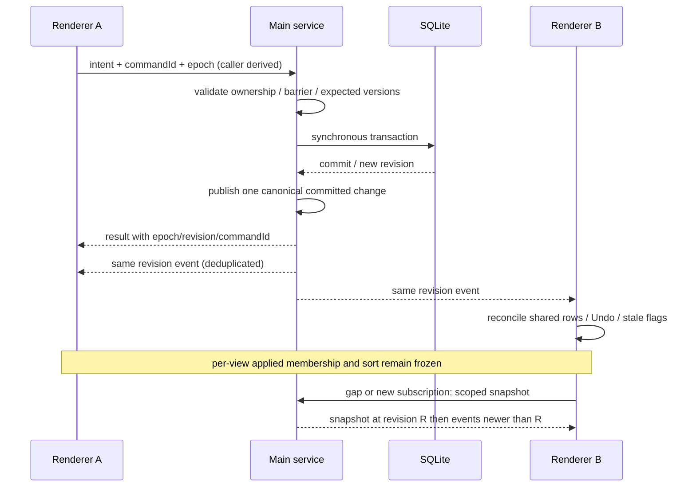
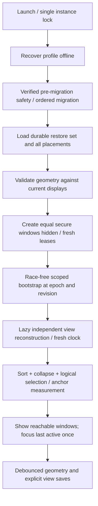

# Multiple equal windows: proposed architecture

Research/design, 2026-10-17. **Broader architecture remains proposed.**
M1 is implemented in [ADR 0027](decisions/0027-secure-window-coordination-foundation.md)
with one production reader and runtime-only window identities, without a schema
change. M2 is implemented in
[ADR 0028](decisions/0028-ordered-shared-state-synchronization.md): process/profile epochs and bounded ordered
commits, fixed notifications, replica recovery, explicit assignments, expected-ID
Undo and progress fanout. Its counter is process-local with fresh snapshots across
epochs; no durable revision table/migration is introduced. Production remains one
reader. M3-M9 below remain unimplemented; their requirements remain proposals.

**Accepted owner policy, recorded during M1:** native HTML DnD is preferred for
reorder/attachment. VS Code-style outside drag-end detachment is acceptable for the
first implementation, including Escape outside creating a window. This deliberate
limitation supersedes the original unconditional cancellation/no-phantom-window
rules below; historical M0/M0.5 findings remain intact. It is not correct cancellation
or evidence of desktop release. Future native detection must remain isolated from
durable ownership/transfer logic. No drag code is added in M1; M8 still requires
real native input testing.
See [MULTI_WINDOW_AUDIT.md](MULTI_WINDOW_AUDIT.md) for verified source traces,
technical debt, command results and evidence limits. Current schema is **12**.
Names and tables below are proposed responsibilities, not existing APIs.

## Requirements and terminology

The target keeps all fifteen owner requirements: equal independent native windows;
Windows quits on last close; drag detach/attach and local reorder; duplicate normal
discussion views; per-view reading intent; shared durable content/local state;
Library/Settings singleton per window with merge-on-transfer; complete restart
restoration; monitor/DPI correctness; and safe concurrent/lifecycle operations.
No primary BrowserWindow, renderer database, separate profile per window or automatic
normal-tab deduplication is proposed.

| Term | Meaning / lifetime |
| --- | --- |
| itemId | Existing stored video/post discussion identity. Shared comments/history/seen/Undo/cache references continue to use it. |
| windowId | Main-generated opaque persistent window identity, independent of Electron's runtime integer BrowserWindow ID. No semantic primary window. |
| tabId / viewId | One opaque persistent tab instance ID; for discussion tabs this **same ID** identifies its reading view. Do not introduce two interchangeable instance keys. A discussion references itemId; duplicates have different viewIds. |
| tab placement | Ownership of one tab by zero (dormant) or one persistent window plus its order. A live discussion view never belongs to two windows. |
| replica | A renderer's acknowledged cache of shared data. Main/SQLite remains authoritative. Different replicas need ordered synchronization. |
| profileEpoch | Main-generated runtime generation for the currently opened profile incarnation. New process/restore invalidates old envelopes. Not a timestamp or durable content revision. |
| ownerGeneration | Main-owned generation of a view's renderer lease. Changes on transfer/reload/revocation. Rejects writes from previous owners. |
| commitRevision | Ordered authoritative application commit version within an epoch, for event/reply/snapshot ordering, including observable topology changes. Private view-save events can carry only a watermark to peers. Distinct from each comment's Undo revision. |
| topologyRevision / viewRevision | Durable CAS version of window placement and individual saved intent. Expected versions guard structural writes and view ownership; clients cannot choose authoritative next versions. |

## Proposed ownership



Keep **one ReaderService and one ReaderRepository instance** for the profile.
Synchronous transactions already provide one commit order; one service also owns
the global acquisition lock, helper queue, backup barrier and shutdown. Per-window
services would create competing locks, inconsistent barriers and multiple connections
to close during restore. They provide no renderer isolation benefit: separate
sandboxed windows already isolate React/DOM/workers. A future main-owned DB worker
can move that one authority behind a queue if measurements justify it.

WindowCoordinator owns BrowserWindows, caller registry, native geometry, creation,
focus, close/reload leases and restore set. It does not own seen/query algorithms.
ReaderService routes validated use cases with authenticated caller context; repository
owns transactions. TabTransferCoordinator owns transient drag/handoff state and asks
the repository for atomic placement changes. ProfileOperationCoordinator owns
cross-renderer quiescence and global barrier phases. These can start as small modules;
do not add a framework/event bus or split the existing repository speculatively.

Each renderer uses a small shared replica store plus `Map<viewId, DiscussionViewSession>`.
An item→viewIds index fans shared changes to all affected sessions. One renderer can
reuse the same immutable comments array across its duplicate views, while each session
keeps its own query result/sort/collapse/navigation/bulk selection/anchor. A second
renderer needs an IPC clone; no shared mutable JS object crosses processes.

## Shared data, independent views and command ordering

### What belongs where

| Shared and authoritative | Per discussion view, durable | Per renderer/view, temporary |
| --- | --- | --- |
| items/comments/author evidence; seen/revisions; one Undo per discussion; accepted attempts/NEW; Library membership; preferences/custom translation/helper configuration; canonical thumbnail cache | draft/applied **semantic** query, sort, logical comment+row-offset anchor, navigation selected comment, collapse default and sparse exceptions | frozen applied result IDs/roles/evaluation clock, seenStale, pending/error/generation, bulk selected IDs/range anchor, query worker, measured rows/DOM, focus/native text Ranges/context menu, expanded thumbnail/description |

Bulk selection stays temporary across restart, matching ADR 0024. It should move
with a live discussion transfer. Persisted navigation selection remains separate.
Geometry/worker handles never persist. Restore evaluates semantic applied criteria
with fresh now/system zone, as today; normal shared seen events do not re-evaluate.

### IPC authentication and versions

Register each channel **once**. Resolve event.sender to a live coordinator record;
require exact mainFrame and expected app document URL for that WebContents. Main
derives windowId and renderer incarnation from the record. A renderer-supplied
windowId is neither authentication nor routing authority. Extra request fields still
reject. Scope tab/view commands to current ownership; check item/comment ownership
for all shared commands as today. A foreign window may request a *transfer* through
a valid transfer token, but cannot directly save another window's reading view.

Named intents may gain bounded expected epoch, lease/revision and command ID fields.
Keep the preload frozen, hide transport events and strip IpcRendererEvent before
callbacks. Validate notification payloads as well as commands. No generic SQL, paths,
URL opening, raw native handles, arbitrary channel subscription or executable input.
Browser-created windows remain denied; only coordinator factories create app windows.
See [Electron security guidance](https://www.electronjs.org/docs/latest/tutorial/security).

Use bounded opaque command IDs per renderer incarnation for retry/deduplication;
retain completed IDs for that lease or expire the lease before evicting IDs that
could be retried. A repeated toggle/Undo/transfer cannot execute twice. A new process
invalidates the epoch, so old requests cannot retry into a different incarnation.
Do not claim exactly-once delivery across a main crash; committed DB state is truth
and restart bootstraps it. Add durable command receipts only if cross-process retry
becomes an explicit requirement.

Serialize intent and collapse writes through one per-view transport writer (or one
shared sequencing adapter for today's two queues). If both advance viewRevision,
independent queues must not race with the same expected version. Acknowledgments
advance only the transport's accepted revision, never rehydrate newer live controls.
Transfer/close checkpoints fence the final local sequence and persist complete current
intent plus collapse before revoking ownership. Shared seen/preferences commands
still use main commit ordering and do not overwrite view fields.

Shared seen mutations serialize on main. Proposed checkbox intent is an explicit
`seen` assignment computed from the acknowledged checkbox state, using the existing
atomic assignment logic; Ctrl still assigns that resulting state to the stored
subtree. Two stale windows both asking “seen” then converge instead of toggling
twice. This changes concurrent intent semantics and needs an ADR/acceptance test;
it preserves ordinary single-window behavior. An alternative is retaining authoritative
toggle-at-execution; document the visible double-toggle trade-off before choosing.

Undo remains one shared recovery per item. Include **expected operation ID** from
the displayed descriptor; atomically compare it before restoring revision-owned
entries and consuming. Stale Undo returns a conflict/current descriptor, not Undo
of a different window's newer command. Ordinary later seen edits continue to win,
including away-and-back revisions. All frozen matching/selected/prefix IDs stay
explicit; never recompute or widen them after another view changes.

### Ordered notification and reconciliation protocol



Main allocates ordered versions at commit boundaries with no await between commit
and event registration. A durable profile change counter is preferable to timestamps;
increment it in the same transaction. Epoch handles process/restore resets. New
bootstrap/event subscription must be race-free: register first, queue bounded events,
take a revisioned snapshot, discard queued events ≤ snapshot version, then deliver
newer events. Snapshot reads use one logical main turn/transaction. A dropped/gapped
stream requires a fresh authoritative snapshot, never guessed replay from local maps.

Integrate the counter into the repository's existing outer transactions; do not
wrap `dispatch` in another BEGIN around methods that already transact. Ingestion's
optional tab opening and removal's topology updates belong to the same commit as
their content change. Publish a compact committed invalidation even if subsequent
DTO/bootstrap construction or sending to one destroyed renderer fails. An observer
failure cannot turn a committed write into a reported rollback, and reconnect/gap
recovery must work without assuming an in-memory event log survived a crash.

Initial rollout can use a contiguous revisioned invalidation stream plus coalesced
scoped snapshots. Avoid sending every Library comment to every window for every click.
Small seen changes can carry changed IDs/booleans/comment revisions and Undo descriptor;
large bulk/refresh can invalidate one item and fetch one item snapshot. Metadata,
preferences and topology are small. If item subscriptions filter data, send lightweight
revision envelopes/no-op watermarks for skipped changes or use explicit per-item
versions; otherwise global gaps would be falsely detected. Bound queued bytes and
fall back to snapshot under backpressure.

Replies and events feed the **same** reducer; compare epoch and revision, not arrival
order. A late acquisition snapshot cannot overwrite newer seen/preferences/removal.
Removal publishes an item tombstone and updated all-window placements transactionally;
pending workers, menus and commands for that item are invalidated. Reacquiring the
same remote source gets a new internal item identity; stale old item/view IDs fail.
Keep tombstones until no older snapshot/event can be accepted, or simply reject all
older versioned snapshots. Do not rely only on one renderer's removedIds set.

On shared seen change: update all local duplicate views' live unseen counts, ruler
and navigation; set seenStale on affected restrictive-seen sessions; retain frozen
membership/order/NEW. Refresh: commit shared rows/history/NEW once; the initiating
view re-evaluates its last applied criteria and preserves draft. Proposed peer policy
is refresh every instantiated view of that item against **its own** applied criteria,
preserving each draft/sort/anchor/collapse; unvisited views reconstruct lazily on
activation. Do not reorder on seen/NEW alone. Coordinate refresh generations so an
older worker cannot replace a later explicit Apply. Choosing a peer “data changed,
Update view” policy instead is an unresolved UX decision, not permission to share
one result across views. Query errors retain each prior result.

## Windows and operation lifetime

### Creation, close, exit and crash

All windows use the same security factory and no parent-child BrowserWindow relation.
Only native **dialogs** have an owner. Closing one window revokes its renderer lease
after its close preflight; it never shuts down the shared service while another
window remains. Windows exits on last real app-window close, after app-level settlement.
Auxiliary/provisional drag surfaces must not accidentally keep the app alive or
trigger last-window exit in the middle of a committed detach.

Normal close: prevent the first native close, freeze that renderer's input, settle
or cancel its pending query consistently, capture anchors, drain seen/preferences/
view/collapse queues, persist placement/geometry and mark its restore status, revoke
leases, then allow close. No async guarantee from React unmount/beforeunload alone.
Use a coordinator close state to avoid recursion and a window can close only once.
Do not drop a failed save silently; leave the window open with retry/explicit close
choice. A crashed/hung renderer cannot be drained; retain last acknowledged state
and offer recovery without blocking all other windows indefinitely.

Explicit app Quit snapshots all current windows as the next restore set **before**
closing them. Proposed normal-close policy: intentionally closed windows are absent
from the next restore set; closing the last window preserves that final window for
next launch. This matches “restore last session” without reopening every window ever
closed. Window records/views can remain dormant for reopen; closing is never Library
deletion. The owner must confirm this policy because “restore all windows” does not
specify intentional close versus quit. At crash, restore the last durable active set.
No policy uses a permanently special first window.

Renderer `render-process-gone`/reload: invalidate its lease and pending drag tokens,
keep committed view/topology data, recreate/reload only that renderer and issue fresh
leases. An accepted shared command can still commit after renderer death; its event
reaches peers. Unsent drafts/last debounce interval are not crash-durable. Document
that bound and flush on intentional close; do not promise to recover unacknowledged
memory after OS termination. Main crash uses SQLite transactional rollback/commit and
existing offline restore recovery before opening any window.

### Asynchronous origin closes

| Operation | Proposed completion behavior |
| --- | --- |
| Acquire/Refresh | App-owned after acceptance. If other windows remain, finish shared commit and broadcast summary/data even if origin closes; do not cancel merely because its renderer disappears. Any live window can cancel the exact active cancellable operation ID. If last window closes, existing app shutdown abort/await semantics apply. |
| Successful Acquire tab opening | Carry origin window lease at start. Open/activate within that still-live origin only; if it is gone, persist Library result without opening/focusing an arbitrary peer. No hidden replacement window. Removal/history still commit once. Transaction must check origin liveness/lease at commit. |
| Refresh reevaluation | Origin reading view may have moved: dispatch completion by stable viewId/current owner, not the old window. If view closed/dormant, keep semantic intent and shared data for lazy reopen. |
| Seen/bulk/Undo/preferences accepted before close | Finish transaction; report through shared stream. Close drains accepted caller commands. Cancel transient unsubmitted confirmations; never retarget them to another tab. |
| Helper picker | Capture originating window. If it dies before choice/probe commits, cancel that selection rather than silently parenting to another window; already committed helper change remains shared. Keep one serialized helper service. |
| Backup/restore dialog before confirmation | Origin closure cancels preflight (or coordinator temporarily defers that close). No parent reassignment. Confirmed restore becomes app-owned and finishes safely through restart even if origin later dies. |
| Thumbnail request/source browser action | Complete already authorized action safely; destroyed recipient is ignored. Recheck current item/canonical identity/cache grant as today; broadcast only useful image metadata/invalidation, not filesystem paths. |
| Query worker | Per-view generation. Close disposes after settled/accepted intent; transfer uses a bounded handoff. A peer window never inherits worker/DOM objects. |

Global acquisition remains one operation: multiple windows do not imply concurrent
extractors. Progress/current/completion notifications go to every authorized live
window and newly opened windows can query current state. Content commit is the
authoritative event; operation-progress settlement arriving first must not be used
to infer that peer data is already synchronized.

## All-window backup/restore barrier

Keep existing SQLite online backup and closed-file restore/recovery. Extend their
precondition from “this renderer flushed” to **every current participant drained**.

1. Main accepts one profile operation, records operation/epoch and participating
   renderer incarnations, freezes topology (new windows/transfers/reloads queued),
   broadcasts `prepare`, and blocks *new user commands*. All windows show an inert
   accessible operation state, not only the origin's Settings panel.
2. Issue each participant a one-use bounded drain lease tied to that operation.
   Normal mutations reject; only its pre-barrier queues/full intent checkpoints
   can drain under that lease. Commands already accepted on main finish. A renderer
   quiesces UI, settles accepted workers, drains FIFO and view/collapse queues, and
   acknowledges its final local sequence. Main validates ownership and sequences.
   This avoids the deadlock of blocking the very saves preflight needs to flush.
3. Main waits for all live participants' acknowledged drains and earlier helper
   selections; settle geometry/topology writes too. Crashed participants contribute
   last committed state; a live unresponsive participant fails backup/restore
   preflight with a clear retry/close choice, not automatic loss of its queues.
   New/reloading windows remain pending until the barrier resolves. Timeouts are
   hang guards, not implicit approval to discard state.
4. Enter a hard mutation barrier with no drain exceptions. Backup retains current
   acquisition-busy rejection. Restore confirmation then aborts/awaits acquisition,
   helper and cache jobs, makes verified safety, checkpoints DELETE/closes and runs
   the established offline replacement. Do not move synchronous DB connections into
   windows or let geometry/view saves bypass the barrier.
5. Cancel/validation failure/completed backup: revoke drain leases, publish barrier
   release/current revisions and resume against the unchanged profile. Reconcile
   any commits accepted before the barrier before further user input. Persist failures
   remain dirty; never blindly replay old full snapshots over a newer intent.
6. Once offline restore begins, revoke all old-profile leases/epoch and keep **all**
   windows inert until actual process relaunch. Any queued old save, worker result,
   transfer token, reply or thumbnail grant is invalid. `restartPending` remains
   terminal even on offline failure; startup recovery opens a fresh authority.
   No old renderer can write after replacement, including geometry writes during quit.

Backup snapshots include all window/tab/view tables as part of the same SQLite
snapshot; cache bytes remain excluded. Restore replaces the saved topology too.
New process restores it after recovery/migration and never seeds an existing empty
backup. Global barrier details need deterministic state-machine tests plus real
two-window interruption tests; this is the highest data-safety milestone.

## Atomic tab transfer

Dragging is a gesture front end to this protocol, not ownership itself. Explicit
keyboard “Move to window…” and “Move to new window” commands should use the same
protocol, providing an accessible alternative and allowing deterministic testing
before drag UX is ready.

```mermaid
sequenceDiagram
  participant S as Source renderer
  participant C as Transfer coordinator
  participant T as Target renderer
  participant DB as SQLite
  S->>C: beginTransfer(viewId, expected placement/version)
  C-->>S: short-lived opaque token / freeze lease
  S->>S: freeze view; settle query; capture/flush intent + collapse
  S->>C: bounded live handoff snapshot / final sequence
  T->>C: offer token + insertion neighbor + target version
  C->>T: prepare provisional view without ownership
  T-->>C: ready (same epoch, transfer and snapshot version)
  C->>DB: transaction: CAS owners/versions; move or singleton merge
  DB-->>C: commit new placement + generation
  C-->>S: committed: remove old panel, revoke old lease
  C-->>T: committed: activate with new lease, handoff state
  Note over S,T: before commit failure restores source; after commit DB is truth
```

Opaque random tokens are main-issued, short-lived, one-use, epoch/source-view/owner
bound; target can supply token and a bounded insertion neighbor/index, never arbitrary
view contents or an unverified source window. No source comment text, URLs or file
paths in OS drag payload. Targets must pass the usual IPC sender checks. Validate
target window readiness and allowed tab-strip bounds; external apps/forged HTML
payloads have no authority. Preview messages cannot mutate durable ownership.

For native HTML DnD, prepare the main-issued token before synchronous dragstart
serialization (for example during pointer-down preparation). Do not await IPC inside
dragstart and then assume DataTransfer is still writable. If preparation is not ready,
cancel that start without moving state. Only a namespaced custom format containing
the opaque token is exchanged; inspect types during hover, read token at drop.
Do not trust dropEffect or an external application's accepted drag as a committed
application transfer. Keep the source node alive throughout an OS drag so it can
receive its terminal event; renderer death is cancellation/recovery, not detachment.

Source remains owned and displayed (possibly frozen/ghosted) until commit. Settle
or cancel a pending Apply first; preserve accepted applied intent, current draft,
sort, collapse, logical anchor/navigation and temporary selection. Cancel menus,
native text ranges and unsubmitted bulk confirmations. Source queue final sequence
is a fence; old-owner late saves fail after ownerGeneration advances. Readiness
does not entitle target to save before commit. A new detach window is provisional
and securely loaded **before** source placement changes.

For uninterrupted transfer, a bounded runtime snapshot may carry frozen applied
IDs/roles, stale flag and temporary selection at a known item version. This avoids
accidentally re-running a relative/seen query and changing membership merely by
moving. It is validated against item ownership and remains memory-only; the existing
100k explicit-target bound is a starting limit, not proof that all views fit it.
Freeze/serialize relevant source/shared updates during the short handoff, then replay
newer shared events to target; no main transaction spans awaits. If the underlying
item changes before commit, refresh the handoff or cancel without changing placement.
After restart/crash, use durable semantic reconstruction as today; frozen results
are not a new durable format. A “re-evaluate on every transfer” shortcut would change
existing frozen-view semantics and needs explicit owner approval; it is not proposed.

Transaction moves exactly one tab, source and target order/active IDs and topology
versions. Prefer insertion by neighboring tab ID with an expected topology version;
reject/rebase visibly rather than applying a stale numeric slot. For same-window
reorder use the same structural command rules. Duplicate discussion tabs **never**
merge, including same item/source. New duplicate gets new viewId with copied semantic
intent/collapse/anchor and empty temporary selection; whether it also copies the
current frozen result is a UX choice listed below.

Library/Settings: unique partial constraint `(windowId, kind)` for these kinds only.
If target already has the kind, atomically remove source placement and activate the
existing target tab without reordering/overwriting the target's local UI state.
Return `mergedIntoTabId` for focus/announcement; no discussion deduplication. Settings
preference changes already committed are shared. An uncommitted custom translation
draft needs an explicit preserve/discard decision before source merge; do not silently
activate it or replace a target draft. Library filter can remain target-local.

Cancellation/failed readiness/stale versions/rejected validation before commit:
discard provisional target/preview and unfreeze source in its original placement;
no DB changes. A positively cancelled transfer does not detach. The accepted provisional
outside-HTML adapter may interpret an unobserved Escape as detach intent (see policy
above); ownership transactions must not depend on that detector. On target crash **after commit**,
placement remains durable and a fresh target renderer/recovery restores it. Do not
automatically clone into source or roll back over new target edits. If compensating
move is offered, it is another version-checked transaction. Main crash before commit
leaves source; after commit restores target. Tokens are not persisted and cannot
replay after restart. Freeze/cancel transfers during profile operations or owner
close; if last source tab transfers, proposed default is leave a normal empty source
window (no hidden primary dependency); auto-close is a separate UX choice.

## Dragging feasibility and native uncertainty

### Verified platform evidence

* HTML DnD offers drag data read/write at dragstart and read at drop; dragover data
  is protected, so do not expect to read the token during hover. Main can announce
  the active transfer for eligible windows to preview.
* The HTML standard treats Escape, no target and operation=none as failed drags.
  Consequently dragend/dropEffect=none is **not** proof of release on the desktop.
  See [HTML drag processing/data-store modes](https://html.spec.whatwg.org/multipage/dnd.html).
* Pointer capture redirects events to the capturing element; pointer identity is
  scoped to the top-level browsing context. It is not cross-window ownership or a
  guaranteed desktop-release API. See [Pointer Events](https://www.w3.org/TR/pointerevents3/).
* Electron's [native file drag API](https://www.electronjs.org/docs/latest/tutorial/native-file-drag-drop/)
  and [`webContents.startDrag`](https://www.electronjs.org/docs/latest/api/web-contents/#contentsstartdragitem)
  drag filesystem items, not application tabs. Do not invent temporary exported tab
  files or expose path authority to use it.

These are API/specification facts, not a verified drag implementation in Electron
44.4.5. Installed electron.d.ts exposes screen conversion/window APIs; latest web
docs may describe a newer patch. Pin the spike to the installed runtime and record
Chromium/OS versions. No prototype was implemented in this audit.

| Approach | Useful behavior | Limits / cost |
| --- | --- | --- |
| Extend current pointer capture + main coordination | Smooth in-strip preview; explicit pointerup versus Escape while capture survives; main can sample cursor DIP and send preview to peer windows | Target DOM does not automatically receive drop while source captures. Must route/hit-test manually; current blur cancellation must change deliberately. Out-of-window release, capture loss, occlusion, touch and mixed DPI need actual Windows verification. Polling cursor alone cannot detect release. |
| Native HTML DnD + opaque transfer token | Cross-renderer dragenter/over/drop through Chromium; OS drag image and Escape mechanics; source stays intact pending main commit | Failed desktop release and cancellation share outcome; keyboard/pointer event delivery can change during OS drag loop; no reliable desktop detach promise from DOM alone. Need separate verified release/cancel evidence or fallback UX. |
| Tear off a provisional normal native window during gesture, then coordinate movement/attach | A real window can follow an owned drag and become final on release; shares normal coordinator factory | Detecting reliable release/OS move-loop completion and restoring source on Escape still uncertain. Moving from custom strip into native move loop is not automatic; z-order/focus/input capture may be difficult. Do not create an always-on-top full-screen input overlay as a silent design choice. |
| Windows-specific drag/capture bridge | Can obtain actual native button-release/cancel/drop outcome with narrowly scoped integration | Highest complexity: native module/rebuild/packaging/review, DPI/Windows input/accessibility correctness; future platform adapters. Needs measured justification and explicit separate milestone. Global hooks are not a default requirement. |

**Recommendation:** adopt the tokenized main transfer protocol independently of
input. Run a small Windows spike comparing coordinated pointer capture with native
HTML DnD. First candidate is pointer capture with main cursor/target coordination,
because an explicit pointer release can distinguish a completed gesture from Escape
without overloading HTML failure. Its viability outside windows is **unverified**.
Use native DnD for cross-window attach if it proves more reliable; do not mix both
streams in one gesture without an explicit state transition.

Do not choose “HTML dragend none creates window” as a shortcut. If neither pure
Electron candidate can reliably tell release from cancellation across monitors,
the next decision is a narrowly scoped Windows bridge versus changing the desktop
detach UX. Explicit move/detach commands remain useful interim features, but they
do **not** satisfy the requested drag requirements. The final milestone cannot be
accepted while desktop release/cancel is ambiguous.

### Proposed spike (separate task, no profile/schema access)

Two disposable sandboxed equal BrowserWindows with fake tab labels, logging only
event type/window/token/coordinates/outcome. No SQLite/extractors/real content.
Exercise: press threshold, internal reorder, crossing source edge, target hover/
drop, desktop release, Escape inside/outside, lost capture/Alt+Tab, source/target
close, duplicate native events and right/middle buttons. Compare delivered pointerup
and dragend/key events, screen.getCursorScreenPoint and DOM screen coordinates.
Test 100/125/150/200% monitors, negative origin, boundary crossing, primary changes,
disconnection and taskbar/work-area differences. Verify occluded/minimized windows
do not accept a false drop and external app drops do not move a tab. Record whether
OS hit testing/z-order can be determined adequately without a native bridge.

Acceptance: reproducible one commit or cancellation, never phantom window on Escape,
no tab loss, correct drop position/focus and keyboard alternative. Output a matrix
and recommendation, not production code. Use actual desktop input; CDP synthetic
drag events cannot alone prove the OS drag loop. Mouse first; pen/touch support and
screen-reader announcement must be explicitly characterized rather than assumed.

## Window geometry, monitors, DPI and restoration

Persist normal-state bounds in Electron DIP, maximized/fullscreen flags separately,
last display ID plus work-area/scale evidence as a **hint**, and last-focused window.
Do not persist minimized as a required invisible restart state. DOM CSS pixels,
physical OS pixels and Electron DIP are distinct at zoom/mixed scale. Main obtains
native window/display coordinates; renderer supplies only bounded local strip
rectangles/gesture evidence. Avoid multiplying all coordinates by one global scale.
Use explicit per-display conversions if native input supplies physical points.
[Electron screen API](https://www.electronjs.org/docs/latest/api/screen) documents
cursor DIP, display-change events and Windows conversion methods.

Geometry validation is pure domain-like math with a native adapter: finite bounded
numbers, current display nearest/intersecting the old rectangle, minimum usable
width/height, maximum constrained by available work area, reachable titlebar and
substantial visible area. Negative x/y are valid. If display vanished, relocate on
best surviving work area; do not reset tabs/reading state. If the work area is smaller
than today's 720×520 minimum, explicitly adapt the effective minimum so the window
is reachable; document that exception and test taskbar access. Save normal bounds
using `getNormalBounds`, not maximized dimensions
([BrowserWindow docs](https://www.electronjs.org/docs/latest/api/browser-window)).

Debounce native move/resize persistence through the same authoritative writer and
flush at close/quit/backup; never write during offline restore. Handle display-added,
removed and metrics-changed by revalidating affected windows without focus stealing.
New detach uses main-observed release position in DIP and captured tab hotspot;
clamp to work area and ensure it is visible even at monitor edges. Main validates
target strip hit against the live target incarnation; client rectangles are stale
after resize/DPI/zoom, so invalidate/re-request them during drag.



Create all required native windows from the durable set; restore topology without
mounting/evaluating every hidden discussion. Show loading/errors per window and
maintain responsiveness while large views reconstruct. One corrupt view falls back
with existing localized restoration behavior without discarding the original durable
intent. One invalid geometry is clamped without changing its tabs. Per-window
activation and independent filters/sort/collapse must survive several launches;
no renderer acknowledges saved state over newer local intent.

## Forward-only migration from schema 12

No schema is changed in this audit. **Proposed next version is 13 only if no intervening
schema lands**; implementation must check current schema again. Migration needs an
ADR and populated historical fixtures. Preserve old migration definitions byte-for-byte
in meaning: backup validation derives exact old structures from their prefixes.

### Candidate relational model

* `app_windows`: opaque ID, normal DIP bounds nullable until first native placement,
  native state, geometry evidence, window revision and restore membership. Use
  separate session metadata for last-focused/restore-set revision.
* `tab_instances`: opaque ID, kind, nullable itemId with exact kind/item CHECK;
  **no unique itemId**. Retained dormant discussion instances preserve close/reopen
  intent without pretending a closed tab is open. item deletion cascades every
  discussion instance; Library/Settings are independent.
* `window_tabs(windowId, tabId, position)`: unique tabId (one placement), unique
  `(windowId,position)` and `(windowId,tabId)`. Per-window active membership uses a
  composite deferred FK so active cannot refer to another window's tab. Enforce
  Library/Settings uniqueness per window via an indexed representation of kind
  with CHECK/trigger consistency to tab_instances, or a single placement table with
  partial indexes. Choose final DDL in the schema milestone and test constraints
  directly; a cross-table partial index is not valid SQLite.
* `discussion_view_intent`: viewId FK to discussion instance, semantic fields from
  current view row, viewRevision. Collapse parent/overrides keyed by viewId; include
  itemId where needed for composite same-item comment FKs. Enforce that view/override
  item matches the tab's discussion via composite unique/FK keys or validated
  triggers, not just renderer validation. Navigation anchor/selection remain owned.
* `item_resume_view`: explicit pointer from itemId to a dormant/last-used discussion
  instance for legacy close/reopen behavior. Existing closed item state is not
  discarded just because it is outside the restored tab list. With duplicates,
  explicit Open may activate the last active local instance; explicit Duplicate
  always creates a new one. Cross-window Open policy remains a UX decision.
* Small profile/shared revision metadata. Native runtime IDs, live leases, tokens,
  worker results and bulk selection are not DB records. Window close can leave
  dormant placements/instances as retained recovery state, governed by explicit
  restore membership, not auto-open every retained window.

Do not store duplicate copies of comment/seen/history per view. Collapse defaults
and exceptions belong to each view, including a view with no filter row today.
The final schema should avoid redundant separate tabId/viewId for discussion tabs.

### Exact preservation mapping

1. Before opening old data for migration, existing `protectBeforeMigration` creates
   verified safety. Recovery still runs first. Migration itself is one synchronous
   transaction, forward only; any failure rolls back schema/data/user_version.
2. Create one legacy window record and map the one workspace into it in exact stored
   order and active identity. Generate opaque IDs using a deterministic reserved
   legacy mapping in migration (or a staged precomputed mapping), with explicit
   uniqueness. Do not consume/rewrite source IDs or invent random item associations.
3. For **every existing item**, create one legacy discussion instance. Place only
   those present in old workspace_tabs; others remain dormant with resume pointer.
   This preserves a closed item's saved view and collapse state. Existing Library/
   Settings tabs become single instances in the legacy window, preserving position
   and active status. Empty workspace stays empty; do not auto-add Library.
4. Copy draft and applied JSON **without evaluation/normalization**, sort, anchor
   comment/offset and navigation selection into corresponding view intent. Preserve
   absence of an optional saved record; runtime uses the current documented default
   when absent. Copy collapse default and every override for each item separately,
   including items with no discussion_view_state row. No UTC bound/result persistence.
5. No legacy geometry exists. Represent it as “not recorded,” then use the current
   1240×900/native-placement behavior validated against current work area on first
   launch and save actual bounds. This is a transparent fallback for missing evidence,
   not a claimed preservation/reset of an existing position.
6. Keep content_items, comments, comment_state including **revisions**, attempts and
   attempt order/baselines, seen_operations and all entries, helper_settings and
   preferences (including retained custom code) unchanged. If FKs require rebuilding
   any parent, stage/copy its cascading children **before** dropping it (v11 lesson).
   Prefer not to rebuild valuable unrelated tables at all.
7. Validate item/view ownership, exact tab counts/order/active mapping, saved-field
   equality and sparse overrides; run FK checks and application validation within
   the migration/testing boundary. Drop legacy workspace/view/collapse tables only
   after successful mapped copies. Keep no second mutable authority. Commit version
   last with the rest of the migration; perform post-open bootstrap probe as usual.

Malformed legacy convenience data is not permission for migration to delete or reset
it. If it cannot be mapped losslessly under the new constraints, abort with the
original database and verified safety preserved; design an explicit recovery path.
Keep ordinary per-view runtime fallback separate from migration/backup validation.

Backups: extend validateBackup with explicit schema-version branches for old workspace/
view tables versus new ones; keep recognized versions 1–12 unchanged and add the new
structure/invariants. Stage older backups, validate their original exact schema first,
then run the unchanged chain plus new mapping on the candidate only. Verify both
staged and installed current-schema profiles. Original backup bytes remain unchanged.
Newer/unknown/modified schemas still reject. A schema-12 executable must reject a
schema-13 DB instead of downgrade. Test empty restored profiles without demo seeding.

Thumbnail cache requires no identity migration: existing videoId/content hash files
remain profile-owned and excluded from snapshots. Source canonical checks/grants
remain main-owned; restart issues new runtime grants. Library removal checks remaining
stored video references, not number of view instances. Safety snapshots include all
new authoritative window/view tables, with the same immutable restore artifact policy.

## Test matrix

U = deterministic domain/reducer/state-machine test; DB = temporary SQLite integration;
C = renderer component/jsdom with mocked transport/layout; E = actual Electron windows;
N = actual Windows desktop/monitor/native input. E/N always disposable profiles.

| Area | Deterministic coverage | Required actual-window evidence |
| --- | --- | --- |
| Equal lifecycle | U coordinator transition/last-window count; close/quit/restore-set semantics | E open 3, close each creation order including first; others stay usable; last exits after settlement; no hidden provisional window keeps process alive |
| Duplicate views | C two same-item sessions with different filters/sorts/collapse/anchors/bulk selection, unique React/DOM/ARIA IDs; DB independent intent rows | E same video and post duplicated within/across windows, navigation/reopen/restart preserves independence |
| Shared seen/Undo | U reducer event/reply reordering/dedupe/stale flags; DB interleaved assignment/subtree/bulk/expected-Undo IDs and away-back revisions | E mark in A, B updates live/ruler while both applied memberships stay frozen; stale Ctrl+Z cannot undo replacement recovery |
| Concurrent/stale actions | U epoch/revision gaps/dedup/backpressure; DB two callers serialized, stale topology/view CAS and rollback | E delayed IPC replies, refresh while peer seen/removes, background window resync, local errors do not revert peers |
| Preferences/helpers/cache | DB shared atomic custom activation and helper queue; U canonical image association/removal | E Settings in both reflect committed preferences, both honor busy/progress; dead dialog owner cannot mutate via replacement parent; image reuse/offline fallback |
| Transfer | U token lifecycle, expire/duplicate/forgery, CAS source/target, cancellation and snapshot generation; DB atomic placement/active/order/lease; C handoff state | E source/target crash before readiness, before/after commit, delayed old-owner saves; failed new window leaves source intact |
| Special tabs | DB per-window partial uniqueness; U/C Library/Settings merge vs same-item discussion no-merge, dirty draft policy | E transfer into present/absent singleton, focus existing tab and keyboard announcement; simultaneous incoming special transfers cannot duplicate |
| Native gestures | U threshold/insertion/versions; C keyboard and pointer state routing | N internal reorder, detach desktop, attach, Escape inside/outside, lost capture, Alt+Tab/occlusion/minimize, external app drop, secondary button, touch/pen characterization |
| Backup/restore | U all-window participant/drain barrier with fake deadlines/death/new-window races; DB all tables preserved, safety failures, old/new validation | E queued writes and queries in 2+ windows, backup cancel, restore cancel/commit/relaunch; every stale window/geometry/worker write rejects; forced offline rename gaps recover |
| Migration | DB populated v12 including closed views/collapse/Undo children/custom target/history; supported older backups staged; fail at each copying step and compare original | E launch migrated profile, reconstruct legacy and new duplicate windows, backup/restore/new restart and existing-empty no-seed |
| Crash/interruption | U revoked leases and post-commit truth; DB transaction rollback, restore recovery checkpoints | E kill renderer, reload one, kill main around placement commit; restart has exactly one owner; shared accepted operation survives origin death with peers alive |
| Monitors/DPI | U negative-origin/reordered/missing displays, finite/NaN/overflow bounds, work area smaller than min, display ID changes | N 100/125/150/200%, nonprimary/negative origins, move/restart/maximize, unplug/reconnect, taskbar/work-area changes; focus/position stay reachable |
| Virtualization/restoration | U/C complete versus displayed maps, hidden anchor representatives, per-view data keys, bounded row/ruler DOM; worker deadline/supersession | E/N 10k/50k video/post in 2–4 windows, distant independent anchors, collapsed hidden targets, font/locale/zoom/DPI reflow/thumbnail expansion, no seen writes on reveal |
| Security | U all channels authorized registry/exact top frame/document, malformed/extra fields, forged view/target/token/epoch, stale lease; DB cross-item rejection | E extra unregistered WebContents/subframe/navigated/closed sender denied, window.open/navigation blocked in every window; packaged sandbox/fuses retained |
| Performance | U structural work bounds, avoid O(N) work in scroll observer; DB scale correctness, observations not fragile timing assertions | E measure peak memory/clone bytes/main stalls/input latency with concurrent large views and backup. Agree hardware budgets from baseline; jsdom/zoom is insufficient |

Keep existing tests that establish domain/security/data invariants. Rewrite only
the changed workspace/instance contracts and brittle one-window harness wiring;
preserve historical migration fixtures. Automated native input plus a documented
manual mixed-monitor pass may both be necessary. Physical display disconnect and
OS drag cancellation cannot be certified by unit tests or screen mocks.

## Independently testable implementation milestones

Sizes are relative: S focused, M several modules, L cross-process/data, XL high
native or safety uncertainty. Each is a separate Codex task, reviewed before the
next; no milestone is permission to execute an installer or valuable profile.

| Milestone / type / risk | Goal and likely modules | Data change / tests / Electron acceptance |
| --- | --- | --- |
| M0 native feasibility, research / XL uncertainty, small code scope | Separate disposable two-window spike; no production modules | No schema. Run native matrix above; publish exact outcome/recommended input adapter. Exit: unambiguous release/cancel/drop positioning or explicit blocked platform decision. Can run before other foundations. |
| M1 authenticated window context, foundation / M | Extract secure factory/WindowCoordinator from main.ts; reader-ipc caller context; dialog parent capture; preserve one visible window | No schema/feature yet. Registry/frame/URL/all-channel negative tests, origin-death dialog tests. Existing full suite and built-entry smoke pass; app still behaves as today. Exit: service no longer depends on mutable mainWindow for caller identity. |
| M2 shared mutation synchronization, foundation / L | ReaderService/repository versioned commits; shared DTO/preload events; renderer replica reducer; progress fanout; guarded Undo and chosen seen assignment contract | Small revision metadata migration only if needed, with safety/backup support. U/DB ordering/dedupe/gaps/retry/removal/Undo tests and existing renderer semantics. E test-only second replica/window verifies events without shipping new-window UI. Exit: late snapshots cannot regress committed data; no generic IPC bridge. |
| M3 global lifecycle barriers, foundation / XL | ProfileOperationCoordinator; ReaderService data operations; renderer drain/close leases; main shutdown/close/reload | Normally no new content schema. Deterministic participant race/failure tests, E 2-window preflight/crash/relaunch fixtures, all existing backup recovery cases. Exit: no stale saves across restore and no lost accepted queues on intentional close; one-window product still works. |
| M4 window/view persistence migration, foundation / L | domain workspace/view/collapse contracts; migrations/repository/backup-validation; new topology/session tables and mapping | Forward-only next schema; fully populated v12 + historical staged backups; injected failure/rollback, children/custom target equality. E restart legacy open AND closed views with unchanged semantics. Exit: current single-window UI uses unique tab/view instances, no data reset. M1–M3 contracts settled first. |
| M5 independent duplicate views, feature / L | App mapping/useDiscussionViews; session queues; panel/description/comment ID namespaces; Library Open/Duplicate commands | Per-view schema from M4; no duplicate content tables. C/U same-item independence, workers/focus/temp selection; E 2 duplicate video/post tabs, independent anchor/collapse/query restart. Exit: duplicate normal tabs never auto-merge and shared mutations synchronize. |
| M6 equal windows + geometry restoration, feature / L | WindowCoordinator + screen adapter; window menu/new command; scoped bootstrap/window tab commands, per-window singletons | Persist restore set/normal bounds/last active with validated absent-geometry fallback. U geometry/close policy; DB topology constraints; E 3 equal windows/last close/quit/restart; N mixed monitors and unplug. Exit: no special primary, reachable restored windows and one service. |
| M7 explicit transfer/merge protocol, feature / L | TabTransferCoordinator/repository transaction/handoff; keyboard Move to window/new; source/target renderer generation fences | Placement/lease revisions from M4; tokens/transient frozen state not durable. U/DB/C atomic move/merge/rollback/late save; E close/crash both sides with live selection/query/scroll. Exit: exactly one durable owner at every crash point, correct special merge, no normal merge. |
| M8 drag adapter, feature / XL | useTabStrip/WorkspaceTabs and chosen M0 main/native adapter; accessible announcements/focus; packaging only if native adapter required | No further content schema. E/N genuine detach desktop/attach/reorder/cancel mixed DPI/occlusion; all M7 protocol tests retained. Exit: all drag requirements actually met, not substituted by explicit menu commands. |
| M9 scale and release verification, hardening / M–L | Window-aware smoke utilities, profile/perf harness, selective scoped loading if measurements justify, docs/screenshots | No speculative DB redesign. Full suite/typecheck/lint, E 2–4 windows at 10k/50k with backup/refresh/Undo/crash/restart; packaged ZIP runtime smoke if artifacts change. Exit: recorded practical budgets/limits and regression evidence. No Setup execution or public-release claim. |

M0 can reveal a platform dependency early. M1→M2→M3 protect safety before visible
multi-window capability; M4→M5 separate the identity migration from window UX;
M6→M7→M8 layer deterministic ownership before gestures. If a foundation needs a
schema increment, ship validator/migration safety in that same milestone, not later.
Do not enable user-facing new windows before M3–M5 invariants are satisfied.

## Owner decisions and uncertainties

The core fifteen requirements need no simplification. Before dependent implementation,
resolve the following narrow policies; recommendations are proposals, not accepted rules.

1. Intentional close vs restart set: preserve all windows at explicit Quit; retain
   final window on last close; exclude earlier deliberately closed windows (recommended).
   Alternative “reopen every closed window” requires a different explicit session policy.
2. Library Open when duplicates exist: recommended activate last-used same-item tab
   in that window, otherwise resume/create a local instance; explicit Duplicate always
   creates. Never focus/merge another normal window's tab implicitly. Decide new-view
   seed policy: copy the chosen view's full reading intent or start with current defaults.
3. Refresh peers: recommended re-evaluate each instantiated same-item view's own
   applied criteria; alternative explicit stale-data notice avoids background membership
   changes but needs an extra user action. Drafts remain independent in either case.
4. Duplicate command: semantic-only fresh evaluation versus copying current frozen
   result for exact visual duplicate. Transfer should preserve the live frozen view;
   restart always freshly evaluates, as already documented.
5. Empty source after last-tab transfer: recommended keep ordinary empty window;
   automatic close needs explicit close/restore-set semantics and must not terminate
   a provisional target by mistake.
6. Dirty Settings draft when singleton merges: recommended block merge with preserve/
   discard choice; never overwrite the existing target's uncommitted code silently.
7. Stale checkbox policy: explicit desired-state assignment recommended; document
   concurrency behavior. Guarded operation-ID Undo recommended without per-view recovery.
8. M0 result: whether pure Electron input can meet desktop-drop/cancel fidelity.
   A native bridge or changed drag UX requires a separate owner decision if the spike
   fails; no fallback is silently equivalent to the full requirement.
9. Supported practical window count/hardware responsiveness targets: measure 2–4
   large windows first. No arbitrary hard cap or performance budget is invented here.

No prototype, migration or production refactor is authorized by this document.
After reviewing these proposals, implement one scoped milestone with its own ADR,
tests and disposable-profile verification.
