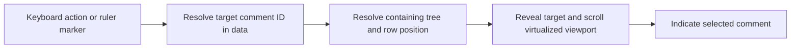

# UI and navigation

## Application menu and window commands (M8.2)

The menu button beside Discussion reader / Czytnik dyskusji opens a compact menu:

| Action | Polish | Windows shortcut |
| --- | --- | --- |
| New Window | Nowe okno | Ctrl+N |
| Close Window | Zamknij okno | Ctrl+Shift+W |
| Quit Application | Zakończ aplikację | Ctrl+Shift+Q |

The native File menu remains available. **Ctrl+W still closes the active tab.**
Alt+F4 keeps ordinary OS window-close behavior. macOS uses Cmd+N, Cmd+Shift+W and
the standard app-menu Cmd+Q. Main executes native shortcuts; the renderer does not
add a second accelerator handler.

Click or press Enter/Space to open; ArrowDown starts at the first command and
ArrowUp at the last. Up/Down wrap, Home/End choose the endpoints, Enter/Space
activate once, and Escape restores trigger focus. Outside click/resize dismisses
the menu. Quit is separated by a divider. Labels, hints and colors follow locale
and theme, and the menu stays inside the current viewport. Composition keys do
not activate commands.

New Window creates an equal empty reader. Close removes only that window from
next-launch membership when peers remain; last Close retains the last window.
Quit drains/captures all currently open readers for next launch. M3 still freezes
input immediately. Quickly completed operations keep the reader visible; only a
pending operation longer than 180 ms presents full-screen themed progress. Errors
and reconciliation Retry remain immediate. See [ADR 0035](decisions/0035-reader-menu-selection-and-lifecycle-presentation.md).

## Drag tabs (M8)

Drag a tab with the primary mouse button. Release in its strip to reorder, or in
another reader's strip to attach the same instance at the insertion marker. Hold
near strip edges to scroll. The native ghost and localized status accompany the
gesture; hover does not activate another discussion. Mouse is the established
physical gesture target; pen/touch behavior is unverified. Keyboard/menu alternatives
below remain available. A very fast drag before token preparation cancels safely;
an ordinary click continues to activate normally.

An empty reader keeps a full-width, labeled tab drop area. It highlights only
during a supported app-tab hover and clears on leave/drop/gesture cancellation.
Keyboard focus surrounds the whole tab, including the separate close control;
it does not leave an internal vertical edge beside Close after a gesture.

Release outside the app to request a new equal reader near the native cursor.
This uses an intentional guarded drag-end heuristic: **Escape outside may also
create a detached window** when no reliable cancellation event arrives. Desktop,
external applications and taskbar release are not perfectly distinguishable.
Delivered Escape cancels; no geometry-only attachment is allowed. Dirty Settings
requires preserve/discard for its already offered destination. Exact frozen reading
state and original identity follow M7; source-empty windows remain open. See
[ADR 0034](decisions/0034-native-html-tab-dragging.md), [testing](TESTING.md) and the
[pending physical matrix](M8_MANUAL_VERIFICATION.md).

## Move a tab between windows (M7)

Open any tab's menu with right-click, Shift+F10 or the context-menu key. Choose
**Move to Window...** (Polish: **Przenieś do okna...**) to select another ready
numbered reader, or **Move to New Window** (**Przenieś do nowego okna**). The
source is excluded; New Window remains available when no peer exists. The dialog
shows the source title (ellipsis with its full title available on hover), numbered
destination rows with tab counts and active-tab labels, and a separate plus-icon
New Window option. Native radio controls support Tab, Space and arrow navigation.
Selecting a row only selects it; the footer's **Move** (**Przenieś**) confirms it.
Cancel starts focused; Escape cancels and returns focus to the invoking tab.
The dialog follows System/Light/Dark, scrolls its body in small windows and keeps
its footer reachable. Destination hints describe the displayed snapshot; main
still rejects closed or changed destinations rather than silently retargeting.
A successful move activates/focuses the destination tab and announces it;
a failed move keeps the source usable with feedback and retry through the same menu.

Discussion moves preserve the same view identity, draft/applied filters, frozen
matches/order/stale state, sort/collapse, logical anchor/offset, navigation selection
and temporary bulk IDs/range anchor. They do not rerun a query merely because the
window changed. Menus, unsubmitted confirmations and native text selections are
cancelled. Shared Refresh after the handoff retains its normal per-view behavior.
A crashed/restarted renderer reconstructs durable semantics as before.

A discussion never merges with another view of the same item. Library/Settings
merge into the destination's existing instance when present, retaining its filter,
editor and other local controls. An unsaved source custom translation draft requires
Keep editing (cancel/preserve) or explicit Discard draft and continue; it is never
silently lost or saved. An empty source window stays visible/open. A failed new
window is cleaned up before it can become a restored reader.

See [ADR 0033](decisions/0033-atomic-cross-window-tab-transfer.md) and
[verification](TESTING.md). M8 native dragging is described above.

## Equal native reader windows (M6)

Use native **File > New Window** / **Ctrl+N** (**Cmd+N** on macOS; Polish **Plik >
Nowe okno**). Each new window starts empty, with its own Library/Settings tabs,
discussion views, duplicates, active tab and reading state. Library content, seen,
Undo, preferences, helpers and acquisition are shared. Windows have no special
primary/child relationship. M7/M8 add transfer and drag-out detachment as described above.

Explicit Quit restores all open windows on next launch. Closing one among several
excludes it; closing the last retains that last window. Crashes recover the last
durably acknowledged session. Empty workspaces stay empty. Normal bounds and
maximized/fullscreen state restore against currently available work areas; minimized
windows reopen visible. Monitor evidence is a hint; unreachable saved geometry is
clamped. Startup focuses the saved last-active window once. Native Close/Reload
briefly drains every reader under M3; failed saves leave the reader usable for retry.
See [ADR 0032](decisions/0032-equal-native-windows-and-session-restoration.md) and [native evidence](TESTING.md).

## Duplicate discussion tabs (M5)

Right-click a discussion tab, or focus it and use Shift+F10 / the context-menu key,
then choose **Duplicate Tab** (Polish: **Duplikuj kartę**). The new independent
view appears immediately after its source, becomes active and receives tab focus.
Library and Settings remain singletons. Copies show a strip-order ordinal after
the underlying title; the content title itself is unchanged.

The copy starts with the source's acknowledged semantic draft/applied query,
sort, logical anchor/offset, navigation selection and collapse choices. It performs
a fresh evaluation with current comments/seen/NEW and a fresh clock, so its initial
matches may differ from the source's frozen result. Temporary selection, menus,
text selection and header expansion are local. A failed source save prevents
creation. Each mounted view retains its state when another tab becomes active.

Library Open prefers the last-used local instance when open, otherwise the first
open copy in strip order. With none open, it resumes the local last-used dormant
instance, creating one only when necessary. Close removes placement, never content
or siblings. Removal deletes every copy. Shared seen and guarded Undo update all
copies; Apply affects one view, and accepted Refresh evaluates every instantiated
view using its own applied criteria while preserving its draft. Existing tab drag,
Alt+arrows, roving focus, F3/Shift+F3 and Ctrl+Z remain. See [ADR 0031](decisions/0031-independent-duplicate-discussion-tabs.md).

## Reader usability (ADR 0026)

Video headers order actions/status/Refresh, title with source-opening button,
optional thumbnail, description, metadata. Community headers stay unchanged.
Thumbnail compact/expanded sizing, keyboard/menu/cache behavior and no-image spacing
stay unchanged; header reflow preserves virtual comment anchors. Selection circles
follow each comment's effective nesting indentation immediately left of its
avatar, with a constant 10 px gap. They share the existing compact/clamped row
indentation and stay vertically centered on the avatar. The gutter remains
reserved while on-demand circles are hidden, preventing selection-mode reflow.
Neutral rails/elbows and comment backgrounds retain their existing geometry;
the circle's opaque surround keeps connectors out of the control's hit target.
Avatar gutters, rails/elbows and compact deep returns share layout variables and
responsive indentation bounds. Existing measurement/anchor handling covers controls
shown/hidden, locale and width changes without changing selection or hierarchy.
If reflow invalidates row sizes during scrolling, a bounded mounted-row refresh
prevents estimate heights from overlapping wrapped content, including at zoom.

Date/discoveries adds optional local From/To HH:mm. Blank times retain whole days;
To includes the entire minute. Presets disable custom fields. Edits remain drafts;
Apply/Ctrl+Enter checks native and shared Temporal validity, preserving results on
failure. Status/saved views include semantic times; Refresh uses applied criteria.

Custom translation requires a saved valid code before activation. Explicit Save
commits code/activation together; preset switches retain the code. Accessible “?” help
explains syntax/support limits. Loading rings intentionally keep rotating under
reduced motion, with existing text, elapsed time and completion/cancellation behavior.

## Comment selection and menus (ADR 0024)

Bulk selection is a separate session-only ID set per discussion view; F3's navigation
selection and persisted reading identity stay independent. Round buttons toggle
membership (plain/Ctrl); Shift on a circle adds an inclusive range in current
visible applied/sorted/collapsed order, including offscreen rows. Body/text Shift
retains native selection. Sort preserves IDs; collapse keeps hidden selections
with a hidden count; successful Apply/Refresh removes IDs outside complete membership.
Clear/Exit are explicit; restart clears the bulk set. Settings defaults circles to
selection-mode-only; Always show keeps them visible while browsing.

The compact toolbar assigns selected read/unread, expands/collapses selected
expandable parents, clears or exits. Nested parents receive explicit preferences;
descendants are not implicitly selected or recursively expanded. Right click,
Context Menu or Shift+F10 opens comment actions without mutation. Selected-group
actions appear only for a clicked selected member. Arrows/Home/End, Enter/Space,
Escape, outside pointer and restored focus are supported. View changes, scroll,
tab hiding and target detachment close the viewport-clamped menu. Copy selection
preserves native text ranges; full-comment text copy is separately labeled.
Links/translation/copy permalink use stored-identity capabilities.

The menu has one active enabled item, reflected in both focus and its single
visual highlight. Actual pointer movement activates the entry beneath it;
ArrowUp/Down wrap enabled entries and Home/End choose the endpoints. Enter/Space
executes the active action. Keyboard activity wins while the pointer is stationary,
even if CSS hover still matches another entry. Renders/focus changes do not count
as pointer movement. Disabled entries cannot become active or execute.

Prefix actions always confirm the exact inclusive reading prefix, with discussion,
endpoint identity/position, target/changing/hidden counts and context notice.
Include collapsed replies defaults enabled; disabling chooses visible rows only.
The endpoint's later descendants are excluded in both modes. Confirmation retains
its item/ID snapshot through tab/view/Refresh changes; no later IDs are added.
Cancel has default focus and Escape cancels before a pending write.
See [ADR 0024](decisions/0024-comment-selection-context-menus-and-view-prefix-seen.md)
for exact range fallback, snapshot, focus and security policy.

## Floating reader controls

A compact circular Back to top / Wróć na górę button appears in the lower-left
of the active discussion viewport after scrolling beyond 400px or three-quarters
of the viewport height, whichever is larger. It scrolls the existing `.reader-panel`
to zero, including the header, filters and original selection toolbar. Scrolling
is immediate for both normal and reduced motion: dynamic virtual-row measurement
can interrupt native smooth scrolling.
It never changes seen, bulk/navigation selection, sort, collapse or applied queries.
The existing virtualizer's settled identity/offset persistence handles the new
position. The existing session scroll revision supersedes an unfinished
collapse/sort/reveal correction, so it cannot pull the reader away from the header
after the explicit action. Only transient scroll intent changes; logical selection
and criteria remain intact. Window/document scrolling is not involved.

With at least one selected comment and the original selection toolbar entirely
outside that same panel's viewport, a compact floating strip shows total/hidden
counts and read/unread buttons with localized accessible names/tooltips. An upward
details control exposes Expand/Collapse selected, Clear and Exit. Both presentations
use the same DiscussionViewSession, selected IDs, command handlers, pending/error
state, confirmation snapshot, sparse persisted collapse and revision-safe Undo.
Actions do not scroll to the original toolbar. Clear/Exit removes the strip; existing
Always/on-demand circle preferences remain unchanged. When the original toolbar
intersects the viewport, its floating counterpart disappears.

Controls stay inside their owning panel's visibility tree, so hidden/unmounted
discussions and Library/Settings cannot display them. Fixed positioning follows the
panel's measured viewport, with right clearance for the scrollbar/ruler; it does
not narrow comment layout. The strip wraps at narrow widths/zoom, details opens
upward, and semantic theme/focus tokens apply. Context menus layer above it; native
modal confirmations remain in the top layer with their established inert/focus
behavior. IntersectionObserver uses the reader as root; passive scroll observation
only updates the Back to Top threshold. Neither path scans or mounts comments,
rebuilds projections, or remeasures virtual rows.
If scrolling or Clear/Exit removes a focused floating control, focus returns to
its reader panel with preventScroll. Focus moved elsewhere by the user or a modal
is retained.

## Removing local demo discussions

Library labels synthetic discussions Demo independently of the ordinary Remove
from Library button. The same modal focuses Cancel initially; confirmed removal
deletes only that local discussion, comments, manual state, history, tab, saved view,
collapse and Undo. Unrelated content/settings/helpers/recovery remain. Main retains
active-acquisition conflict protection. Demo identity is derived from the stored
`synthetic-demo` baseline attempt, never title/author/source/application ID patterns.
Demos retain their labels, fixture clock/NEW examples and unavailable source actions
even though removal is allowed. Fresh development seeds as before; existing or
restored databases never reseed, including after deletion empties the Library.
Production starts demo-free; complete backups retain any demos until explicit removal.

## Persistent reply collapse (ADR 0023)

Discussions default fully expanded. Each comment with applied display descendants
has a native chevron Show/Hide replies button. Its count includes all descendants,
not the comment itself or only direct children. Collapsed summaries optionally add
live unread and frozen applied matches. EN/PL labels, tooltips, aria-expanded,
Enter/Space and existing focus styling apply. Text selection and external actions
keep their existing behavior. Expand all / Collapse all operate on this discussion,
clear sparse exceptions, retain query/sort/selection and persist promptly.

F3/Shift+F3, unseen buttons and ruler markers resolve complete sorted data, open
only required safe display ancestors, persist and reveal the exact target through
the virtualizer. Match X/N and counts include hidden replies. Manual collapse keeps
hidden selected identity without trying to focus it. Capture ID/row offset before
changes; retain a visible anchor or map to the closest visible collapsed ancestor
at offset zero. Restart and close/reopen use that fallback without forced focus.

The ruler compresses hidden contributions onto that visible ancestor's row center.
Category tooltips distinguish total contributions and hidden replies; own membership
is total minus hidden. Pointer/keyboard ties at the same center prefer the first
hidden category member, retaining all candidates in data. Three SVG paths remain
constant. See [ADR 0023](decisions/0023-persistent-thread-collapse-and-virtual-navigation.md) for exact policy and persistence/failure semantics.

## Reader actions and selection (ADR 0022)

Normal comment surfaces never mark seen. Drag, Shift extension, cross-element
selection and Copy use native browser behavior. Explicit checkbox click toggles one;
Ctrl+checkbox assigns that result to all stored descendants. Settings and tooltips
list only the remaining checkbox shortcut. Undo and applied membership stay stable.

Positive video uploader evidence accents the author name and adds Creator/Autor text;
Community and unknown evidence remain ordinary. Pinned, UNSEEN, MATCH, CONTEXT and
NEW stay separate. Safe author names and video timestamps are underlined browser
commands with small external glyphs, native focusable buttons, localized names and
tooltips. Missing safe identity gives ordinary text. Estimated publication labels
stay approximate. Community has no invented comment permalink; Open on YouTube in
the heading explicitly opens its post. Actions neither mark nor select/navigate rows.
Selecting across a link-shaped control suppresses activation without cancelling
native pointer events.

Translate in browser is always visible beside compact metadata, with an outline
language icon and localized label. It opens the full stored comment in Google
Translate with auto-detection and the saved target. Text exceeding 5000 UTF-16 units or a URL exceeding 8000 encoded
characters is rejected; localized feedback offers full Copy and manual translation in smaller parts. There
is no truncation or automatic outbound request. Settings explains the Google privacy
boundary and provides Follow application language, ten presets and Custom… (ADR 0026).

A compact 16px CSS spinner replaces the indeterminate progress bar. Coarse stage,
elapsed time and exact-ID Cancel stay global while switching tabs; Saving and
Updating view remain non-cancellable. Reduced motion keeps steady rotation with stage
text. No percentage is shown. Existing app-owned outline vectors now share one
ActionIcon mapping for external/translation/copy, Refresh/Cancel, seen/unseen/Undo,
Library/Settings and tab close; icons are decorative and controls remain named.

## Data and backups (ADR 0019)

Settings has localized Create backup… and Restore backup… actions, complete-profile
explanation and a personal-metadata/machine-specific-helper-path notice. Backup uses
a main-owned native Save dialog with a dated SQLite filename. A verified success
shows its destination. Existing backups are retained; choose a new filename.

Restore uses a native Open dialog and validates an owned staged copy before native
confirmation: it replaces library, reading states, history and settings, first saves
a safety snapshot, then restarts. Cancel is initially focused; Escape cancels the
confirmation. No merge/import behavior is implied. A modal indeterminate operation
state blocks reader changes while pending view/seen saves settle and data work runs.
Failures are localized; invalid input never replaces current data. Confirmed restore
cannot be cancelled during the offline replacement. Fresh startup acknowledges
successful restore or recovery; old in-memory workspace/view state is discarded.
See [ADR 0019](decisions/0019-consistent-sqlite-backup-and-safe-restore.md).

## Source access and deliberate marking (ADR 0015)

Each real discussion heading has a compact external-link icon button labeled
“Open on YouTube” / “Otwórz w YouTube”. The title stays selectable. Only the
application item ID crosses IPC; main reconstructs and validates its canonical
YouTube video/post destination before opening the browser. Failure produces a
compact localized header alert, without changing stored content/workspace.
Synthetic demos omit the action.

Seen labels offer at least 36 px width/height with compact visible checkbox and
visible focus. Only checkbox click and Ctrl+checkbox mutate seen; row-wide Shift
and Ctrl+Shift gestures were removed in ADR 0022. Native text selection, Shift
extension, cross-element selection, Copy and external actions never mark comments.
See [Seen state](SEEN_STATE.md).

Publication bulk scopes show a date and optional native minute time per boundary.
Blank time retains calendar-day semantics; upper time includes the whole entered
minute. Confirmation includes times and preview count. Repeated/nonexistent DST
times reject locally and authoritatively in main with no write. Query date UI,
applied views, live ruler and durable Undo retain their prior contracts.

Settings helper entries show detected/tested versions and textual tested,
untested or unavailable/invalid status. Untested versions warn but are selectable,
persisted and usable through ordinary validated extraction. [ADR 0015](decisions/0015-safe-usability-intents-and-helper-confidence.md) records the
privileged intent and compatibility boundaries.

The reader implements nested comments, explicit manual seen checkboxes, English/Polish preferences, live acquisition/Refresh and the compact persistent tab workspace in [ADR 0007](decisions/0007-unified-workspace-and-library-removal.md). Library, open tab order and active selection are distinct; close never deletes a discussion. [ADR 0017](decisions/0017-persistent-discussion-view-restoration.md) persists independent draft/applied queries, sort, stable comment anchor/offset and selection, with fresh lazy reconstruction at restart. Active-discussion search/seen filtering, stable session applied views and match/unseen navigation are implemented in [ADR 0008](decisions/0008-active-discussion-applied-queries.md). ADR 0010 implements bounded variable-height rendering and unmounted-target reveal. [ADR 0011](decisions/0011-virtualized-overview-and-durable-new.md) implements the applied-view ruler and durable latest-accepted post-baseline NEW. [ADR 0012](decisions/0012-publication-date-and-latest-discovery-filters.md) implements publication-date/latest-discovery filtering; bulk actions and durable safe Undo are implemented in [ADR 0013](decisions/0013-atomic-bulk-seen-and-durable-undo.md). Counts cover all stored comments; synthetic examples remain isolated. See [requirements](PRODUCT_REQUIREMENTS.md), [the walkthrough](HOW_IT_WORKS.md) and [filtering semantics](FILTERING_AND_SEARCH.md).

Windows is the initial target platform. Other platform support is a later possibility; see [packaging](PACKAGING.md).

## Bulk seen actions and recovery (ADR 0013)

Each discussion has closed-by-default Bulk actions details. Action is explicitly
Mark seen / Mark unseen. Scope is All comments, Current APPLIED matches with count,
Published on/after, Published on/before, or Published between. Only publication
scopes show date and optional time inputs. Unrestricted views disable matching scope. All/date
resolve all stored comments; matching captures exactly applied active IDs, never
context, raw-only hits or mounted rows. Calendar semantics reuse ADR 0012.

Localized native confirmation states active-discussion scope, action, scope and
current target preview and the captured discussion's name. The dialog is outside
tab panels, so parallel acquisition activating another tab cannot hide or retarget
it. Cancel starts focused; Escape cancels; pending writes
cannot dismiss it. All/date always confirm because their target count can grow
through Refresh before the transaction. A frozen matching target of zero/one
does not need multi-comment confirmation. Ctrl+click stays unconfirmed.

Acknowledged status reports changed counts, no-op preservation or errors. Undo
appears next to this area whenever the discussion's durable descriptor exists,
including after restart or tab reopen. Its tooltip names this discussion's latest
recoverable multi-comment seen change. Safe partial Undo reports restored/skipped
counts; later edits win even after returning to the same seen value. Fully stale
Undo consumes recovery with zero restored. There is no redo or ordinary-click Undo.

Local writes are FIFO acknowledged, not optimistic. Bulk/Undo update live seen,
unseen counts/navigation and the ruler UNSEEN lane, preserving applied IDs,
membership/order, MATCH/CONTEXT roles/counts, query drafts, selection and NEW.
Applied Seen/Unseen criteria show the saved-but-stale Apply indication. Undo never
reverts Apply, criteria, Refresh or navigation. Recovery has no expiry; only a later
successful qualifying same-discussion operation replaces it, or Undo/removal consumes
it. See [Seen state](SEEN_STATE.md) and [ADR 0013](decisions/0013-atomic-bulk-seen-and-durable-undo.md).

## Shortcuts and gestures discoverability

Current bindings target Windows; future platform mappings may differ. The renderer
owns one metadata registry (`src/renderer/shortcuts.ts`) with stable IDs, key tokens,
localized descriptions, categories and contextual scopes. Its formatter supplies
Settings key labels and control hints. Handler callbacks remain with the relevant
view; no configurable bindings or shortcut preferences are stored.

Settings contains the complete localized Shortcuts and gestures reference, including
existing focused-tab navigation, seen gestures, form submission and cancellation.
Apply, match navigation, discussion search, Library filter, Add/Open, active tab
close, seen help and tab reorder help expose compact registry-derived hints.
Background close controls omit Ctrl+W because that command closes the active tab.

| Binding | Implemented action and scope |
| --- | --- |
| Ctrl+Tab / Ctrl+Shift+Tab | Activate next/previous workspace tab, wrapping across discussion, Library and Settings tabs. |
| Ctrl+W | Close active tab using the existing right-then-left neighbor rule; empty workspace does nothing. Stored discussions are retained. |
| Ctrl+N | New equal native window, also available in the application menu. |
| Ctrl+Shift+W | Close this native window through M3; other readers remain open. |
| Ctrl+Shift+Q | Quit the application through M3, preserving all intended native windows. |
| Ctrl+F | Focus/select the active discussion search or Library metadata filter. Settings and empty workspace leave browser/default behavior alone. |
| Ctrl+L | Reveal the existing URL form and focus/select its input; repeat selects existing text. Subsequent typing/navigation remains ordinary input editing. |
| F1 | Open/activate singleton Settings and scroll/focus the stable `keyboard-shortcuts` heading after acknowledged activation and committed rendering, including when Settings is already active. |
| Ctrl+Enter | Apply active discussion draft, including from its query controls. |
| F3 / Shift+F3 | Next/previous applied match, including from query controls; never save seen state. |
| Alt+Left / Alt+Right | Reorder only the focused workspace tab. |
| Left / Right / Home / End | Existing activation/focus navigation on workspace tabs. |
| Ctrl+Z | Undo latest recoverable multi-comment seen change in the active discussion, outside editable controls and confirmation dialogs; unavailable recovery leaves the key unconsumed. |
| Ctrl+Click | Seen checkbox applies its resulting state to the comment and all descendants. |
| Enter | Existing natural URL submission or discussion query form Apply. |
| Escape | Drag cancellation, URL form hiding and removal/bulk dialog cancellation unless its write is pending. |

One Reader document routing boundary handles workspace/focus/help and discussion
commands. Focused-tab keys, native form submission and contextual cancellation
stay with their existing owners. Exact modifiers, composition and already-handled
events are respected. Inputs, textareas, selects and contenteditable keep ordinary
typing/navigation. Explicit exceptions are workspace cycling/close, search focus,
URL focus and F1; discussion Apply/match keys also work in query controls but do
not interrupt unrelated editable controls such as the URL form.

Removal or bulk confirmation suspends every top-level shortcut while open, including
while its write is pending. The native modal retains keyboard/focus ownership;
Escape still follows its existing safe cancellation rule. Pending workspace writes
do not launch another workspace command. Defaults are prevented only after a
contextual command is accepted; missing focus targets and inapplicable commands
remain unconsumed. No global Alt+arrow reorder is introduced.

Source Refresh remains button-only: no Ctrl+R/F5 source-refresh binding. Reopen
(Ctrl+Shift+T), numbered tabs (Ctrl+1..9), global comment search and unseen
navigation shortcuts are deliberately unbound. No new query semantics, persistent
view state, OS hotkeys or platform policy is introduced by this UX increment.

## Implemented acquisition controls

[ADR 0007](decisions/0007-unified-workspace-and-library-removal.md) introduced the
unified workspace. M4/M5 now use an ordered list of discussion view instances and
singleton Library and Settings tabs. Every kind
can close, move and become active. App launch actions activate an existing view
or append a closed one. None is pinned or reserves a slot. Inline SVG icons,
truncated titles and separate close buttons keep horizontal tabs compact;
accessible names/tooltips announce Video, Community Post, Library and Settings.

Pointer dragging previews order with feedback and commits only its final slot.
Alt+Left/Right on a focused tab reorders it without changing active identity;
Arrow/Home/End activate/focus. Closing active chooses immediately right, otherwise
left, otherwise empty. Closing background preserves active. Open/active/order
persist in schema 13; acquisition uses the local Library Open policy and Refresh does
not alter workspace. Revision checks preserve newer local workspace acknowledgments.

Library is a full workspace view of all stored discussions, including closed ones,
with author/handle, comment/unseen counts and open status. Open reuses stored
identity/state; Activate does not duplicate a tab. The simple metadata filter
covers video title, post text, author display name and handle, independent of UI
language. It is not discussion comment search. Remove from Library opens a modal
confirmation describing permanent local comment/seen/history deletion and no
effect on YouTube. Cancel is initially focused; Escape cancels unless a write is
pending. Success updates Library and removes all of the discussion's view instances with ordinary
neighbor rules; failure retains the item. Synthetic demo removal is unavailable
with an explanation. Main rejects removal while that source is being acquired/
refreshed; wait and retry. Library removal has no Undo or remote deletion; seen-state Undo is separate.

Settings is a normal singleton tab containing durable Language and Appearance.
The compact toolbar has branding, Add/Open, Library and Settings; preference
dropdowns no longer occupy it. Helper configuration explanation contains no
configured paths or editing UI. The on-demand URL form and compact source/coverage
header remain. Video descriptions retain full text behind two-line Show/Hide;
Community bodies remain readable.

The comment tree keeps the safe projected relationships. Neutral ancestry rails
continue through parent gutters and sibling branches; short elbows and last-child
termination expose the nested structure. Flat rows retain exact data depth and shared ancestry (ADR 0010); reply indent is 22px, then 10px from depth 5 and 3px from depth 10, with a 340px maximum gutter for extreme chains. From depth 5 a neutral return connector joins the parent gutter to its compact rail.
Unseen uses a subtle row tint plus UNSEEN text and the explicit checkbox. Rails
never indicate seen state. Compact 32px avatars, bylines and multiline bodies stay.

[ADR 0017](decisions/0017-persistent-discussion-view-restoration.md) implements persistent query/sort/anchor/selection intent for the uncollapsed reader. Applied results remain session-only and are rebuilt on restart. Close/reopen retains the live session; Library removal clears session and storage. ADR 0023 persists sparse expansion state. Bulk actions and durable safe Undo are implemented in [ADR 0013](decisions/0013-atomic-bulk-seen-and-durable-undo.md); collapse is implemented in ADR 0023; variable-height presentation is implemented in ADR 0010.

Avatars use only usable HTTPS URLs, anonymous CORS, no-referrer, lazy loading,
async decoding and fixed dimensions. Empty alt text avoids duplicating the byline;
load/CORS failure falls back to initials. There is no avatar cache or authenticated
loading, and source text never becomes HTML/SVG markup.

The compact URL form accepts supported public video/individual-post URLs; Enter
and Add / Open submit. Main validates/canonicalizes the target. Successful
acquisition merges known sources instead of opening duplicate items and activates
the acknowledged item. Real items have Refresh; demo items do not. Refresh uses
stored source identity and retains the current tab selection. Last applied criteria are reevaluated against committed comments, including those missing from the newest extraction and new unseen ones. Draft controls are preserved; reevaluation failure keeps prior valid membership and reports a view error.

Acquiring/Refreshing status disables live submission only; reading, tabs and local
seen/preference saves remain available. Failure shows localized stable error
context and preserves the current discussion. Accepted partial/unknown output
shows a modest coverage notice. English and Polish cover every new label/error.
Real items use local-library wording and current render time; fixed demo-clock
and NEW examples are confined to synthetic items. Real NEW is the latest accepted post-baseline first-discovery cohort, retained through restart until another accepted attempt replaces it.
Renderer acknowledgment reconciliation preserves local seen edits across overlapping
save/acquisition responses without overwriting newly merged membership/remote text.

## Organize reading around discussions

Use browser-like tabs for opened YouTube videos, individual Community Posts, Library and Settings. The principal loop is **acquire → persist → refresh → identify what changed → read in context → manually mark processed → search/filter/navigate**. This is a persistent discussion inbox, so reopening the application must restore useful reading state instead of discarding it like a temporary download.

Workspace IDs/order/active selection and independent discussion view intent now restore. Each reading view owns its anchor, query, sort, collapse and navigation selection; the referenced content and seen state are shared. The concepts are:

| State | Purpose |
| --- | --- |
| Content item | Identify the video or Community Post being read. |
| Scroll anchor | Stable comment application ID + row-relative offset; null means header/top. |
| Draft and applied filters/search | Separate semantic intent; freshly reconstruct applied results at restart. |
| Sorting | Preserve the organization of top-level conversations. |
| Expanded/collapsed replies | Persist the view's sparse collapse default/exceptions (ADRs 0023/0030/0031). |
| Selected/navigation comment | Restore the current location for keyboard reading. |

Opaque tab/view IDs, tab order and active ID survive restart through SQLite. ADRs 0017/0023/0030/0031 implement the reading concepts above; optional badge details remain future scope. Seen belongs to shared comments. Library Open activates the local last-used open instance, with first strip-order fallback, or resumes its retained dormant view when none is open. Explicit Duplicate always creates a fresh view identity.

Restart is a fresh applied-query reconstruction boundary: current durable comments/seen/NEW are evaluated with the existing resolver/worker and fresh now/system IANA zone. Draft criteria are never promoted silently. A saved Unseen match marked seen before quit may stop matching after restart; seenStale starts false. Result ID arrays and old numeric date bounds are never persisted. After sorting, restore a displayed anchor/row offset, otherwise displayed selection, otherwise first restrictive match in current sorted order, otherwise start. An explicit header anchor restores top. Restore selection only if displayed, without DOM focus. Failed restoration shows a localized message and unrestricted session result, with saved applied criteria as draft for retry; the original durable applied criteria remain until a successful explicit Apply/Refresh. See [database](DATABASE.md) and [seen state](SEEN_STATE.md).

A tab may show an unseen-comment count. If provided, define whether it counts the entire content item or a filter scope, and keep its label clear. This is a derived count of individual comments, not a stored thread-level status. Count scope and interaction with a stable displayed result remain open.

## The comment reader

ADR 0017 uses one serialized full-view queue per discussion view: 400 ms idle for draft
bursts, 50 ms for successful Apply/sort/selection, and 250 ms scroll idle followed
by a 50 ms coalesced save. Explicit navigation captures after settling. Tab switch,
background/active close and acquisition activation flush useful current anchors.
No synchronous termination IPC or guarantee of the final scroll pixel is added.
Save failures display localized feedback and retry on the next edit/flush. Stable
application IDs and row offsets are authoritative; raw scrollTop, result arrays,
virtual measurements, ruler geometry, transient errors/pending/seenStale, focus,
hover and open details are never persisted.

The discussion uses Reddit-like neutral ancestry rails and elbows while supporting desktop reading. Keep replies visually attached to their conversations. Sorting reorders complete display-root trees only; replies always retain their relative preorder.

### Whole-conversation sorting (ADR 0016)

The compact accessible Sort select applies immediately, independently of query
Apply. English options are Original order, Newest first, Oldest first, Most liked,
and Latest activity; Polish uses Kolejność pierwotna, Od najnowszych, Od najstarszych,
Najwięcej polubień, and Ostatnia aktywność. Titles explain each key.

Original is the default stored/display order, not a promise of current YouTube
ranking. Newest/Oldest use only the display root's own usable publication time.
Most liked uses only its projected available likes; known zero precedes unknown.
Latest activity uses the newest usable publication time anywhere in the complete
tree. Estimated/coarse instants participate just as in date filtering. Unknown
keys follow known keys, and all ties retain Original order. Missing metadata is
never zero or a discovery/Refresh timestamp. Most liked is disabled with accessible
localized explanation when no displayed root has known likes; a retained selection
then effectively uses Original without forgetting the chosen mode.

Sort is independent per discussion, survives close/reopen in one Reader lifetime,
and clears on Library removal. ADR 0017 restores the saved sort after fresh query reconstruction, including all-unknown Most liked. Changing mode captures the virtual anchor ID/offset and restores that
same comment at approximately the same viewport position, retaining selection.
No valid anchor means start. It never jumps to a match or marks seen.

Match/F3/Shift+F3 and live-unseen navigation, context-neighbor resolution, wrapping,
and match X/N all follow sorted display preorder. Frozen match membership/counts
and matching bulk targets do not change. Ruler categories retain their identities
while their geometry and targets follow the sorted rows. Apply retains mode and
reveals the first sorted restrictive match. Successful Refresh retains mode,
recomputes committed metadata keys, and preserves the existing Refresh anchor.
Seen/NEW changes alone never reorder; draft edits do not alter displayed trees.
See [ADR 0016](decisions/0016-whole-conversation-sorting.md).

The design should accommodate an avatar, author/display name/handle, comment text, relative publication time, exact timestamp on hover or in details, like count, pinned status, uploader/creator indication, nested replies, a seen checkbox, and permalink/copy actions. Some source fields may be absent. Their absence must not be displayed as a fabricated value, and the initial exact field layout remains a UI decision.

Rendering external content respects the [Electron security boundary](ARCHITECTURE.md). Remote text remains React text. ADR 0006 selects anonymous HTTPS avatars with fallback and no application cache; external-link opening and richer formatting remain open.

Relative times and numbers use the chosen display locale; exact timestamps must remain discoverable. [Localization and theming](LOCALIZATION_AND_THEMING.md) describes live language/theme changes and semantic visual tokens.

### Manual processing controls

Clicking a comment's checkbox toggles only that comment. Ctrl+click applies the resulting state to that comment and every descendant in its stored subtree. It does not toggle descendants independently, touch ancestors, or limit the operation to rows currently rendered by the virtualizer. No scroll, display, navigation, expansion, or selection action marks a comment seen.

The user-specified Ctrl+click gesture is exposed through seen-control help and the
Settings shortcut reference. Platform-specific alternative gestures and keyboard
equivalents remain unspecified; they must preserve the same [seen-state semantics](SEEN_STATE.md).

Bulk controls must support all comments, on/before, on/after and between local publication dates, and actual matching filter results, scoped to the active discussion. “All comments” means every stored comment for the active video or Community Post. Date operations affect each qualifying comment independently, while matching-only operations use the last applied active-filter matching IDs and exclude visible context. ADR 0013 supplies one durable recovery operation per discussion and safe partial Undo.

### Context, matches, discovery, and state

Keep these concepts visually understandable:

| Concept | Source of truth |
| --- | --- |
| Seen/unseen | Persisted manual state of this comment. |
| Raw search match | The comment satisfies the search expression, independently of other filters. |
| Active-filter match | The comment satisfies the full combined predicate in the last applied evaluation. |
| Context-only | Included for its conversation without being an active-filter match; it may still contain a raw search hit. |
| Newly discovered | Discovery associated with a refresh, independently of seen state. |

While seen edits await view recomputation, the displayed membership and order remain stable. The logical active-filter matching set, match/context roles, and matching-comment/containing-thread counts stay tied to the last applied evaluation. Live checkboxes reflect saved state. MATCH/CONTEXT badges identify applied roles, with SEARCH HIT for raw-only context. They are independent of live unseen tint/checkbox, NEW and neutral rails. Saved seen changes show an Apply indication only for applied Seen/Unseen; draft difference is separate. Neither changes applied counts. Matching-only bulk actions and next/previous match navigation use that applied matching set; see [stable filtering](FILTERING_AND_SEARCH.md).

An old comment can remain unseen for months; a just-discovered comment can immediately be marked seen. “New” must not become a synonym for “unseen.” The first successful acquisition establishes the baseline: its comments are unseen and retain `firstDiscoveredAt`, but receive no visual **New** highlighting. Comments discovered by later refreshes are eligible for new indicators. Only discoveries in the latest accepted post-baseline refresh are NEW; accepted partial/unknown and zero-insert refreshes replace the cohort, failures preserve it, and seen/publication/restart do not change it; [refresh and merge](REFRESH_AND_MERGE.md) defines the underlying distinction.

All locally stored comments in a matching top-level conversation are part of the contextual result. Collapsing replies may hide rows from immediate display, but must not erase their membership, counts, or navigation targets. ADR 0023 shows frozen applied-match counts in collapsed reply summaries.

## Separate updating a view from refreshing a source

Manual seen changes save immediately. They must not cause the current result membership or order to rearrange beneath the reader. **Apply changes / Update view** recomputes that result using saved data. **Refresh** retrieves remote data and merges it into persistence; after a successful explicit Refresh, the active view is automatically recomputed without another Apply action. These operations need distinct controls and explanations.

| Action | Meaning | Shortcut status |
| --- | --- | --- |
| Apply | Validate/evaluate draft over acknowledged local data; only success promotes it. | Ctrl+Enter while a discussion is active; Enter in its search form. |
| Refresh source | Run the relevant extractor, merge observations, and automatically recompute the active view on success. | Button only; Ctrl+R/F5 source Refresh deliberately unbound. |
| Next/previous unseen | Live unseen comments in displayed applied trees, including context. | Accessible buttons; no keyboard binding added. |
| Next/previous match | Last applied active-filter matching IDs in displayed preorder. | F3 / Shift+F3 and accessible buttons. |

The compact search form edits draft only: text, selected fields, All/Unseen/Seen, case and regex toggles, compact Date / discoveries details, and Apply. It does not apply on typing. Invalid/expensive/failed evaluation retains previous results and shows localized feedback. Navigation wraps, never marks seen, and unseen targets update from live seen independently of applied matches. Collapse uses native buttons (ADR 0023); future source-refresh shortcuts remain open; ADR 0010 selects virtualized reveal and Apply/Refresh scrolling. The applied matching set/count and matching-only bulk scope are settled as described above. See [stable filtering](FILTERING_AND_SEARCH.md).

Extraction can be long-running or fail. Provide understandable progress, error, and partial-result context without confusing a failure with an empty discussion or losing the last valid local snapshot. ADR 0018 implements global coarse progress, elapsed time and explicit pre-save Cancel; [extractors](EXTRACTORS.md) and [refresh and merge](REFRESH_AND_MERGE.md) own their underlying contracts.

## Date and discovery controls (ADR 0012)

Compact Date / discoveries details sit beside search fields. Labeled native From
and To inputs represent calendar dates; To says whole day. A preset selector offers
Custom / no preset, Today, Last 24 hours and Last 7 days. Presets disable From/To
with an explanation and clear them on mode change. A separate selector offers All
discoveries and NEW from latest refresh. Approximate-source help is compact with
a tooltip, not permanent explanatory chrome.

Controls are draft-only, independently retained per discussion across close/reopen.
Apply or Ctrl+Enter validates/evaluates all criteria and promotes only on success.
Reversed ranges have `aria-invalid` inputs and a localized alert. Compact applied
status names date restrictions and NEW independently of draft controls. Successful
Refresh re-resolves applied criteria with a fresh clock/current system zone,
preserving drafts; failures retain the old view. No timer changes membership.
F3/Shift+F3, match/unseen buttons and virtual ruler reveal use existing data paths;
MATCH includes date/discovery, NEW remains an independent displayed category.
See [exact semantics](FILTERING_AND_SEARCH.md#publication-dates-and-time-adr-0012).

## Navigate data, then reveal the row

[ADR 0009](decisions/0009-isolated-discussion-rendering-and-tab-input.md) keeps
discussion content mounted while isolating rendering from activation. M8 replaces the historical pointer-capture adapter with native HTML DnD
(as described above); no pointer capture runs during a native tab drag. Vertical wheel over an overflowing strip scrolls horizontally
immediately; horizontal deltas also work. Motion at an immovable edge or without
overflow is not consumed. Wheel outside the strip retains normal panel scrolling.

Keyboard navigation must support next/previous unseen comments and matches. Next/previous navigation in the filtered reader uses the current applied active-filter matching set. Any separately labeled search-specific navigation must operate within the applicable view and must not confuse raw search hits with active-filter matches. Targets are comment identities in application data, not a query for rendered DOM elements. This lets navigation reach a comment many thousands of rows away or inside a collapsed subtree.

The implementation must be able to identify a target, make its location visible, scroll it into the virtualized viewport, and indicate the active comment. This may require expanding its ancestor path. Current uncollapsed navigation wraps at both ends. Match candidates remain applied IDs; unseen candidates use live seen over displayed membership. From context, next/previous selects the eligible neighbor in preorder. Each row has an application-owned target ID, selection outline and final scrollIntoView call. ADR 0010 fulfills measured virtualized reveal; collapse/expansion is implemented in ADR 0023; ADR 0017 restores selection/anchor without focus. These choices must not broaden the filtered reader's match navigation beyond its applied matching set.

Navigating to a comment must never change its seen state. Selecting a match must also not cause context comments to join the matching set.

## Overview ruler

[ADR 0011](decisions/0011-virtualized-overview-and-durable-new.md) implements an 18px ruler just inside the active discussion scrollbar. It represents only the applied displayed virtual sequence: live unseen (including context), restrictive applied active-filter matches, and durable NEW. Unrestricted identity candidates create no match markers. Raw-only SEARCH HIT context has no match marker. Initial-baseline comments have no NEW marker.

Pure markers contain application ID, virtual presentation index and all applicable categories. Row centers use full measured/estimated scroll geometry, including header/query offset and column bottom/footer. Resize/remeasurement refines positions without mounting target comments. Short 3px bands retain category counts and ordered targets; unseen/match/NEW each occupy a 6px lane. One SVG with three paths keeps marker DOM constant even at 50k. ADR 0016 supplies sorted presentation indexes; ADR 0023 supplies compressed collapse mapping.

Pointer lane selects category; the closest row center within the clicked band wins, with preorder breaking ties. Selection uses the existing session application-ID/index reveal path. The single labeled keyboard stop supports Up/Down bands, Home/End endpoints, Left/Right categories and Enter/Space activation at band center. Empty lanes do nothing. Hover/focus shows localized compact category counts, never comment contents. Existing match/unseen navigation remains available; all ruler actions leave seen untouched.

Seen acknowledgment updates only the unseen category immediately; frozen applied match IDs and durable NEW remain. Apply changes displayed membership and matches without changing NEW identity. Accepted Refresh replaces NEW and reevaluates applied criteria; source failure preserves both.

Use semantic theme tokens for marker categories and distinguish important states with more than color alone. Ensure keyboard navigation offers access to the same comment targets. See [localization and theming](LOCALIZATION_AND_THEMING.md).

## Large discussions and durable state

The bounded reader implementation in
[ADR 0010](decisions/0010-variable-height-discussion-virtualization.md) uses a pure
flat complete-tree preorder and pinned TanStack Virtual. Large discussions mount
viewport rows plus six-row overscan and at most one focused row. Small results up
to 200 comments retain their complete accessible surface. Header/query controls
stay outside the measured list on the existing reader-panel scrollbar.

Actual variable heights replace width/body-aware estimates; width/locale reflow
invalidates measurements and keeps the current data anchor/offset. Hidden panels
retain useful viewport/height caches and session scroll. Neutral continuations,
elbows, last-child endings and compact return connectors use shared ancestry data,
so no ancestor article needs mounting. Exact depth remains data; indentation has a
340px maximum gutter for extreme chains. Articles retain stable application IDs,
author/time/seen labeling and correct complete-presentation list positions/counts.

Navigation resolves the application ID and presentation index, scrolls through
measurement/mount, then reveals/focuses that exact article. Selection alone does
not keep a row mounted. A focused checkbox/article can remain as one extra row
until focus leaves it; Apply removing that row returns focus to the reader.
Query comparison, counts, live unseen candidates and subtree seen targets still
use complete data, independently of the mounted slice.

Successful explicit Apply scrolls to the first active match for a restrictive
view, or discussion start for unrestricted/zero matches. Query control focus and
existing retained selection are preserved. Successful Refresh preserves draft
and captures the current visible identity/offset at evaluation completion, using
retained selection then start only if that anchor disappears. Header scroll is
preserved. Failed queries retain the current view/scroll. ADR 0017 extends these data anchors to durable restart restoration. SQLite query/index/clone/memory scaling,
and collapse remain separate targets. ADR 0016 implements whole-conversation sorting, including sorted first-match Apply and virtual anchor retention. Bulk recovery is implemented in [ADR 0013](decisions/0013-atomic-bulk-seen-and-durable-undo.md). ADR 0011 adds the ruler and durable NEW.

Assume thousands or tens of thousands of comments. Virtualize the large comment view while keeping the complete result model available to filtering, counts, bulk actions, and navigation. Do not render the entire dataset merely to enable search or overview-ruler positioning.

ADR 0010 chooses renderer virtualization, measurement and overscan. Query scheduling, IPC pagination/batching, memory and supported-hardware performance budgets remain engineering choices. Stable comment identities must connect storage, rows, selection, and restoration; row indexes alone are not durable identities. Review the [architecture](ARCHITECTURE.md) before choosing library-specific view state.

A small meaningful UI/E2E suite is expected later. Choose a few workflows that cross important boundaries, such as baseline acquisition followed by refresh, saved seen edits followed by a matching bulk action and Apply, or navigation through a virtualized discussion and restored tabs. These are candidates, not an exhaustive UI-test checklist. Keep most state, search, scope, and discovery edge cases in the fast domain/integration suites described in [testing](TESTING.md), with focused UI checks for the ruler, languages, and themes where useful.

## Global acquisition progress (ADR 0018)

A compact surface below the application toolbar survives workspace tab switches.
English/Polish operation type, coarse stage, elapsed mm:ss and indeterminate progress
remain separate from comments/coverage. Cancel is explicit and available only before
Saving; there is no percentage or keyboard cancellation binding. Escape retains its
existing contextual form/dialog behavior. Add/Open and all Refresh buttons stay disabled
for the single operation; reading, scrolling, local seen writes, query edits, Settings
and workspace navigation stay available during fetch.

One validated preload subscription is cleaned up on unmount/StrictMode probes. A
read-only current-operation snapshot hydrates reload without overtaking newer events.
Settled operation IDs reject late notifications. Renderer elapsed ticking uses one
startedAt offset then performance.now, with no main clock events. Only safe source/app
identity travels in progress; arbitrary input URLs and helper paths are not reflected.

Successful remote commit preserves acknowledged counts, warnings and coverage, then
shows Updating view without Cancel while the existing session reevaluates last applied
criteria and restores sort/anchor. Query errors retain their own feedback. Completion
shows inserted/updated/warnings and total main seconds. User cancellation is neutral:
"Refresh cancelled. Saved discussion was unchanged." Failure remains the existing
localized stable error. No stale busy surface remains after settlement.

## Optional video header thumbnail (ADR 0025)

A cached image occupies its own row after the video title/source-action row and
before description/metadata (ADR 0026), aligned with the title. Default width is 360px with max-width
100%; activation toggles to full reading-column width. A 16:9 box uses contain,
never crops or distorts the image, and changes size immediately. Missing/loading/
failed-decoding images reserve no space. The button has visible focus, aria-expanded
and localized Expand thumbnail / Shrink thumbnail (Powiększ miniaturę / Pomniejsz
miniaturę) actions. Native Enter/Space toggles without document-wide shortcuts.
Expansion is local to the mounted discussion.

Right-click or the focused control's Context Menu / Shift+F10 key opens the existing
focus-managed menu with Open in image viewer / Otwórz w przeglądarce obrazów.
Main resolves the actual cached image by item identity and opens it only on explicit
activation. A failure has localized, nonintrusive feedback. There is no modal or
additional reader window, folder/file browser, playback, or automatic navigation.

Image changes remain inside the header component. Existing comment projections,
selection, filters, drafts, sorting, collapse and seen are untouched. Header-only
height changes retain the virtual reader's current comment identity/offset without
clearing row measurements; native browser anchoring is disabled only for panels
containing thumbnails to avoid a second correction. Image responses are scoped to
the mounted canonical discussion and invalidated on deactivation/unmount. Avatars
retain their separate anonymous remote-image/fallback policy.

## M2 shared replicas

Production still has one reader; authorized test renderers share ordered committed
content/preferences/workspace/seen/Undo. ReaderReplica merges notifications and
command stamps through one bounded reconciliation path, with authoritative gap
recovery. Peer seen changes preserve frozen applied IDs/order and local reading
intent. Accepted peer Refresh re-evaluates that session's own applied criteria
while keeping its draft, sort and collapse/anchor behavior. Content props commit
before refreshed worker results. Local Refresh retains Updating view until worker
settlement. Removal disposes sessions and rejects historical replies/snapshots.
Mounted custom translation inputs follow shared code when untouched and retain an
edited local draft until Save. See ADR 0028; M3 global lifecycle barriers and all
public additional-window/duplicate-view UI remain outside this milestone.
